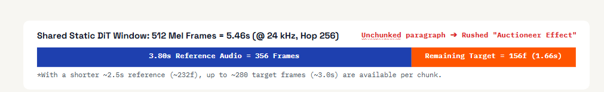

# On-device voice cloning — step-by-step implementation

## Introduction

This document describes the implementation of the on-device multilingual voice cloning application for Android. It traces a generation request from model preparation and engine initialization through reference conditioning, text segmentation, speech synthesis, waveform reconstruction, and WAV export.

The application takes three inputs: a reference recording, a transcript of that recording, and the target text to synthesize. Kotlin manages the Android workflow and exchanges data with the native C++ engine through JNI. The engine processes the audio, runs the pretrained IndicF5 and Vocos models locally through Google LiteRT, and returns the generated waveform to the application.

The walkthrough summarizes the earlier Flutter, Sherpa-ONNX, and PyTorch work before documenting the current LiteRT pipeline in detail.

## How the project got here

| Earlier stage | What it established |
|---|---|
| Flutter + Sherpa-ONNX | A working English voice-cloning baseline on Android using ZipVoice-Distill. |
| IndicF5 on a laptop | PyTorch trials demonstrated synthesis in Indian languages and exposed how reference length and speaking pace affect duration. |
| ONNX export investigation | Static INT8 and dynamic FP32 exports were explored for mobile deployment. |
| Current Android app | IndicF5 and Vocos are converted directly to LiteRT. Kotlin manages the app, and C++ runs audio processing and sampling. |


## 1. Prepare the models and package the app

The preparation scripts run off the phone. The APK ships two quantized FlatBuffers and the vocabulary the IndicF5 exporter used.

1. [`export_dit_litert.py`](scripts/export_dit_litert.py) loads the pretrained IndicF5 transformer weights in evaluation mode and converts a fixed-shape wrapper to an FP32 LiteRT FlatBuffer. The wrapper exposes one velocity prediction. The Android engine owns the sampling loop.
2. [`export_vocos_litert.py`](scripts/export_vocos_litert.py) exports the Vocos decoder with real and imaginary spectrum outputs. The native engine handles inverse Fourier reconstruction.
3. [`quantize_litert.py`](scripts/quantize_litert.py) applies the `dynamic_wi8c_afp32` recipe. The recipe stores eligible weights as per-channel INT8. The public tensors still carry FP32 audio features and time values, plus INT32 token IDs. INT8 describes the eligible weights.
4. The Android app loads `indicf5_dit_int8.tflite`, `indicf5_vocos_int8.tflite`, and `vocab.txt` from its assets. The two current model files total **341.20 MiB**, down from **1,339.54 MiB** in FP32, a **74.5%** reduction in model file size.

| Graph | Inputs | Output |
|---|---|---|
| IndicF5 DiT | Noisy mel and reference conditioning, each `[1,512,100]` FP32. Tokens `[1,128]` INT32. Time `[1]` FP32. | Velocity `[1,512,100]` FP32 |
| Vocos | Mel `[1,100,512]` FP32 | Spectrum `[1,2,513,512]` FP32, with real and imaginary planes |

### Check the export before packaging

[`evaluate_parity.py`](scripts/evaluate_parity.py) compares PyTorch and LiteRT FP32 with matched inputs and sampling. [`benchmark_int8.py`](scripts/benchmark_int8.py) compares LiteRT FP32 and INT8. The archived desktop checks reported **0.0037 dB** DTW-aligned mel-cepstral distortion for FP32 against PyTorch, and **0.99923** average velocity cosine similarity for INT8 against LiteRT FP32 in the eight-step comparison. These measure conversion fidelity against the specified baselines. Speech naturalness, intelligibility, and speaker similarity need separate evaluation. [Phase 2 parity results](litert_docs/phase_wise_implementation/phase_2_report.md) · [Phase 3 quantization results](litert_docs/phase_wise_implementation/phase_3_report.md)

## 2. Initialize the Android inference engine

`MainActivity.initializeEngine()` starts the Kotlin wrapper. `LiteRTIndicEngine.initialize()` runs on the IO dispatcher, copies the three assets to private storage if required, then passes their paths and the thread count through `nativeInitFromFile()`. The native handle stays alive for subsequent synthesis calls.

`initializeFromFiles()` loads the vocabulary and creates a model and interpreter for each graph. It sets **five threads** and attaches XNNPACK through the interpreter options when the delegate can be created. It allocates the fixed tensors during initialization and reuses those allocations during generation. The current path uses the LiteRT C API, with CPU delegation. Its fixed arenas save repeated setup, while JNI and LiteRT buffer copies, native working vectors, and Kotlin waveform allocations still occur.

Earlier bring-up exposed a second allocation through `SignatureRunner` that could leave a tensor without data. The current sampler accesses the allocated interpreter tensors directly. When changing an export, check input order, shapes, types, model hashes, and delegate logs before relying on performance numbers. [Kotlin wrapper](android/app/src/main/java/com/indic/voice/LiteRTIndicEngine.kt#L63) · [JNI bridge](android/app/src/main/cpp/jni_bridge.cpp#L57) · [C++ initialization](android/app/src/main/cpp/litert_indic_engine.cpp#L102) · [Bring-up notes](litert_docs/phase_wise_implementation/phase_5_device_verification_report.md)

## 3. Capture the reference voice and enter its transcript

The user supplies the exact words spoken in the reference and either records with the microphone or picks a WAV. `AudioRecorderHelper` records **24 kHz, mono, 16-bit PCM** and writes a WAV header. The picker copies the selected file to cache and checks that it is decodable. The native WAV reader converts 16-bit samples to floats and averages channels. The import path passes those samples to the engine at its assumed 24 kHz rate, so use a 24 kHz PCM WAV for imports.

The UI enables generation when the engine is ready, recording has stopped, reference audio is loaded, both text fields contain content, and no generation job is active. The user is responsible for matching the transcript to the recording. [Reference screen](android/samples/screen_20261121_174325.png) · [Recorder](android/app/src/main/java/com/indic/voice/AudioRecorderHelper.kt) · [Input validation and import](android/app/src/main/java/com/indic/voice/MainActivity.kt#L424) · [WAV decoding](android/app/src/main/cpp/audio_processor.cpp)

## 4. Take the target text

In **Target Speech Text**, the user can type directly or load and edit a **Quick Ideas** preset. The reference transcript describes what the model hears in the clip. Target text specifies what the generated voice should say. The user also selects **12 Fast**, **16 Balanced**, or **24 HQ** sampling steps. Balanced is the default. Pressing **Generate Cloned Speech** starts `synthesizeCurrentText()`, which snapshots the text and passes the trimmed target to the chunker. [Target-text screen](android/samples/screen_20261121_174730.png) · [Generate handler](android/app/src/main/java/com/indic/voice/MainActivity.kt#L621)

## 5. Split the target text into chunks

IndicF5 has one static **512-frame mel window** for each inference. The reference takes the first part, leaving the rest for the target speech. At **24,000 samples per second** with a **256-sample hop**, each frame step represents about **10.67 ms**, and the full nominal window represents about **5.46 s**. In the graphic, the reference uses **356 frames**, leaving **156 frames**, about **1.66 s**, for target speech in that chunk. Each later chunk reuses the same reference. The full paragraph can therefore be longer than a single inference window.



`MultilingualChunker.split()` protects decimal dots and common abbreviations, then tries sentence boundaries, breaks oversized sentences at clause punctuation, and falls back to word boundaries when necessary. It restores the protected dots and merges fragments shorter than 12 characters when they fit next to a neighboring chunk. The limit is **44 UTF-16 code units** if the input contains a detected Devanagari, Tamil, Telugu, or Kannada character, and **60** otherwise. The chunker's frame estimates are metadata. Native inference computes its own duration budget from the cached reference in step 7.

For **“Open your books. Read the first line.”**, the split yields two chunks in order: **“Open your books.”** and **“Read the first line.”** Using sentence boundaries when possible gives the stitcher a natural place to join audio. A long reference or transcript can still reduce usable capacity, and unusual input such as very long unbroken words merits testing. [Chunker](android/app/src/main/java/com/indic/voice/text/MultilingualChunker.kt#L49) · [Chunking tests](android/app/src/test/java/com/indic/voice/text/MultilingualChunkerTest.kt)

## 6. Prepare and cache reference conditioning

After splitting the target, the Kotlin job calls `setReferenceAudio()` once. JNI passes the reference PCM and transcript to C++. The engine caches the transcript, the extracted mel values, and the reference frame count. The activity reuses that cache for every chunk in the current generation job.

`AudioProcessor::extractMel()` computes the recording's RMS and raises quiet but non-negligible signals toward 0.1. It applies reflection center padding and a Hann window, then uses KissFFT with a **1,024-point FFT**, a **256-sample hop**, and a precomputed **100-band mel filter bank**. It takes the log after applying a small floor and caps the reference at 512 frames. The resulting mel contains the acoustic information used to condition the model. [Reference cache](android/app/src/main/cpp/litert_indic_engine.cpp#L190) · [Mel extraction](android/app/src/main/cpp/audio_processor.cpp)

## 7. Build the input tensors for each chunk

`LiteRTIndicEngine.synthesizeChunk()` passes the chunk text, selected step count, guidance strength **2.0**, and seed **42 + chunk index** through JNI. With `R` as the cached reference frame count, the native engine estimates the target frames from the ratio of target and reference text byte lengths.

```text
requested = max(80, floor(R / max(1, reference_bytes) * max(1, target_bytes) * 1.15) + 10)
total     = min(512, R + requested)
allocated = total - R
```

The 80-frame floor applies before the shared-window cap. For example, a 470-frame reference leaves only 42 frames even when the duration heuristic requests 80 or more. Kotlin's character budget and the native byte-based estimator are therefore useful heuristics with different inputs.

The engine copies the reference mel into the leading rows of a zero-filled conditioning tensor. It combines the reference transcript, a separator space, and the target chunk, appending terminal punctuation to the chunk where the native punctuation rule applies. `IndicTokenizer::encode()` looks up vocabulary IDs and pads or truncates the sequence to **128 tokens** using `-1` for padding and unknown entries. The text-token cap is separate from the mel-frame cap. [Kotlin inference wrapper](android/app/src/main/java/com/indic/voice/LiteRTIndicEngine.kt#L108) · [Native chunk input](android/app/src/main/cpp/litert_indic_engine.cpp#L210) · [Tokenizer](android/app/src/main/cpp/indic_tokenizer.cpp)

## 8. Generate new mel frames with IndicF5

`EulerSampler::sample()` fills the latent tensor with seeded Gaussian noise. At each time step it runs the same DiT graph twice: one pass with the reference mel and tokens, and one with zero conditioning and pad-only tokens. Each pass predicts the velocity of the current mel representation. The sampler combines them using classifier-free guidance and advances the latent with an Euler update.

```text
v = v_conditioned + 2.0 * (v_conditioned - v_unconditioned)
latent_next = clamp(latent + (time_next - time) * v, -4.5, 4.5)
```

For step index `i` out of `N`, the sampler sets `u = i / N` and uses `t = u + s × (cos(πu/2) − 1 + u)`. The current coefficient `s = −1` gives `t = 1 − cos(πu/2)`. The Euler increment uses the gap between adjacent values of `t`. At the default **16 steps**, there are **32 DiT invocations per chunk**. Continuous Flow Matching provides the learned direction of the updates. The native loop applies them to move from noise toward speech features guided by the audio and text conditioning.

The activity launches a lifecycle-scoped job. The Kotlin wrapper dispatches reference preparation and native inference to `Dispatchers.Default`. The job reports the active chunk and sampling progress, runs the stitcher on `Dispatchers.Default`, and saves on `Dispatchers.IO`. A cancellation request is checked between chunks and at sampling checkpoints through the JNI callback. A LiteRT invocation already in progress runs until control returns to a checkpoint. [Euler sampler](android/app/src/main/cpp/euler_sampler.cpp) · [JNI progress callback](android/app/src/main/cpp/jni_bridge.cpp#L124) · [Generation loop](android/app/src/main/java/com/indic/voice/MainActivity.kt#L671)

## 9. Convert the mel output to PCM with Vocos

The engine restores the original reference mel in the leading frames and transposes the sampled mel to `[1,100,512]` for Vocos. Vocos emits **513 complex frequency bins per frame** as separate real and imaginary planes. Native code performs an inverse short-time Fourier transform using KissFFT, overlaps Hann-windowed frames, normalizes by the window envelope, and removes center padding.

The engine then takes the generated region from about `reference_frames × 256` samples through `total_frames × 256`, bounded by the reconstructed length. If the cropped waveform's peak is at least **0.03**, the native chunk path scales it to a **0.95** peak. JNI returns the generated PCM and a seven-field telemetry buffer to Kotlin. It carries reference mel time (zero on the cached chunk path), DiT time, Vocos time, iSTFT time, total native chunk time, audio duration, and chunk RTF. [Vocos and PCM slicing](android/app/src/main/cpp/litert_indic_engine.cpp#L270) · [Inverse STFT](android/app/src/main/cpp/audio_processor.cpp)

## 10. Stitch the chunks, save the WAV, and play or export it

The activity collects nonempty chunks in input order. If every chunk is empty, it reports that no audio was produced. If only one chunk fails and returns empty, the current loop can save the audio from the remaining chunks. A completed WAV alone is therefore insufficient to confirm that every word was generated.

`WaveformStitcher.stitch()` trims quiet edges using an amplitude threshold of **0.012**, keeps a **25 ms** cushion at the leading and intermediate trailing edges, and preserves **120 ms** at the final trailing edge. It applies **5 ms** raised-cosine fades to each edge, inserts **30 ms** of silence between chunks, and appends **450 ms** of trailing silence. It peak-normalizes the result to **0.95**. Each chunk fades separately into silence before the next begins.

`GenerationHistoryManager` writes **24 kHz mono 16-bit PCM** to a WAV in app-private storage. After saving, the local library supports seekable playback, revisiting prior clips, downloads, and the Android share sheet. Downloads use MediaStore on Android 10+ with a legacy file path on earlier versions. Sharing passes an `audio/wav` content URI through FileProvider with temporary read access. [Stitcher](android/app/src/main/java/com/indic/voice/audio/WaveformStitcher.kt) · [WAV and history](android/app/src/main/java/com/indic/voice/history/GenerationHistoryManager.kt) · [Downloads exporter](android/app/src/main/java/com/indic/voice/history/AudioExporter.kt) · [Share action](android/app/src/main/java/com/indic/voice/MainActivity.kt#L390)

## 11. Verify the workflow and interpret the readings

| What to check | What the current app measures or does |
|---|---|
| **Output correctness** | In airplane mode after installation, generate a short sentence and a paragraph with a matching reference transcript. Play the saved files, listen for missing chunks or clipped endings, and verify download and sharing. |
| **App real-time factor (RTF)** | The app divides summed native chunk compute time by final stitched audio duration. An RTF above 1 means generation took longer than the audio under that timing definition. Reference preprocessing, Kotlin stitching, file writing, and app orchestration fall outside the native chunk timer. |
| **End-to-end time** | Separately time the interval from tapping Generate to completed save. Record device, build, model hashes, reference, target text, steps, threads, and warm or cold state. |
| **Resident memory** | The app reads `VmRSS` after stitching and before saving. It is a point sample. To reproduce peak RSS, sample during the whole run and report the sampling method. |
| **Regression tests** | From `android/` on Windows, run `.\gradlew.bat :app:testDebugUnitTest` with the configured JDK and Android SDK. The chunker and stitcher tests cover text splits and waveform assembly. Run device checks for inference and audio behavior. |

The archived Galaxy S23 suite reports **1.50–1.64× RTF** and **378–389 MB peak VmRSS**. Its Tamil paragraph returned **16.10 s** of audio in **24.47 s**, or **1.52× RTF**. Later screenshots display **7.88× with 933 MB** and **11.77× with 812 MB**. Their device and build conditions are unavailable, and their displayed memory is a point sample. Reproduce the same workload on the same build and device before comparing those readings. This walkthrough uses existing measurements. [Archived benchmark and app captures](TECHNICAL_DOCUMENTATION_REVISED.md#19-benchmarks-methods-and-testing) · [App telemetry calculation](android/app/src/main/java/com/indic/voice/MainActivity.kt#L735) · [Memory reader](android/app/src/main/java/com/indic/voice/TelemetryMonitor.kt)
