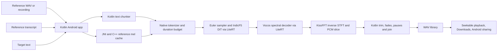
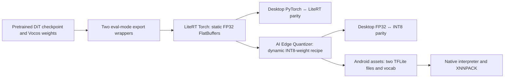

# On-Device Multilingual Voice Cloning with Google LiteRT

Technical engineering report · 21 November 2026

This project deploys pretrained IndicF5 and Vocos on Android. A short recording, a matching transcript, and target text are sufficient inputs for local generation after installation. The current application uses Kotlin for workflow and storage, JNI for the Kotlin/C++ boundary, and LiteRT with XNNPACK on CPU for the two neural graphs. The work delivered conversion, quantization, native inference, audio processing, and long-form orchestration. Model training and accelerator deployment fall outside the demonstrated implementation.

Current behavior below is based on `android/app/src` and the checked-in Python tools. Historical performance comes from archived reports or device captures, as identified per table. Model file sizes were independently checked against files on disk. This revision did not reproduce device timings. The older Galaxy S23 benchmark and recent app screenshots report materially different values.

## 1. Problem and engineering goals

The user supplies text and wants to hear it in a voice represented by a short sample, without uploading the sample for synthesis. Indian scripts and different speaking rates make alignment and duration important. On Android, storage, resident memory, CPU time, and the size of the model's acoustic window constrain the deployment. The initial goal combined multilingual coverage, usable latency, and a 600 MB resident-memory target. Those targets need per-device qualification. A successful offline synthesis demonstrates execution and local data handling. It does not by itself establish real-time speed, intelligibility, or speaker similarity.

| Stage | Model | Runtime | Application | Outcome |
|---|---|---|---|---|
| English baseline | ZipVoice-Distill + Vocos | Sherpa-ONNX | Python, then Flutter/Dart on Android | Working mobile baseline and device benchmarks |
| Indic feasibility | IndicF5 + Vocos | PyTorch | Laptop CLI, batch runner, and desktop UI | Multilingual samples and duration experiments |
| Mobile export investigation | IndicF5 + Vocos | ONNX / ONNX Runtime experiments | Native C++ and Dart FFI explored | Static INT8 and dynamic FP32 ONNX exports documented |
| Current mobile deployment | IndicF5 + Vocos | Google LiteRT, TfLite C API, XNNPACK | Kotlin + C++ NDK | Offline synthesis, chunking, playback, history and WAV output |

Sources: [midsemester report](MIDSEM_REPORT_COMPREHENSIVE.md), [timeline](reports/timeline.md), [progress report](reports/progress_report.md), [LiteRT engineering report](litert_docs/LITERT_COMPREHENSIVE_ENGINEERING_REPORT.md).

## 2. Flutter and Sherpa-ONNX baseline

The first mobile path used the Emilia release of ZipVoice-Distill, a reported 123M-parameter model with an approximately 104 MB INT8 ONNX acoustic bundle, a four-step sampling configuration, and a separate 24 kHz Vocos model. Its backbone is a Zipformer. The project used the English path, although the bundle is labeled Chinese/English. Sherpa-ONNX already supported this zero-shot model. Its lack of a ready IndicF5 DiT loader motivated a different Indic deployment path.

The Flutter app demonstrated audio recording/import, transcript and target input, WAV conversion through the Flutter audio converter, a waveform player, and file output. The Dart service runs inference in a background isolate. Start with [English entry point](english_tts.py), [Flutter UI](voice_clone_proto/lib/main.dart), [TTS service](voice_clone_proto/lib/services/tts_service.dart), [model loader](voice_clone_proto/lib/services/model_loader.dart), and [audio converter](voice_clone_proto/lib/services/audio_converter.dart).

| Android hardware as reported | Short RTF / peak RSS | Medium RTF / peak RSS | Long RTF / peak RSS | Approx. cold load |
|---|---:|---:|---:|---:|
| Galaxy S23, Snapdragon 8 Gen 2, 8 GB | 3.826 / 1,033 MB | 1.520 / 1,287 MB | 1.288 / 1,562 MB | 1,200 ms |
| Galaxy Tab S9 FE+, Exynos 1380, 8 GB | 9.279 / 1,021 MB | 2.918 / 1,491 MB | 2.508 / 1,772 MB | 2,100 ms |
| Galaxy M53, Dimensity 900, 8 GB | 8.415 / 1,021 MB | 2.782 / 1,219 MB | 2.531 / 1,539 MB | 1,850 ms |

The reports call these RTF medians for approximately 5, 25, and 65 words. The [midsemester results](MIDSEM_REPORT_COMPREHENSIVE.md#3-empirical-hardware-baseline-english-model-on-physical-devices) mark the Tab S9 FE+ long run marginal. The archive does not consistently supply sample counts, percentiles, or exact OS builds. The [ZipVoice benchmark worksheet](reports/zipvoice_benchmark.md) contains unfilled columns. Lenovo Tab K10 estimates in the midsemester report are excluded from the measurement table. On-chip accelerator availability in the historical table does not establish accelerator use.

## 3. IndicF5 laptop proof of concept

The laptop path loaded the pretrained IndicF5 checkpoint and used the target text, reference recording, and reference transcript as inputs. Single-prompt and batch runs helped separate failures from duration allocation, reference mismatch, and acoustic quality. Early notes describe experimenting with akshara estimates and code-point heuristics, RMS normalization, and duration relative to the matched reference. The current Android estimator uses a distinct byte-length formula described in §14.

| Historical CPU test, 8 Euler steps | Target length | Output | Compute | RTF |
|---|---:|---:|---:|---:|
| Telugu | 75 chars | 5.56 s | 38.56 s | 6.94× |
| Kannada | 75 chars | 5.48 s | 47.32 s | 8.63× |
| Tamil, native reference | 85 chars | 6.31 s | 63.76 s | 10.10× |
| Telugu | 155 chars | 11.58 s | 72.20 s | 6.23× |
| Tamil | 155 chars | 12.77 s | 76.29 s | 5.98× |

The [project summary](project_summary.md#6-empirical-hardware-benchmark-results) gives these timings without a precise laptop CPU or run distribution. Historical feasibility reports also mention Hindi. Kannada desktop evidence and script handling in the app have a different scope from the four-language S23 table. Sources: [clone.py](clone.py), [batch.py](batch.py), [prompts.json](prompts.json), [desktop engine](src/voice_studio/engines/indicf5.py), [midsemester report](MIDSEM_REPORT_COMPREHENSIVE.md).

## 4. ONNX export and mobile investigation

The early static IndicF5 ONNX artifact used a 128-frame export according to the project summary. A later dynamic FP32 graph stored weights in an external `.onnx.data` file. The current workspace contains both FP32 ONNX variants, the static DiT INT8 graph (349,055,195 bytes), and Vocos INT8 ONNX (22,119,090 bytes). The project investigated an ONNX Runtime Mobile C++ sampler and Dart FFI boundary because the Sherpa path did not directly wrap IndicF5. Historical reports disagree on how far that experimental bridge progressed. The shipping Android entry point uses Kotlin, JNI, and `.tflite` artifacts, so an aspirational combined English/Indic Flutter build is excluded from the current architecture. Sources: [project summary](project_summary.md), [timeline](reports/timeline.md), [midsemester report](MIDSEM_REPORT_COMPREHENSIVE.md).

## 5. Motivation for LiteRT and native Android

The team chose a direct PyTorch-to-LiteRT conversion path, reducing dependence on an intermediary mobile ONNX pipeline. LiteRT provides an Android runtime and CPU delegation. Leaving the solver and inverse FFT outside the neural graphs simplified export and gave native code control of step scheduling and post-processing. Kotlin replaced this path's Flutter shell for direct access to Android lifecycle, recording, playback and storage. The cut in measured storage applies to the LiteRT models. A Flutter-to-Kotlin memory attribution would need an isolated experiment with the same model, workload, and measurement method. Sources: [LiteRT engineering report](litert_docs/LITERT_COMPREHENSIVE_ENGINEERING_REPORT.md), [LiteRT Torch](https://github.com/google-ai-edge/litert-torch), [Google LiteRT](https://developers.google.com/edge/litert).

## 6. Current architecture and data flow



`MainActivity.synthesizeCurrentText` validates UI state and owns the lifecycle job. `LiteRTIndicEngine.kt` owns the native handle and coroutine dispatch. `jni_bridge.cpp` marshals arrays, strings, progress, and telemetry to and from C++. `LiteRTIndicEngine::initializeFromFiles` owns the models, interpreters, delegates, vocabulary, and fixed tensor allocations. `setReferenceAudio` prepares conditioning once per generation job. `synthesizeChunk` constructs per-chunk inputs, samples a mel, decodes, slices, and returns PCM. The activity collects completed chunks, stitches and saves them. Models are bundled with the app. Android manifest and this inference path do not require network for generation. Sharing delegates delivery to the selected Android app.

## 7. IndicF5 and Continuous Flow Matching

AI4Bharat describes 1,417 hours of pretraining and 11 supported Indian languages. The mobile project deploys that checkpoint. The exporter constructs a roughly 335M-parameter DiT with width 1024, depth 22, 16 attention heads, feed-forward multiplier 2, text width 512, four text convolution layers, and 100 mel channels. It obtains the text-embedding count from the shipped vocabulary. The model predicts a velocity over the current mel latent, conditioned on the reference mel and text. The architecture name “Diffusion Transformer” describes the backbone. This inference routine integrates a learned flow from Gaussian noise.

For an illustrative conditional Gaussian/optimal-transport path, take data mel $x_1$, noise $x_0 \sim \mathcal{N}(0,I)$, time $t \in [0,1]$, and small terminal noise coefficient $\sigma_{\min}$. Then

$$
x_t=[1-(1-\sigma_{\min})t]x_0+t x_1,
\qquad u_t=x_1-(1-\sigma_{\min})x_0.
$$

A conditional flow-matching objective regresses the vector field $v_\theta(x_t,t,c)$ onto $u_t$ under conditioning $c$:

$$
\mathcal{L}=\mathbb{E}_{t,x_0,x_1,c}\left[\left\|v_\theta(x_t,t,c)-u_t\right\|_2^2\right].
$$

At deployment, sampling solves $dx/dt=v_\theta(x,t,c)$ with the pretrained weights. The project adds the conditioned/unconditioned combination and finite-step Euler integration described in §12. Sources: [IndicF5 model card](https://huggingface.co/ai4bharat/IndicF5), [F5-TTS](https://aclanthology.org/2025.acl-long.313/), [Flow Matching](https://arxiv.org/abs/2210.02747), [DiT exporter](scripts/export_dit_litert.py).

## 8. PyTorch export and INT8 quantization



The [DiT wrapper](scripts/export_dit_litert.py) instantiates the architecture, extracts transformer/EMA-prefixed weights from safetensors, and strictly loads the state dict. It exports one velocity evaluation from fixed example tensors. The [Vocos wrapper](scripts/export_vocos_litert.py) exposes real and imaginary spectral planes and leaves iSTFT to the host. The project phase reports describe using WSL2 for the PyTorch/MLIR conversion toolchain. The checked-in scripts are the reproducible entry points, with local model assets and pinned environment details to be recorded per run.

| Graph | Inputs | Output | Deployed shape |
|---|---|---|---|
| DiT | Noisy mel and conditioning mel (FP32), text IDs (INT32), time (FP32) | Velocity (FP32) | Two `[1,512,100]` mel inputs, text `[1,128]`, time `[1]`, velocity `[1,512,100]` |
| Vocos | Transposed mel (FP32) | Complex spectral coefficients as FP32 real and imaginary planes | `[1,100,512]` to `[1,2,513,512]` |

`quantize_model` in [quantize_litert.py](scripts/quantize_litert.py) defaults to `dynamic_wi8c_afp32()`. Eligible weights use per-channel INT8, while graph interfaces remain FP32/INT32 and eligible kernels may dynamically quantize activations internally. For a symmetric weight channel with scale $s$, quantization approximates $w \approx s\,q$ with integer $q$ clipped to the selected signed range. The CLI also exposes a static INT8 recipe, which is not the documented mobile deployment recipe. The report uses model file size, excluding runtime allocation, APK overhead, or duplication on extraction.

| Model | FP32 bytes | FP32 MiB | Android INT8 bytes | INT8 MiB | Reduction |
|---|---:|---:|---:|---:|---:|
| IndicF5 DiT | 1,350,452,516 | 1,287.89 | 343,840,552 | 327.91 | 74.5% |
| Vocos | 54,158,844 | 51.65 | 13,935,880 | 13.29 | 74.3% |
| Combined | 1,404,611,360 | 1,339.54 | 357,776,432 | 341.20 | 74.5% |

The two workspace output artifacts match the two Android asset files by SHA-256. 341.20 MiB equals 357.78 decimal MB. The archived 341.21 figure reflects the earlier artifacts/rounding in Phase 3. The original presentation's 349 MB and 22.5 MB resemble ONNX-stage artifact sizes. They cannot be used as the current LiteRT model bytes. Sources: [Phase 1](litert_docs/phase_wise_implementation/phase_1_report.md), [Phase 3](litert_docs/phase_wise_implementation/phase_3_report.md), [Google quantizer overview](https://developers.google.com/edge/litert/quantization/model_optimization).

## 9. Numerical parity and validation scope

| Archived test | Scope and inputs | Evidence |
|---|---|---|
| Phase 2 FP32 parity | PyTorch vs LiteRT FP32, matching prompt, noise seed and synchronized eight-step sampler | 1.000000 average velocity cosine after rounding, 0.0037 dB DTW-MCD |
| Phase 3 quantized parity | LiteRT FP32 vs LiteRT INT8, eight Euler steps on the desktop test | 0.99923 mean velocity cosine, step range 0.99875–0.99992, reported waveform cross-correlation 0.92557, 2.44 s finite audio |
| Later engineering deck/report | Later spectral figure without a repeatable per-run trace in the presentation | 2.14 dB cited in the earlier deck/report narrative. It is not the Phase 2 FP32 result and is excluded from the revised headline metrics. |

`evaluate_parity.py` compares velocity fields, mels and reconstructed audio. Velocity cosine is $a\cdot b/(\lVert a\rVert\lVert b\rVert+\epsilon)$. It measures direction and can be high even when magnitude differs. The DTW-MCD routine extracts MFCCs, aligns differing sequence lengths with dynamic time warping, and reports average scaled cepstral distance along the alignment path. The conventional scale for Euclidean cepstral difference is $(10/\ln 10)\sqrt{2}$. MCD captures spectral distortion under the test protocol. It is not a listener score, ASR error rate, speaker similarity score, or a guarantee of perceptual equivalence. The available evidence lacks a controlled multilingual listener or speaker-embedding study. Sources: [Phase 2 report](litert_docs/phase_wise_implementation/phase_2_report.md), [Phase 3 report](litert_docs/phase_wise_implementation/phase_3_report.md), [parity script](scripts/evaluate_parity.py), [INT8 benchmark](scripts/benchmark_int8.py).

## 10. Kotlin, JNI and LiteRT interpreter lifecycle

- Build configuration: LiteRT and LiteRT API 1.0.1, SDK 35 / minimum API 26, JVM 17, CMake 3.22.1, NDK 28.2.13676358, C++17 with `-O3`. The project declares ARM64 and ARMv7 ABIs. Physical performance evidence reported here is for the S23 or the older English devices.
- Kotlin copies missing or wrong-length assets to app-private storage on the IO dispatcher. The file-based initializer creates models through `TfLiteModelCreateFromFile`. Size checks are not content integrity checks. Closing the wrapper releases the native engine.
- `tflite_loader.cpp` dynamically resolves TfLite C API and XNNPACK symbols from the runtime library. `initializeFromFiles` uses official delegate default options, sets thread counts, attaches the delegates before interpreter creation, and allocates tensors once per interpreter. Allocation failure propagates initialization failure to the UI.
- JNI transfers the reference float array and strings, takes the chunk's step count, CFG and seed, returns a Java float array and telemetry, and calls the Kotlin predicate between ODE steps. Native processing uses explicit copies across the TfLite buffer API and JNI. Fixed tensor allocation does not imply an allocation-free or zero-copy pipeline.
- Earlier bring-up used input resizing and graph modification with a separate delegate attachment. Phase 5 logs describe allocation failures and a “tensor 402 lacks data” failure after SignatureRunner reallocation, followed by inlining quantized FlatBuffer weights and switching to raw tensor access. Current source uses the static export, official options layout, and interpreter input indices, avoiding SignatureRunner's second allocation pass. Retest tensor shapes, index order, and delegate partitions whenever re-exporting models.

Sources: [Gradle](android/app/build.gradle.kts), [CMake](android/app/src/main/cpp/CMakeLists.txt), [loader](android/app/src/main/cpp/tflite_loader.cpp), [JNI](android/app/src/main/cpp/jni_bridge.cpp), [Kotlin engine](android/app/src/main/java/com/indic/voice/LiteRTIndicEngine.kt), [C++ engine](android/app/src/main/cpp/litert_indic_engine.cpp), [bring-up report](litert_docs/phase_wise_implementation/phase_5_device_verification_report.md).

## 11. Reference audio and text preprocessing

The recorder writes 24 kHz mono 16-bit PCM WAV using `AudioRecord`. The picker copies a file to app cache and checks RIFF and decodability. `AudioProcessor::decodeWavBytes` locates the `fmt ` and `data` chunks, reads 16-bit samples, averages channels, and produces floats scaled by 32768. It reads the sample-rate header, but the Kotlin/JNI path returns PCM without resampling it. Use 24 kHz PCM for reference imports. The app validates a completed audio input, a nonblank reference transcript, and nonblank target text. It does not transcribe or verify the reference words.

For PCM samples $a[n]$, native code computes $r=\sqrt{\operatorname{mean}(a[n]^2)}$. If $10^{-6}<r<0.1$, it raises RMS to 0.1. It center-pads by 512 samples using reflection, applies a periodic Hann window, and computes magnitudes with KissFFT: FFT size 1024, hop 256, 513 nonnegative frequency bins. The 100 mel bands use a precomputed filterbank from `mel_filterbank.h`, with $m_{t,b}=\ln\max(10^{-5},\sum_k B_{k,b}|X_{t,k}|)$. It keeps at most 512 reference frames and captures the transcript in the native cache. One mel hop is 10.667 ms. A reference near the 5.46 s nominal full window leaves little or no target budget.

`IndicTokenizer::encode` maps individual UTF-8 units against the line-indexed vocabulary, maps unknown units to the pad value, and pads or truncates to 128 IDs. Native text is reference text, separator space, and punctuated target chunk. It is a vocabulary lookup. It does not implement a dedicated phoneme or akshara segmentation stage. JNI uses modified UTF-8, so supplementary Unicode handling needs tests. Kotlin chunk-length accounting uses UTF-16 code units, while C++ duration sizing uses the byte length of the JNI strings.

Sources: [recording helper](android/app/src/main/java/com/indic/voice/AudioRecorderHelper.kt), [activity](android/app/src/main/java/com/indic/voice/MainActivity.kt), [audio processor](android/app/src/main/cpp/audio_processor.cpp), [tokenizer](android/app/src/main/cpp/indic_tokenizer.cpp), [vocabulary](android/app/src/main/assets/vocab.txt).

## 12. Sampling and invocation

`EulerSampler::sample` initializes the full latent with seeded `std::mt19937` Gaussian values. The activity sets seed `42 + chunk.index`, guidance $g=2.0$ and 12, 16, or 24 steps. The fixed schedule uses sway coefficient $s=-1.0$:

$$
u_i=i/N,\quad t_i=u_i+s\big(\cos(\pi u_i/2)-1+u_i\big),\quad \Delta t_i=t_{i+1}-t_i.
$$

Each step invokes the same DiT twice. The first pass provides the real conditioning mel and tokens. The second uses zero mel and all `-1` text IDs at the same latent and time. Update:

$$
v_g=v_c+g(v_c-v_\varnothing),\qquad
x_{i+1}=\operatorname{clip}\big(x_i+\Delta t_i v_g,-4.5,4.5\big).
$$

```text
initial_latent = seeded_gaussian(512, 100)
for step in schedule:
    if cancelled: return no chunk
    conditional = invoke_DiT(latent, reference_mel, tokens, step.time)
    null = invoke_DiT(latent, zero_mel, pad_tokens, step.time)
    latent = clip(latent + step.delta * (conditional + 2 * (conditional - null)))
    report completed step
restore the original reference mel prefix
invoke Vocos and reconstruct the target waveform
```

That is 24, 32, or 48 DiT calls per generated chunk for 12, 16, or 24 steps. User cancellation is cooperative, observed before the first step, after completed steps, and between chunks. A currently executing native invocation runs to its next check. The checked-in sampler passes fixed CFG and cosine sway. The earlier low-step study describes adaptive guidance and linear timing as experiments. They are not the active Android path. Sources: [sampler](android/app/src/main/cpp/euler_sampler.cpp), [engine](android/app/src/main/cpp/litert_indic_engine.cpp), [activity](android/app/src/main/java/com/indic/voice/MainActivity.kt).

## 13. Vocos and waveform reconstruction

The sampler replaces the generated reference prefix with the original mel and transposes `[512,100]` to `[100,512]` for Vocos. The exported decoder predicts complex Fourier coefficients using amplitude and phase in the head:

$$
S_{k,t}=A_{k,t}(\cos\phi_{k,t}+j\sin\phi_{k,t}).
$$

C++ reads the real and imaginary planes with time as the inner stride. It performs real inverse FFT per frame, divides by 1024, applies the Hann window, adds overlapping frames at a 256-sample stride, and divides the resulting waveform by the summed squared windows where the envelope exceeds $10^{-4}$. It removes 512 samples from each end for center padding. Native code slices from `ref_frames × 256` to the capped total-frame end, bounded by reconstructed length, then returns the new speech region.

The full iSTFT buffer can already be scaled to a 0.95 peak. After cropping, the generated region receives its own gain to 0.95 when its peak is at least 0.03. The post-stitch normalization is a separate stage. The 0.03 rule prevents some amplification of quiet target chunks at the native crop, but it is not a system-wide silence or noise gate. Sources: [Vocos paper](https://arxiv.org/abs/2306.00814), [export wrapper](scripts/export_vocos_litert.py), [native Vocos path](android/app/src/main/cpp/litert_indic_engine.cpp), [iSTFT](android/app/src/main/cpp/audio_processor.cpp).

## 14. Long-form segmentation and stitching

The app scans the whole input for any Devanagari, Tamil, Telugu, or Kannada unit and chooses a 44-character budget for matching inputs or 60 otherwise. It protects decimal periods and a list of common abbreviations, splits sentences on punctuation followed by whitespace, and uses clause boundaries then words for oversized segments. Very long unbroken tokens get hard splits in one branch. Short fragments under 12 characters may merge if the joined text fits. `SpeechChunk` stores diagnostic estimates (6.5 frames/character for detected Indic input, 4.5 otherwise, floor 80), plus index, text and last-chunk identity.

The native engine independently computes the target frame budget. Given cached reference frame count $R$, reference byte length $B_r$ and target byte length $B_g$:

$$
G_0=\max(80,\lfloor1.15 R\,\max(1,B_g)/\max(1,B_r)\rfloor+10),
\qquad G=\min(512-R,G_0).
$$

The 80-frame floor is approximately 0.85 s before capping. Text length limits are heuristics. They do not guarantee fit for all reference lengths or tokenization, and the native cap can shorten generation. The splitter's word fallback can also leave an oversized unbroken token after an existing word is flushed. Test these cases explicitly before documenting hard input limits.

```text
chunks = chunker.split(target)
cache reference mel and transcript once
for each chunk in order:
    run the fixed-window engine with the cached reference
    collect nonempty PCM and native stage timings
if no chunk contains PCM: surface failure
trim and join the collected chunks
save one PCM WAV and refresh the library
```

The current stitcher defaults at 24 kHz are:

| Parameter | Default |
|---|---:|
| Boundary fade | 5 ms raised cosine per edge |
| Silence test | Absolute sample amplitude 0.012 |
| Leading and intermediate-tail cushions | 25 ms |
| Final trailing cushion | 120 ms |
| Inter-chunk pause | 30 ms |
| Final comfort silence | 450 ms |
| Master peak | 0.95 |

Fades multiply independent chunk edges before copying them into a zero-initialized joined buffer. The chunks do not overlap. With trimming enabled, quietly decaying boundary regions are retained according to the cushions. One chunk is also faded and padded. Completely quiet inputs are left untouched at the trim stage. Source comments that say “120 ms pauses” or “crossfade” describe older wording. The implementation is authoritative. The app skips empty chunks and can save the successfully generated subset when another chunk returns empty. It retains chunk buffers and the final array until completion, so long inputs increase memory despite fixed inference shapes. Sources: [chunker](android/app/src/main/java/com/indic/voice/text/MultilingualChunker.kt), [waveform stitcher](android/app/src/main/java/com/indic/voice/audio/WaveformStitcher.kt), [orchestration](android/app/src/main/java/com/indic/voice/MainActivity.kt).

## 15. Conditioning cache and memory behavior

`setReferenceAudio` saves mel frames and reference transcript once per generation job. Each chunk copies the cached mel to a newly initialized conditioning buffer. Both neural graphs retain fixed arenas across chunks. The native sampler, FFT path, JNI marshaling, and Kotlin stitcher allocate working buffers and may copy them. The Android app also retains PCM for the recording, the per-chunk output list, and intermediate prepared chunks when joining. The fixed arenas improve reuse. They do not establish constant process RSS or guarantee immunity to Android memory pressure. Process RSS includes resident mappings and Android/Kotlin memory in addition to model and interpreter allocations. Extracted asset files can consume separate disk space from the app package. Sources: [Kotlin wrapper](android/app/src/main/java/com/indic/voice/LiteRTIndicEngine.kt), [native engine](android/app/src/main/cpp/litert_indic_engine.cpp), [stitcher](android/app/src/main/java/com/indic/voice/audio/WaveformStitcher.kt).

## 16. Stability, audio quality and debug history

| Symptom | Investigation and change | Remaining uncertainty |
|---|---|---|
| Startup crash or delegate failure | Historical delegate option ABI mismatch and resizing order issues. Current code uses official option defaults and attaches delegates when creating interpreters from statically shaped files. | Confirm partition coverage in logcat for each runtime/model combination. |
| Tensor 402 reported without data | Phase 5 found a second SignatureRunner allocation after general interpreter allocation and external offset buffers during diagnosis. It inlined buffers and switched to raw access with one allocation. | Preserve per-build tensor order and rerun numerical parity after modifications. |
| Ringing, static or degraded phonemes at 6–8 steps | Repository histories describe coarse updates and guidance/schedule experiments. Current code clamps latents, logs norms and NaN counts, and exposes 12/16/24 steps. | Listener and phoneme tests across speakers, languages and step counts are missing. |
| Rushed or truncated long prompts | Fixed reference-plus-target window. Chunking and a nominal 80-frame target floor improve allocation. | Frame capping, token truncation and reference duration can still remove speech. |
| Last word sounded truncated when shared | Android sharing passes the saved WAV through FileProvider. The report describes trimming and recipient playback/transcoding experiments. Current code adds asymmetric trim cushions and 450 ms final silence. | Compatibility varies by receiving app. The padding is protection rather than a guarantee. |

Sources: [bring-up report](litert_docs/phase_wise_implementation/phase_5_device_verification_report.md), [comprehensive report §§7–8](litert_docs/LITERT_COMPREHENSIVE_ENGINEERING_REPORT.md), [sampler](android/app/src/main/cpp/euler_sampler.cpp), [stitcher](android/app/src/main/java/com/indic/voice/audio/WaveformStitcher.kt).

## 17. Runtime, threads and metrics

The current activity starts five XNNPACK threads, using CPU kernels. Both interpreters set their thread options. The engineering report describes tuning thread count on Snapdragon 8 Gen 2, but no code in the production path pins workers to specific cores. Android schedules workers. Reported delegate coverage in the earlier build was 1,995 of 2,212 DiT nodes and 207 of 236 Vocos nodes. These are bring-up logs, not a property of every build. The production code does not initialize an NPU or GPU delegate.

Three timings need distinct names:

1. **Native chunk timing** covers preparation, the DiT step loop, Vocos, iSTFT, slicing and gain. Reference extraction is done before the chunk and recorded as zero in its cache-aware telemetry.
2. **App RTF** divides the sum of native chunk compute times by final stitched output length at 24 kHz. It excludes cached reference preparation, Kotlin stitching, most orchestration and file save. Pauses and the tail contribute to the duration denominator. RTF > 1 means synthesis is slower than real time under that timing scope.
3. **End-to-end wall time** should run from Generate to completed clip save, measured separately. It includes preparation, native compute, stitching and writing. Cold start is another separate measurement.

The app reads `VmRSS` from `/proc/self/status` once after generation. It divides the kernel's kB value by 1024 and displays an integer labeled MB. That is a point sample conventionally expressed in MiB. Peak VmRSS requires periodic capture or another peak-resident metric. “600 MB” is a target in the UI. The historical report's isolated 16-step record lists 3,280 ms DiT, 92 ms Vocos, 18 ms iSTFT, 2 ms stitching (3,392 ms overall). This illustrates where time went on that run. It is not a current per-chunk guarantee.

## 18. Android application workflow

| App area | Implemented behavior |
|---|---|
| Reference Script | Editable transcript, example scripts and persisted text |
| Reference Voice Audio | Microphone recording, WAV picker, selected file cue, duration and preview |
| Target Speech Text | Multilingual text, Quick Ideas presets, 12 Fast / 16 Balanced / 24 HQ selection, validation and generation |
| Progress | Reference preparation, chunk index and per-step progress, cancellation, then saving |
| Generated Speech & Library | Latest clip, seekable local playback, saved history, deletion, download, Android share and telemetry |
| Session | SharedPreferences restore input text, selected step count, expanded sections and reference path when available |

`GenerationHistoryManager` writes 16-bit PCM WAV into app-private storage. Filenames encode timestamp and telemetry used by the history list. `AudioExporter.exportToDownloads` uses a pending MediaStore entry on Android 10+ and a direct external-storage path on older supported versions. Test both against the platform and permission configuration. `MainActivity.shareAudioClip` shares an `audio/wav` content URI with a temporary read grant. The app collects all chunks before writing the clip, so progress updates are available during generation and playback starts after saving.

Current screenshots: [reference workflow](android/samples/screen_20261121_174325.png), [target and output](android/samples/screen_20261121_174730.png), [latest player](android/samples/screen_20261121_174707.png). Source paths: [UI layout](android/app/src/main/res/layout/activity_main.xml), [session cache](android/app/src/main/java/com/indic/voice/SessionCacheManager.kt), [library](android/app/src/main/java/com/indic/voice/history/GenerationHistoryManager.kt), [exporter](android/app/src/main/java/com/indic/voice/history/AudioExporter.kt).

## 19. Benchmarks, methods and testing

### Archived four-language Galaxy S23 suite

The [comprehensive report §9](litert_docs/LITERT_COMPREHENSIVE_ENGINEERING_REPORT.md#9-quantitative-empirical-benchmarks--hardware-performance-profiles) attributes this suite to an SM-S911B, Snapdragon 8 Gen 2, 8 GB, Android 16, and five XNNPACK threads. The contemporaneous presentation labels the setup as 16-step. The table itself does not give per-row step counts, build hashes, exact prompts, repetitions, thermal settings, or timing boundaries. Times, rounded RTF, and peak VmRSS below are transcribed from that table, using its MB label. The table reports all cases as passes, with 1.50–1.64× RTF and 378–389 MB peak VmRSS across the 12 rows. Published RTF is preserved as reported. A few rows differ by 0.01× when recalculated from rounded times.

| Tier | Language | Words | Audio | Generation | RTF | Peak VmRSS |
|---|---|---:|---:|---:|---:|---:|
| Short | English | 11 | 2.48 s | 3.82 s | 1.54× | 378 MB |
| Short | Hindi | 7 | 2.31 s | 3.79 s | 1.64× | 379 MB |
| Short | Telugu | 6 | 2.52 s | 3.85 s | 1.52× | 381 MB |
| Short | Tamil | 6 | 2.40 s | 3.81 s | 1.58× | 380 MB |
| Medium | English | 28 | 7.12 s | 10.84 s | 1.52× | 384 MB |
| Medium | Hindi | 22 | 6.85 s | 10.61 s | 1.54× | 385 MB |
| Medium | Telugu | 16 | 7.30 s | 11.02 s | 1.50× | 386 MB |
| Medium | Tamil | 18 | 7.05 s | 10.79 s | 1.53× | 385 MB |
| Paragraph | English | 68 | 15.82 s | 23.85 s | 1.50× | 387 MB |
| Paragraph | Hindi | 54 | 16.20 s | 24.62 s | 1.51× | 388 MB |
| Paragraph | Telugu | 42 | 15.65 s | 23.78 s | 1.51× | 389 MB |
| Paragraph | Tamil | 40 | 16.10 s | 24.47 s | 1.52× | 388 MB |

### Device bring-up logs and later app captures

The [device verification report](litert_docs/phase_wise_implementation/phase_5_device_verification_report.md) logs the earlier S23 build with four threads and eight steps. It records English 32.168 s and Hindi 32.157 s, about 3.33 s of audio each, RTF 9.67× and 9.66×, and peak VmRSS 552 and 563 MB respectively. It logs 651 ms cold start and approximately 100 ms model initialization as separate measurements. Its timing reflects an earlier path and cannot be used to infer present per-step CPU throughput.

| Capture | Latest-card RTF | Displayed process memory | Interpretation |
|---|---:|---:|---|
| [17:32:16 capture](android/samples/screen_20261121_173216.png) | 7.88× | 933 MB | Historical clip already saved in the app |
| [17:47:07 capture](android/samples/screen_20261121_174707.png) | 11.77× | 812 MB | Saved clip shown with an approximately 8 s player readout |
| [17:47:30 capture](android/samples/screen_20261121_174730.png) | 11.77× | 812 MB | Same latest-clip timestamp as previous row, so treat as a repeated view |

The selected 16-step radio option is visible in screenshots. It does not establish the settings that generated the saved file. The captures do not establish device identity, build, reference-and-target pairing for the saved clip, thermal state, peak memory, or wall-clock latency. They do establish that lower archived timings and memory are not safe defaults for the current app. The local ADB server could not start during this revision, so the report uses the archived runs and screenshots.

### Tests and a reproducible measurement protocol

- Kotlin JUnit tests in [MultilingualChunkerTest](android/app/src/test/java/com/indic/voice/text/MultilingualChunkerTest.kt) and [WaveformStitcherTest](android/app/src/test/java/com/indic/voice/audio/WaveformStitcherTest.kt) cover punctuation, abbreviation handling, multilingual segmentation, empty/single/multiple chunks, length, normalization and trim. The engineering report contains a historical 15/15 pass log. Local Gradle XML results dated 21 November 2026 at 17:41 IST record 13 chunker and 12 stitcher cases, with zero failures, errors or skips. The checked-in source has 10 chunker and 9 stitcher methods annotated with @Test. The XML and checkout therefore reflect different test inventories. This revision inspected both and did not run Gradle again.
- The [native smoke harness](android/app/src/main/cpp/test_native_engine.cpp) and [scratch diagnostics](scratch) cover bring-up topics including tokenization, mel extraction, interpreter invocation and inverse FFT parity. The desktop parity tools allow a numerically controlled comparison with fixed prompts and noise.
- For device benchmarking, record the code revision, APK and model hashes, OS build, exact device, battery/thermal conditions, delegate/thread count, step count, first-run state, and prompt corpus. Choose consented reference recordings of known sample rate and duration. Preserve exact transcript and seed. Log substage timings and final WAV duration, capture end-to-end wall time separately, and collect current and peak resident memory with the sampling method stated.
- Run offline after installing the assets, with short, medium and paragraph cases repeated at 12/16/24 steps. Report counts, medians and P90 for timing and include the raw logs. Check the WAV for missing segments, clipping, unexpected silence and non-finite samples. Retain WAVs and label exported and shared copies. Test cancellation between steps and failure propagation when a chunk returns empty.
- Extend quality evaluation with ASR word or character error rate by script, blinded naturalness ratings and speaker-similarity measurements with disclosed prompts and raters. Keep desktop model parity separate from target-device output quality.

## 20. Limitations, future work and references

The project demonstrates offline execution on Android with pretrained voice conditioning, local WAV output and paragraph generation. Runtime evidence varies materially, and both the archived and recent app RTF values above 1 indicate slower-than-real-time operation in those tests. The archival table does not qualify the latest build against the memory target. Fixed windows, byte-based duration estimation, reference quality, and token truncation limit the reliability of some inputs. Long output accumulates memory in the app. WAV import should explicitly validate or normalize sample rate. The shipping inference path uses CPU. The upstream model's language list and the app's smaller tested set should remain separately documented.

First reproduce current S23 results, collect calibrated wall-time and RSS traces, and repeat on midrange and budget devices. Add explicit frame/token budgeting, reliable chunk failure reporting, sample-rate conversion, and tests for long references and mixed scripts. Evaluate fewer trained or distilled steps and GPU/NPU delegation against a quality and latency baseline. Consider incremental file writing if long outputs are an important workload. Those improvements remain future work.

### References and repository map

| Engineering area | Primary sources |
|---|---|
| Model background | [AI4Bharat IndicF5](https://huggingface.co/ai4bharat/IndicF5), [F5-TTS](https://aclanthology.org/2025.acl-long.313/), [Flow Matching](https://arxiv.org/abs/2210.02747), [Vocos](https://arxiv.org/abs/2306.00814) |
| Converter and runtime | [LiteRT Torch](https://github.com/google-ai-edge/litert-torch), [Google LiteRT](https://developers.google.com/edge/litert), [LiteRT quantizer](https://developers.google.com/edge/litert/quantization/model_optimization) |
| Project history | [Timeline](reports/timeline.md), [progress report](reports/progress_report.md), [midsemester report](MIDSEM_REPORT_COMPREHENSIVE.md), [project summary](project_summary.md), [reports summary](reports/project_summary.md) |
| Implementation | [Android entry point](android/app/src/main/java/com/indic/voice/MainActivity.kt), [C++ engine](android/app/src/main/cpp/litert_indic_engine.cpp), [conversion and parity scripts](scripts), [developer setup](README.md) |
| Engineering evidence | [LiteRT phase reports](litert_docs/phase_wise_implementation), [comprehensive LiteRT report](litert_docs/LITERT_COMPREHENSIVE_ENGINEERING_REPORT.md), [UI parity execution](litert_docs/app_parity/phase_5_6/phase_5_6_execution_report.md), [app screenshots](android/samples) |
| Presentation history | [Original PDF](On-Device%20Multilingual%20Voice%20Cloning%20%281%29.pdf), [short plan](litert_docs/PRESENTATION_SLIDES_SHORT.md), [workflow plan](litert_docs/PRESENTATION_SLIDES_WORKFLOW.md), [revised specification](PRESENTATION_REVISED.md) |

### Appendix A. Validation entry points

From the root with the project's Python and Android toolchains installed:

```sh
python scripts/verify_phase0.py
python scripts/export_dit_litert.py --help
python scripts/export_vocos_litert.py --help
python scripts/quantize_litert.py --help
python scripts/evaluate_parity.py --help
python scripts/benchmark_int8.py --help
```

Use isolated output directories or fresh model paths for parity experiments. On Windows, from `android/`, run `.\gradlew.bat :app:testDebugUnitTest` with the configured Java/Android SDK. To reproduce a device run, capture Android logcat with model hashes, delegate coverage, selected preset, completed chunks and an external RSS sampler. Treat duration from output samples divided by 24,000 as the denominator, and label end-to-end wall time and native compute separately.

### Appendix B. Corrections to earlier claims

| Earlier wording or number | Current interpretation |
|---|---|
| ~349 MB DiT and ~22.5 MB Vocos | These resemble ONNX sizes. Current LiteRT assets are 327.91 and 13.29 MiB. |
| ~385 MB memory ceiling or immunity to out-of-memory | Archived result range, contradicted as a general bound by later app readings. The 600 MB figure is a target. |
| App RTF is wall time, and app VmRSS is a peak | App RTF is summed native time divided by stitched duration. App memory is a post-run sample. |
| Linear schedule or adaptive CFG in current Android | Current generation uses cosine sway −1 and constant CFG 2.0. |
| Zero-copy, zero-allocation, or CPU core affinity | Current code reuses fixed interpreter arenas, copies runtime buffers and allocates per-chunk work. No production core-affinity call was found. |
| Crossfade and 120 ms between chunks | Individual 5 ms edge fades, 30 ms inter-chunk silence, 120 ms final trim cushion and 450 ms tail. |
| All reported languages or quality figures stand for current coverage | English, Hindi, Telugu and Tamil are in the archived S23 suite. Kannada has desktop and script-handling evidence. Parity metrics describe their specific comparisons. |
