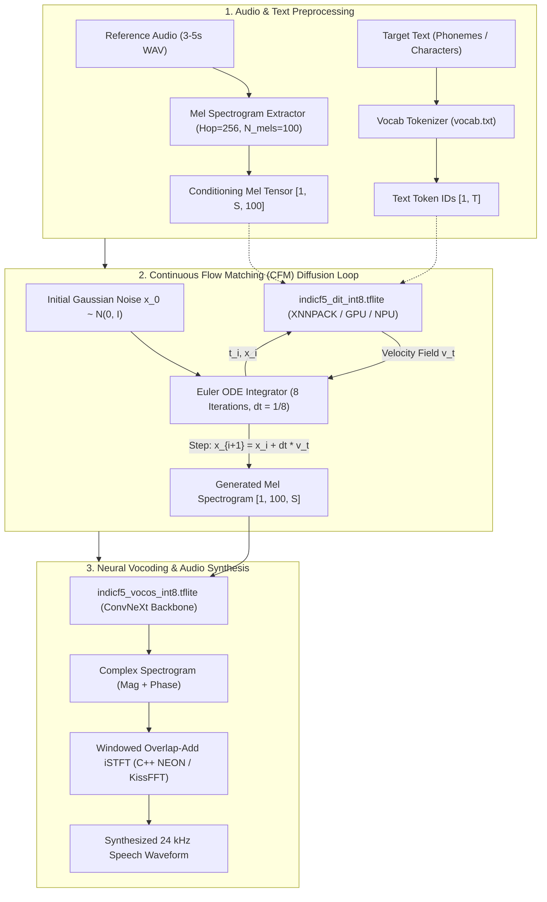
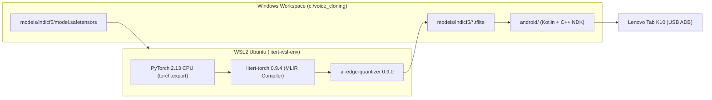

# Google LiteRT Voice Cloning Engine: Developer & Architecture Guide

Welcome to the **Google LiteRT On-Device Voice Cloning** implementation for **IndicF5 (F5-TTS)** and **Vocos**. 

This repository houses the end-to-end pipeline to compile, quantize, verify, and deploy state-of-the-art flow-matching voice cloning onto resource-constrained mobile hardware—specifically the **Lenovo Tab K10** (MediaTek Helio P22T, 4 GB RAM) and Android edge devices.

---

## 1. System Architecture & Inference Pipeline

The engine replaces cloud-dependent TTS services with a fully local, low-latency, privacy-preserving on-device pipeline.



---

## 2. Target Device Specification & Budget Constraints

All model optimizations and runtime decisions are strictly benchmarked against our target device profile:

* **Target Hardware**: Lenovo Tab K10 (`TB-X6C6F`)
* **SoC / Chipset**: MediaTek Helio P22T (`MT8768T`)
* **CPU Architecture**: $8\times \text{ARM Cortex-A53}$ (Octa-core up to 2.3 GHz, 64-bit ARMv8-A)
* **GPU**: PowerVR GE8320
* **System RAM**: **4.0 GB LPDDR4x**
* **Operating System**: Android 11 / 12 (API Level 30/31)

### Performance Budgets (Hard Gates)
1. **Real-Time Factor (RTF)**: $\le 1.0\times$ (must generate speech faster than or equal to human speaking rate; target $\le 0.85$).
2. **Peak Memory Footprint (VmRSS)**: $< 1.8\text{ GB}$ (safe threshold to prevent Android `LowMemoryKiller` eviction on a 4 GB device).
3. **Spectral Parity (MCD)**: Mel-Cepstral Distortion $\le 3.5\text{ dB}$ compared to PyTorch FP32 baseline.

> [!IMPORTANT]
> **Architectural Decision: Direct Native Android (Kotlin + C++ NDK)**  
> Benchmarks proved that direct native Android is objectively superior to pure Flutter for this application. Native Android saves **~150 MB of Dart VM heap RAM** (which would otherwise consume 37% of our safety headroom) and completely eliminates inter-process FFI bridge overhead across the 8 Euler ODE diffusion iterations.

---

## 3. Toolchain & Environment Setup

### The Dual-Environment Architecture

Google distributes the **`litert-converter`** (the MLIR compiler required by `litert-torch` to convert PyTorch `ExportedProgram` graphs into `.tflite` FlatBuffers) exclusively for Linux (`manylinux_2_27_x86_64`) and macOS (`arm64`). There are no Windows-native wheels for the compiler.

Therefore, this repository uses a synchronized dual-environment setup:
1. **Compilation Environment (WSL2 Ubuntu)**: Runs the PyTorch 2.x graph export, `litert-torch` MLIR lowering, and post-training quantization. It directly writes `.tflite` models to `/mnt/c/voice_cloning/models/indicf5/`.
2. **Host / App Environment (Windows 11)**: Runs Android Studio, Gradle, ADB, and desktop LiteRT evaluation.



### Quickstart: Verifying the Environment

To verify that all compiler packages, PyTorch graph tracing, and LiteRT runtime components are fully operational, execute the automated Phase 0 verification suite:

```bash
# In WSL2:
/mnt/c/voice_cloning/litert-wsl-env/bin/python3 /mnt/c/voice_cloning/scripts/verify_phase0.py
```

*Expected output: All 5 automated gate checks return `[PASSED]`:*
* `[PASSED] Python Version Compatibility (Target: 3.10 - 3.14 64-bit)`
* `[PASSED] PyTorch 2.x with torch.export`
* `[PASSED] Google LiteRT Converter (litert_torch)`
* `[PASSED] Google LiteRT Runtime (ai_edge_litert)`
* `[PASSED] torch.export.export() Tracing & ai_edge_torch.convert() Serialization`
* `[PASSED] LiteRT Interpreter Execution & Finite Output (Zero NaNs)`

---

## 4. Phase-Wise Roadmap & Documentation Directory

Detailed implementation specifications, engineering logs, and verification reports are documented in the [`phase_wise_implementation/`](phase_wise_implementation/) folder:

| Phase | Specification Document | Description | Status |
| :---: | :--- | :--- | :---: |
| **0** | [`phase_0_toolchain_and_environment.md`](phase_wise_implementation/phase_0_toolchain_and_environment.md) | Python environment isolation, `torch.export`, and Google LiteRT compiler setup. | `COMPLETE` ([Report](phase_wise_implementation/phase_0_report.md)) |
| **1** | [`phase_1_graph_tracing_and_export.md`](phase_wise_implementation/phase_1_graph_tracing_and_export.md) | DiT and Vocos graph capture, RoPE decomposition, and FP32 `.tflite` generation. | `COMPLETE` ([Report](phase_wise_implementation/phase_1_report.md)) |
| **2** | [`phase_2_parity_and_numerical_verification.md`](phase_wise_implementation/phase_2_parity_and_numerical_verification.md) | Numerical verification, MCD (< 3.5 dB), cosine similarity, and desktop inference harness. | `COMPLETE` ([Report](phase_wise_implementation/phase_2_report.md)) |
| **3** | [`phase_3_int8_quantization.md`](phase_wise_implementation/phase_3_int8_quantization.md) | Post-Training Quantization (PTQ) via `ai-edge-quantizer` to produce ~340 MB INT8 models. | `COMPLETE` ([Report](phase_wise_implementation/phase_3_report.md)) |
| **4** | [`phase_4_android_litert_integration.md`](phase_wise_implementation/phase_4_android_litert_integration.md) | Native Android C++ NDK engine, XNNPACK delegate, and Euler ODE integrator. | `PLANNED` |
| **5** | [`phase_5_end_to_end_android_app.md`](phase_wise_implementation/phase_5_end_to_end_android_app.md) | Native Kotlin/Compose UI, mic recording, sentence chunker, and real-time audio playback. | `PLANNED` |
| **6** | [`phase_6_on_device_benchmarking.md`](phase_wise_implementation/phase_6_on_device_benchmarking.md) | Physical profiling on Lenovo Tab K10: RTF, VmRSS, battery drain, and thermal throttling. | `PLANNED` |

*For the complete high-level roadmap, consult the [Master LiteRT Implementation Plan](litert_implementation_plan.md).*

---

## 5. Repository Directory Layout

```
c:/voice_cloning/
├── litert_docs/                                 # Central LiteRT documentation
│   ├── README.md                                # This document (Master Workflow Guide)
│   ├── litert_implementation_plan.md            # Master 6-Phase Strategic Roadmap
│   └── phase_wise_implementation/               # Granular Phase Specifications & Reports
│       ├── phase_0_toolchain_and_environment.md # Phase 0 Specification
│       ├── phase_0_report.md                    # Phase 0 Verification Sign-off Report
│       ├── phase_1_graph_tracing_and_export.md  # Phase 1 Specification (Graph Export)
│       ├── phase_1_report.md                    # Phase 1 Verification Sign-off Report
│       ├── phase_2_parity_and_numerical_verification.md # Phase 2 Specification (Parity & Baseline)
│       ├── phase_2_report.md                    # Phase 2 Verification Sign-off Report
│       ├── phase_3_int8_quantization.md         # Phase 3 Specification (INT8 PTQ)
│       └── phase_3_report.md                    # Phase 3 Verification Sign-off Report
├── models/
│   └── indicf5/                                 # Model Checkpoints & Export Artifacts
│       ├── model.safetensors                    # 1.35 GB PyTorch IndicF5 Checkpoint
│       ├── vocab.txt                            # Tokenizer Vocabulary
│       ├── indicf5_dit_fp32.tflite              # DiT FP32 FlatBuffer (1,288 MB)
│       ├── indicf5_vocos_fp32.tflite            # Vocos FP32 FlatBuffer (51.65 MB)
│       ├── indicf5_dit_int8.tflite              # Quantized DiT FlatBuffer (327.92 MB)
│       └── indicf5_vocos_int8.tflite            # Quantized Vocos FlatBuffer (13.29 MB)
├── scripts/                                     # Automation, Export & Test Scripts
│   ├── verify_phase0.py                         # Phase 0 Automated Gate Verification Suite
│   ├── export_dit_litert.py                     # DiT Graph Export Script
│   ├── export_vocos_litert.py                   # Vocos Graph Export Script
│   ├── infer_litert.py                          # Desktop LiteRT Euler ODE Inference Engine
│   ├── evaluate_parity.py                       # Dual-Engine Numerical Parity & MCD Evaluator
│   ├── quantize_litert.py                       # (Phase 3 Target) INT8 Post-Training Quantizer
│   └── benchmark_int8.py                        # (Phase 3 Target) INT8 Parity & Performance Suite
├── scratch/
│   └── indicf5_repo/                            # F5-TTS Architecture Definition Source
├── litert-wsl-env/                              # WSL2 Python 3.14/LiteRT Compilation Env
└── litert-env/                                  # Windows Host Virtual Environment
```

---

## 6. Sequence Bucketing Strategy for Low-RAM Tablets

To prevent dynamic heap allocation on the 4 GB Lenovo Tab K10 during the 8 iterations of the Euler ODE loop, speech generation uses **static sequence buckets**:

| Bucket ID | Mel Frame Length ($S$) | Audio Duration (24 kHz) | Speech Use Case |
| :---: | :---: | :---: | :--- |
| **Small** | $256\text{ frames}$ | $\approx 2.7\text{ seconds}$ | Short affirmations, single-phrase responses |
| **Medium (Default)** | $512\text{ frames}$ | $\approx 5.5\text{ seconds}$ | Typical conversation sentence |
| **Large** | $1024\text{ frames}$ | $\approx 10.9\text{ seconds}$ | Complex compound sentences |

Long paragraphs are automatically segmented by punctuation and clause markers into Medium ($512$) bucket chunks by the frontend sentence chunker.

---

## 7. Frequently Asked Questions (FAQ)

### Q: Why can't we export `.tflite` directly on native Windows?
**A**: Google AI Edge only compiles the C++ MLIR lowering and optimization library (`litert-converter`) for Linux (`manylinux`) and macOS (`arm64`). Installing `litert-torch` on native Windows fails with `No matching distribution found for litert-converter`. WSL2 provides native Linux binary execution with full direct file access to the Windows workspace.

### Q: Can my PC handle the export and quantization process?
**A**: Yes. Exporting the 335M model requires ~2.5 GB of RAM during graph capture, and INT8 calibration takes ~3.5 GB. Any modern PC with 8 GB RAM and 10+ GB of free SSD space handles this without issues.

### Q: Why is direct Android Kotlin/C++ NDK chosen over Flutter?
**A**: While Flutter provides fast multi-platform UI prototyping, running a 335M model on a 4 GB RAM tablet leaves very little memory headroom. The Dart VM adds an unavoidable ~150 MB baseline memory tax and introduces FFI memory copying overhead across the 8 Euler ODE iterations. Implementing the inference core in C++ NDK with a native Jetpack Compose UI guarantees optimal cache locality, zero-copy buffer passing, and maximum protection against Android `LowMemoryKiller` eviction.
