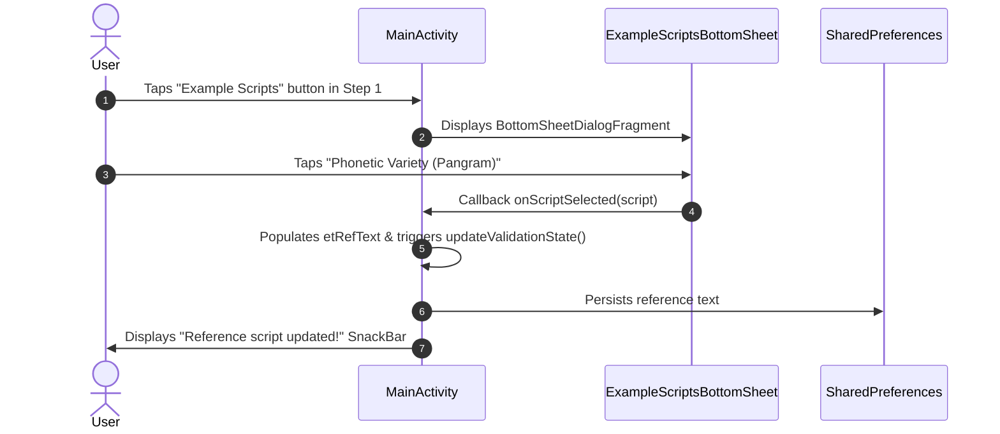
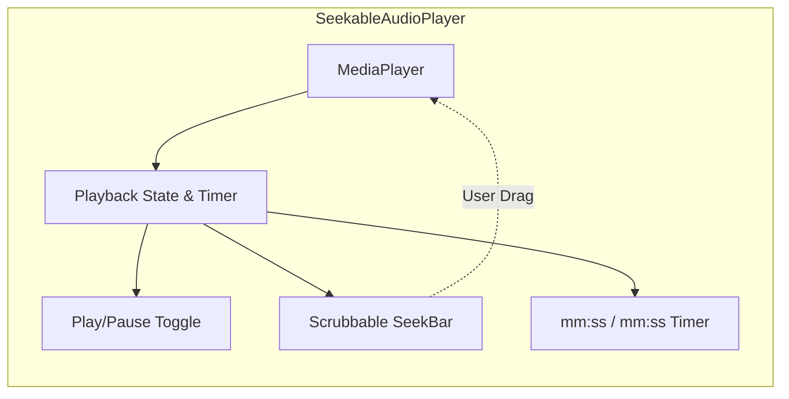

# Phase 3 & 4 Implementation Plan: Presets, BottomSheets, Seekable Audio Player & Telemetry Badges

**Target Module**: `android/app`  
**Parent Plan**: [app_parity_implementation_plan.md](file:///c:/voice_cloning/litert_docs/app_parity/app_parity_implementation_plan.md)  
**Goal**: Implement interactive BottomSheets for Reference Scripts and Target Speech Ideas (including multilingual Indic prompts), and engineer a responsive, seekable audio player component with real-time telemetry pill badges.

---

## 1. Phase 3: Interactive Presets & Modal BottomSheets

### 1.1 Objective & UX Flow
In the Flutter prototype (`voice_clone_proto`), users never have to guess what to say or type. Two dedicated modal bottom sheets provide curated, high-impact scripts:
1. **Step 1: Example Reference Transcripts**: Provides scripts selected specifically for acoustic coverage (timbre, vowels, cadence, prosody).
2. **Step 3: Quick Target Speech Ideas**: Provides categorized text prompts (Short, Medium, Long) with multilingual support for Hindi, Tamil, Telugu, and English.

Tapping any card in either bottom sheet immediately loads the text into the respective `TextInputEditText`, triggers the dynamic step validation engine, and provides a floating confirmation SnackBar.



---

### 1.2 Data Models & Library Structure

#### A. Example Transcript Model (`ExampleTranscript.kt`)
```kotlin
data class ExampleTranscript(
    val title: String,
    val advantageBadge: String,
    val text: String
)
```

**Curated Presets**:
1. **Casual & Conversational** (*Badge: "Natural flow & cadence"*):
   > "Honestly, I'm just hanging out at home today and trying to catch up on some things. The weather is actually pretty nice outside, so I might go for a quick walk later. Let me know what your schedule looks like, and maybe we can grab some food."
2. **Phonetic Variety** (*Badge: "Full pangram coverage"*):
   > "The quick brown fox jumps over the lazy dog, while the five boxing wizards jump quickly and quiet owls hoot after midnight."
3. **Phonetic Coverage** (*Badge: "Nuanced sounds & vowels"*):
   > "The beige hue on the waters of the loch impressed all, including the French queen, before she heard that symphony again."
4. **Professional Narration** (*Badge: "Clear formal pacing"*):
   > "Welcome to the voice cloning demonstration. Accurate pronunciation and consistent pacing ensure the highest quality voice synthesis."

#### B. Quick Idea Model (`QuickIdea.kt`)
```kotlin
enum class IdeaSection { SHORT, MEDIUM, LONG }
enum class Language { ENGLISH, HINDI, TAMIL, TELUGU }

data class QuickIdea(
    val section: IdeaSection,
    val language: Language,
    val text: String
)
```

**Curated Ideas Library**:
- **Short (1 Sentence)**:
  - *EN*: "Hello! This is a quick test of the voice cloning system."
  - *HI*: "नमस्ते! यह वॉइस क्लोनिंग प्रणाली का एक त्वरित परीक्षण है।"
  - *TE*: "హలో! ఇది వాయిస్ క్లోనింగ్ సిస్టమ్ యొక్క శీఘ్ర పరీక్ష."
  - *TA*: "வணக்கம்! இது குரல் குளோனிங் அமைப்பின் விரைவான சோதனை."
- **Medium (2–3 Sentences)**:
  - *EN*: "Artificial intelligence is rapidly transforming how we communicate across different languages and cultures. With on-device neural voice cloning, you can generate natural speech in real time without relying on cloud servers or internet access."
  - *HI*: "आर्टिफिशियल इंटेलिजेंस हमारे संवाद करने के तरीके को तेजी से बदल रहा है। ऑन-डिवाइस न्यूरल वॉइस क्लोनिंग के साथ, आप क्लाउड सर्वर पर निर्भर हुए बिना वास्तविक समय में स्वाभाविक आवाज उत्पन्न कर सकते हैं।"
  - *TE*: "కృత్రిమ మేధస్సు మనం వివిధ భాషలలో సంభాషించే విధానాన్ని వేగంగా మారుస్తోంది. ఆన్-డివైస్ న్యూరల్ వాయిస్ క్లోనింగ్ ద్వారా క్లౌడ్ సర్వర్‌లపై ఆధారపడకుండా రియల్ టైమ్‌లో సహజమైన ప్రసంగాన్ని రూపొందించవచ్చు."
  - *TA*: "செயற்கை நுண்ணறிவு மொழிகளுக்கு இடையேயான தகவல் தொடர்பை வேகமாக மாற்றி வருகிறது. சாதனத்திலேயே இயங்கும் குரல் குளோனிங் மூலம் கிளவுட் சேவையகம் இல்லாமல் இயற்கையான குரலை உருவாக்க முடியும்."
- **Long (Descriptive Paragraph)**:
  - *EN*: "The morning sun rose gently above the rolling green hills, casting a warm golden glow across the quiet valley below. A flock of wild geese soared gracefully against the amber dawn, while a cool morning mist slowly drifted through the pine forest. In the distance, the gentle rush of a mountain stream blended harmoniously with the awakening sounds of nature."
  - *HI*: "सुबह का सूरज धीरे-धीरे हरी पहाड़ियों के ऊपर उगा और नीचे शांत घाटी में एक सुनहरा प्रकाश बिखेर दिया। दूर पहाड़ों से बहने वाली नदी की कलकल ध्वनि प्रकृति के सुंदर वातावरण के साथ पूरी तरह घुलमिल गई।"

---

### 1.3 UI Components & XML Layouts
1. **`layout/bottom_sheet_example_scripts.xml`**:
   - Header with icon (`ic_menu_agenda`), title, subtitle, and close button.
   - `RecyclerView` rendering categorized cards.
2. **`layout/bottom_sheet_quick_ideas.xml`**:
   - Header with icon (`ic_dialog_info`), title, subtitle, and language filter chips (All, English, Hindi, Telugu, Tamil).
   - `RecyclerView` rendering ideas grouped under Section headers (Short, Medium, Long).
3. **`layout/item_preset_card.xml`**:
   - `MaterialCardView` with dark purple background (`#1A162B`), highlight border on selection, title, badge container, and body text.

---

## 2. Phase 4: Seekable Audio Player & Telemetry Badges

### 2.1 Objective & Architecture
The current implementation plays audio blindly using `AudioTrack` without scrubbing, position display, or pause/resume controls. Phase 4 replaces this with a fully encapsulated, reusable **`SeekableAudioPlayer`** component.



---

### 2.2 Reusable Player View (`SeekableAudioPlayerView.kt` & `view_seekable_audio_player.xml`)

#### A. Layout Specification (`view_seekable_audio_player.xml`)
- Enclosed inside a compact `MaterialCardView` (`#241E3A`, radius `10dp`).
- **Play/Pause Button**: `MaterialButton` icon toggle (`ic_media_play` / `ic_media_pause`).
- **Interactive SeekBar**: Material `SeekBar` styled with `@color/primary` thumb and progress track.
- **Time Label**: Compact monospace `TextView` displaying `00:00 / 00:03`.

#### B. Component Logic (`SeekableAudioPlayerView.kt`)
1. **Lifecycle & State Management**:
   - Handles `MediaPlayer.prepare()`, `start()`, `pause()`, and `seekTo()`.
   - Uses a lightweight Kotlin coroutine or `Handler` polling at `30ms` to smoothly update the `SeekBar` during playback.
2. **User Scrubbing / Dragging**:
   - `OnSeekBarChangeListener`:
     - `onStartTrackingTouch`: Temporarily pauses position updater.
     - `onStopTrackingTouch`: Executes `mediaPlayer.seekTo(progress)` and resumes playback.
3. **Auto-Reset**:
   - `OnCompletionListener`: Automatically resets seekbar and time to `00:00`, resets toggle button to play state.

---

### 2.3 Step 4 "LATEST" Gradient Card & Telemetry Badges

#### A. Card Aesthetic (`bg_latest_card.xml`)
- Linear gradient from Midnight Purple (`#2E1B5B`) to Deep Surface (`#1B162C`).
- Stroke: 1dp `#5B45A8`.
- Prominent `LATEST` badge pill in top left corner.
- Dynamic filename label: `generated_voice_<timestamp>.wav`.

#### B. Real-Time Telemetry Badges
1. **Real-Time Factor (RTF) Badge**:
   - Background: `bg_pill_rtf.xml` (semi-transparent green `#2600E676` with green border).
   - Text: `RTF: 1.32x` (Bold Green `#00E676`).
2. **Resident Memory (VmRSS) Badge**:
   - Background: `bg_pill_rss.xml` (semi-transparent blue `#262979FF` with blue border).
   - Text: `Memory: 380 MB` (Bold Electric Blue `#2979FF`).
3. **Execution Latency Breakdown**:
   - Displays exact kernel execution stages:
     `Mel: 18ms | DiT: 20120ms | Vocos: 610ms | Total: 20748ms`.

---

## 3. Step-by-Step Implementation Roadmap

```text
Step 1: Data Models & Layout Resources
├── Create models: ExampleTranscript.kt, QuickIdea.kt, PresetData.kt
├── Create layouts: bottom_sheet_example_scripts.xml, bottom_sheet_quick_ideas.xml
└── Create item layouts: item_preset_card.xml, view_seekable_audio_player.xml

Step 2: Modal BottomSheets Implementation
├── Implement ExampleScriptsBottomSheet.kt with selection callback
├── Implement QuickIdeasBottomSheet.kt with section grouping and language filtering
└── Wire up triggers in MainActivity: btnExampleScripts and btnQuickIdeas

Step 3: Seekable Audio Player Component
├── Implement SeekableAudioPlayerView.kt with MediaPlayer encapsulation
├── Add position polling coroutine and scrubbing listener
└── Embed into Step 2 (Reference Voice Preview) and Step 4 (LATEST Output Card)

Step 4: Telemetry Badge Integration
├── Format RTF pill, Memory pill, and Latency breakdown from SynthesisResult
└── Wire up Export button with download feedback

Step 5: Build, Test & Verify on Device
├── Compile APK via Gradle
├── Deploy to Samsung Galaxy S23 (SM-S911B)
└── Verify interactive bottom sheet selections, seeking accuracy, and telemetry display
```

---

## 4. Verification & Acceptance Criteria

1. **Example Scripts Modal**:
   - Pressing "Example Scripts" in Step 1 smoothly slides up the bottom sheet.
   - Tapping any preset populates the text in Step 1 and dismisses the sheet.
2. **Quick Ideas Modal**:
   - Pressing "Quick Ideas" in Step 3 opens the bottom sheet with Short, Medium, Long, and Indic language tabs.
   - Selecting an idea populates Step 3 and triggers validation check.
3. **Seekable Playback**:
   - Reference voice preview and latest generated speech feature an interactive seekbar.
   - Scrubbing moves the playback position immediately; timer displays `current / total` time accurately.
4. **Telemetry Badges**:
   - When synthesis completes, the `LATEST` card displays accurate RTF (`RTF: 1.xx`), resident memory (`Memory: xxx MB`), and kernel execution breakdown.
