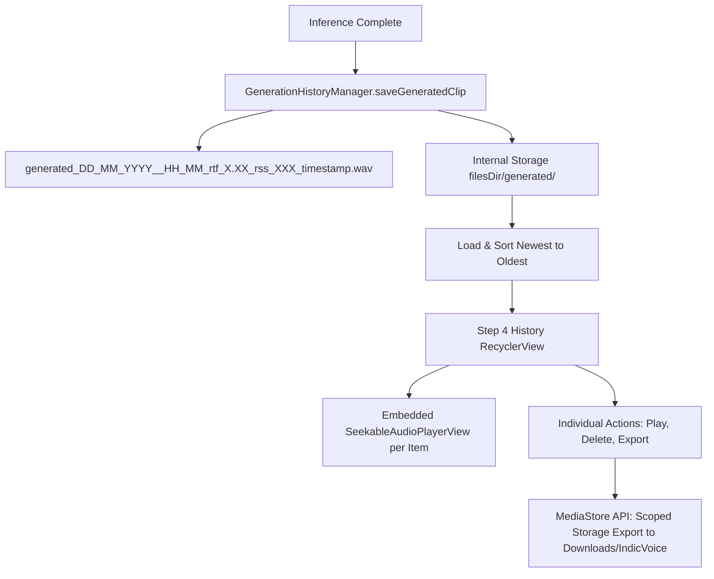

# Phase 5 & 6 Implementation Plan: Generation Library, History, Downloads Export & Session Persistence

**Target Module**: `android/app`  
**Parent Plan**: [app_parity_implementation_plan.md](file:///c:/voice_cloning/litert_docs/app_parity/app_parity_implementation_plan.md)  
**Goal**: Complete the native Android IndicVoice parity by implementing persistent generation history, a multi-clip playback library in Step 4, scoped-storage export to the device's public `Download/` folder, and automatic session persistence across app launches via `SharedPreferences`.

---

## 1. Phase 5: Generation Library, History & Public Downloads Export

### 1.1 Objective & Architecture
In the Flutter prototype (`voice_clone_proto`), generated clips are never lost after inference. They are stored with rich metadata encoded directly into the filename, displayed in an interactive history list, and can be exported directly to the user's phone storage.

Phase 5 establishes a native Android clip management pipeline:



---

### 1.2 Generation History Manager (`GenerationHistoryManager.kt`)

#### A. Filename Convention
Aligns with the pattern in `voice_clone_proto`:
```text
generated_{dd}_{MM}_{yyyy}__{HH}_{mm}_rtf_{rtf}_rss_{rss}_{timestamp}.wav
```
*Example*: `generated_18_10_2026__02_15_rtf_1.32_rss_380_1729215300000.wav`

#### B. Data Model (`GeneratedClipItem.kt`)
```kotlin
data class GeneratedClipItem(
    val file: File,
    val displayTitle: String,
    val rtf: String?,
    val rssMB: String?,
    val timestampMs: Long
)
```

#### C. Extraction Logic
- **Display Title**: Formatted date/time extracted via regex:
  `RegExp(r'(generated_\d{2}_\d{2}_\d{4}__\d{2}_\d{2})')` -> e.g., `generated_18_10_2026__02_15`
- **RTF**: Regex `_rtf_([0-9.]+)` -> `1.32`
- **Memory RSS**: Regex `_rss_([0-9]+)` -> `380`

---

### 1.3 Step 4 History UI & RecyclerView

#### A. UI Layout (`item_history_clip.xml`)
Each past generation card includes:
1. **Title Row**:
   - Display title (`generated_18_10_2026__02_15`).
   - Action buttons:
     - **Export Button** (`ibExportClip`): `stat_sys_download` icon.
     - **Delete Button** (`ibDeleteClip`): `ic_menu_delete` icon with confirmation dialog or undo snackbar.
2. **Telemetry Badges**:
   - RTF pill badge (`RTF: 1.32x`).
   - Memory pill badge (`Memory: 380 MB`).
3. **Seekable Audio Player**:
   - Embedded `SeekableAudioPlayerView` allowing immediate playback and scrubbing of past clips.

#### B. Adapter Implementation (`HistoryAdapter.kt`)
- `RecyclerView.Adapter<HistoryAdapter.ViewHolder>`
- Binds metadata, registers click handlers, and wires audio paths to `SeekableAudioPlayerView`.
- Clean recycling: Ensures `mediaPlayer` is paused and released when view holders are recycled or detached.

---

### 1.4 Scoped-Storage Public Downloads Export (`AudioExporter.kt`)

#### A. Android Scoped Storage Compliance (API 29–35 / Android 10–16)
Android 10+ restricts direct filesystem access to `/storage/emulated/0/Download/`. Modern compliance uses the `MediaStore` API:

```kotlin
val contentValues = ContentValues().apply {
    put(MediaStore.Audio.Media.DISPLAY_NAME, "$exportName.wav")
    put(MediaStore.Audio.Media.MIME_TYPE, "audio/wav")
    put(MediaStore.Audio.Media.RELATIVE_PATH, Environment.DIRECTORY_DOWNLOADS + "/IndicVoice")
    put(MediaStore.Audio.Media.IS_PENDING, 1)
}

val uri = context.contentResolver.insert(MediaStore.Audio.Media.EXTERNAL_CONTENT_URI, contentValues)
// Stream bytes from source file to uri outputStream
// Finally: contentValues.put(MediaStore.Audio.Media.IS_PENDING, 0)
```

- **Output Destination**: `/storage/emulated/0/Download/IndicVoice/<filename>.wav`
- **User Feedback**: Floating green SnackBar: *"Saved to Downloads/IndicVoice: <filename>.wav"*.

---

## 2. Phase 6: Session Persistence, Validation Hardening & Polish

### 2.1 Session Persistence (`SharedPreferences`)

#### A. Stored Keys
| Key | Type | Description |
| :--- | :--- | :--- |
| `pref_ref_audio_path` | `String` | Path to current reference audio clip |
| `pref_ref_file_name` | `String` | Display name of reference audio clip |
| `pref_ref_text` | `String` | Content of Step 1 transcript |
| `pref_target_text` | `String` | Content of Step 3 target speech text |
| `pref_cfm_steps` | `Int` | Selected CFM steps count (8, 16, or 24) |

#### B. Lifecycle & Auto-Save Triggers
- **On App Launch (`onCreate`)**:
  - Restores reference transcript and target text into `TextInputEditText`.
  - Checks if `pref_ref_audio_path` points to a valid file on disk; if so, restores Step 2 Ready state and prepares `playerRefAudio`.
  - Restores selected CFM radio button (`rbStep8`, `rbStep16`, `rbStep24`).
- **On State Change**:
  - `etRefText.addTextChangedListener`: Persists reference transcript.
  - `etTargetText.addTextChangedListener`: Persists target speech text.
  - Live recording / audio upload: Persists reference path and file name.
  - Radio button change: Persists step count.

---

### 2.2 Error Handling & Edge-Case Hardening
1. **Audio File Validation**:
   - Ensure corrupted or non-RIFF audio uploads trigger a clear error Toast and do not crash the C++ decoder.
2. **AudioTrack / MediaPlayer Lifecycle Leaks**:
   - Release all media players when switching clips or exiting the app.
3. **Storage Quota & Cleanup**:
   - Check available device internal storage before saving new clips.
   - Deleting a clip removes the file from disk and instantly updates the history `RecyclerView`.

---

## 3. Step-by-Step Implementation Roadmap

```text
Step 1: History Storage & Export Components
├── Create GenerationHistoryManager.kt (manage internal storage clips & metadata)
├── Create AudioExporter.kt (MediaStore scoped storage export to Downloads/IndicVoice)
└── Create item_history_clip.xml layout

Step 2: History RecyclerView Integration
├── Create HistoryAdapter.kt with SeekableAudioPlayerView integration
└── Update activity_main.xml to include rvGenerationHistory and "Previous Generations" header

Step 3: Session Persistence Integration
├── Implement SharedPreferences loadSession() and saveSession() in MainActivity.kt
└── Add text watchers and state triggers for persistent caching

Step 4: Build, Deploy & Verify on Device
├── Compile APK via Gradle
├── Deploy to Samsung Galaxy S23 (SM-S911B)
└── Verify end-to-end: multi-clip history, seeking, deletion, Downloads export, and session restore
```

---

## 4. Verification & Acceptance Criteria

1. **Clip Persistence**:
   - Each synthesized voice clip is saved to `filesDir/generated/` with correct timestamp, RTF, and Memory RSS metadata.
2. **History List**:
   - Step 4 displays past generations in chronological order (newest first).
   - Each past clip features individual playback with seeking, delete action, and export action.
3. **Public Downloads Export**:
   - Tapping "Export" saves the audio directly into `/storage/emulated/0/Download/IndicVoice/`.
   - The file is accessible in the device's system "Files" / "My Files" app.
4. **Session Restore**:
   - Force-closing and reopening the app restores the last reference audio, transcript, target text, and step count.
