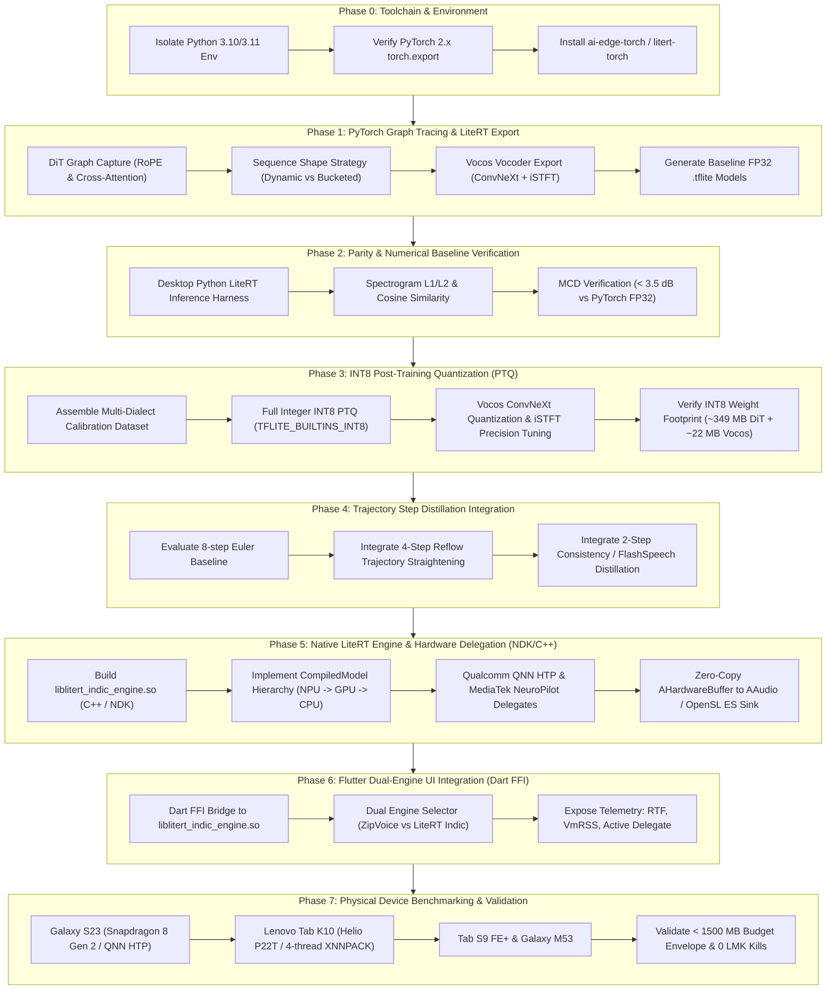

# Google LiteRT Implementation Plan: On-Device Indic Voice Cloning

**Document Version:** 1.1.0  
**Target Architecture:** IndicF5 (22-Layer Diffusion Transformer, 335M params) + Vocos 24 kHz Neural Vocoder  
**Target Silicon:** Qualcomm Snapdragon Hexagon Tensor Processor (HTP), MediaTek NeuroPilot APU, and ARM Cortex-A53 NEON (XNNPACK)  
**Host App Runtime:** Native Android Engine (Kotlin/NDK C++) with Flutter UI (`voice_clone_proto`) or Pure Jetpack Compose

---

## 1. Executive Summary & Background

In the mid-semester architecture, English zero-shot voice cloning was deployed on Android using a Sherpa-ONNX ZipVoice prototype (123M parameters), while Indic multilingual voice cloning was developed around a 22-layer Continuous Flow Matching Diffusion Transformer (IndicF5, 335M parameters) evaluated in Python and exported to prototype INT8 ONNX graphs (`indicf5_dit_int8_static.onnx`, 349 MB, $T=128$).

As identified in **Chapter 5 of the Mid-Semester Report** and **MIDSEM_REPORT_COMPREHENSIVE.md (§6)**, transitioning from custom ONNX Runtime Mobile to **Google LiteRT** (`ai-edge-litert` / `ai-edge-torch` / `litert-torch`) provides three critical advantages:
1. **Elimination of Transpose Overhead:** Direct conversion from PyTorch `torch.export` into StableHLO avoids hundreds of intermediate ONNX `Transpose`, `Reshape`, and `Concat` nodes in multi-head attention and RoPE layers.
2. **Unified NPU Delegation (`CompiledModel` API):** Out-of-the-box hardware offloading to Qualcomm AI Engine Direct (QNN HTP on Snapdragon 8 Gen 2) and MediaTek NeuroPilot (Dimensity APUs), with seamless multi-threaded XNNPACK NEON fallback on budget platforms (Lenovo Tab K10).
3. **Zero-Copy Memory Pipelines:** Native support for `AHardwareBuffer` enables DiT $\to$ Vocos $\to$ AAudio PCM streaming without intermediate user-space `memcpy` stalls, preserving the analytical 801 MB memory budget envelope.

---

## 2. Platform Architecture Trade-Off Analysis: Flutter vs. Direct Native Android

A critical design decision is whether the deployment should be executed in **Flutter** or as a **Direct Native Android (Kotlin + C++ NDK)** application.

### 2.1 Comparative Analysis Matrix

| Architectural Dimension | Pure Flutter (`flutter_litert`) | Hybrid: Flutter UI + Native NDK Engine | Pure Native Android (Kotlin + Compose + C++) |
|:---|:---|:---|:---|
| **LiteRT `CompiledModel` Support** | Partial (v0.2.x wrapper on pub.dev) | **Full** (Direct Google LiteRT C API & Android SDK) | **Full** (Direct Google LiteRT Android SDK & C API) |
| **Iterative ODE Diffusion Loop** | Slow: 8 FFI roundtrips & Dart byte-buffer math | **Fastest**: Entire ODE loop executes in native C++ | **Fastest**: Entire ODE loop executes in native C++ |
| **Memory Footprint (Baseline RSS)** | High: Dart VM + Flutter engine adds ~150 MB | Moderate: Dart VM adds ~150 MB, but model in C++ | **Lowest**: 0 Dart VM overhead; saves 150 MB for LMK safety |
| **Zero-Copy Audio Streaming** | Difficult: File I/O roundtrip via `just_audio` | Native `AAudioStream` / `AHardwareBuffer` sink | Native `AAudioStream` / `AHardwareBuffer` sink |
| **Existing Code Reuse** | Reuses all 1,354 lines of Flutter UI (`main.dart`) | Reuses all 1,354 lines of Flutter UI (`main.dart`) | Must rewrite UI in Jetpack Compose |
| **Development Velocity** | Fast UI, but complex Dart ODE tensor handling | **Optimal Balance** (Keep UI, push compute to C++) | Slower (Rewriting audio recorder, player, HUD in Kotlin) |

---

### 2.2 Assessment of Available Flutter Packages

1. **`flutter_litert` (pub.dev)**:
   - *Status:* Emerging Flutter plugin wrapping LiteRT C API with support for `CompiledModel` and `TensorBufferMode.hostMemory`.
   - *Limitation for Generative Voice Cloning:* Continuous Flow Matching is an **iterative diffusion ODE loop** (evaluating the DiT backbone 2, 4, or 8 times sequentially, updating latent $x_{t+\Delta t} = x_t + \Delta t \cdot v_\theta$). Running this loop from Dart requires 8 separate `writeInput`, `dispatch`, `readOutput` FFI transitions and executing large float-array vector arithmetic in Dart.
   - *Suitability:* Excellent for single-pass inference (e.g., vision, classification), but introduces latency and memory fragmentation when driving multi-step generative diffusion ODEs.

2. **`tflite_flutter` (pub.dev)**:
   - *Status:* Legacy wrapper based on older TensorFlow Lite 2.x C API.
   - *Limitation:* Does **not** support the modern Google LiteRT `CompiledModel` API, Qualcomm AI Engine Direct (QNN HTP), or MediaTek NeuroPilot unified delegation. Not recommended.

3. **`sherpa_onnx` (Currently used in `voice_clone_proto`)**:
   - *Status:* Used successfully for English ZipVoice. It follows the exact pattern we recommend: the entire inference loop and vocoder are pre-compiled into a native C++ shared library, with Dart only invoking a single high-level FFI call.

---

### 2.3 Recommended Platform Strategy: **The Hybrid Native Engine Architecture**

Rather than rewriting the UI in Jetpack Compose or running an 8-step diffusion loop in pure Dart, the superior engineering approach is:
- **UI & Presentation Layer:** Retain **Flutter (`voice_clone_proto`)**. It already implements reference audio recording, file picking, preset prompts, Material 3 theming, audio playback widgets, and history persistence.
- **Inference & Synthesis Core:** Implement as a **Native C++ / NDK Shared Library (`liblitert_indic_engine.so`)** backed by the official **Google LiteRT Android SDK (`com.google.ai.edge.litert:litert`)**:
  1. Initialized once with `CompiledModel` (Qualcomm QNN HTP $\to$ MediaTek APU $\to$ XNNPACK CPU).
  2. Executes the full 2-step / 4-step / 8-step Euler Continuous Flow Matching loop internally in native C++ memory without Dart FFI overhead.
  3. Executes Vocos neural vocoding and iSTFT synthesis in-place.
  4. Exposes a single, clean C-ABI function to Flutter via **Dart FFI**:
     ```dart
     final int status = LitertIndic_Synthesize(
       refWavPath, refText, targetText, outWavPath, numSteps, cfgStrength
     );
     ```
- **Optional Pure Native Fallback**: If physical testing on the 4 GB Lenovo Tab K10 shows that the 150 MB Dart VM footprint puts the device near LowMemoryKiller (LMK) eviction, we can extract the native C++ engine into a standalone lightweight Jetpack Compose APK, saving that 150 MB instantly.

---

## 3. Phase-Wise Implementation Roadmap



---

## 4. Detailed Phase Breakdown

### Phase 0: Environment & Export Toolchain Setup
- **Objective:** Establish a stable, isolated Python environment for LiteRT conversion toolchains without library conflicts.
- **Key Discovery & Pre-requisite:**
  - The current global Python environment is Python 3.14 (`cp314`). Deep learning compilation wheels (`litert-converter`, `ai-edge-litert`, `torch-xla`, `flatbuffers`) officially distribute binary wheels for Python 3.10 and 3.11 on Windows/Linux.
  - Attempting to install `litert-torch` directly on Python 3.14 encounters `ResolutionImpossible` due to missing platform wheels for `litert-converter`.
- **Tasks:**
  1. Set up a dedicated virtual environment using Python 3.10 or 3.11 (via `py -3.11 -m venv litert-env` or WSL2/Docker container).
  2. Install `ai-edge-torch` (v0.7.x), `ai-edge-litert` (v2.3.x), `torch>=2.4.0`, `torchaudio`, `safetensors`, and `vocos`.
  3. Validate that `torch.export` is operational on the host system without deprecation warnings.

---

### Phase 1: Model Graph Decomposition & LiteRT FlatBuffer Export
- **Objective:** Convert native PyTorch DiT and Vocos architectures into optimized `.tflite` FlatBuffers using `ai-edge-torch` / `litert-torch`.
- **Architectural Components to Export:**
  1. **IndicF5 DiT Acoustic Backbone:**
     - Inputs:
       - `x_t`: Mel noisy latent tensor $(\text{batch}=1, T, \text{channels}=100)$.
       - `timestep`: Scalar diffusion step $t \in [0, 1]$ (shape $[1]$).
       - `text`: Token indices sequence $(\text{batch}=1, L_{\text{text}})$.
       - `cond`: Prompt mel conditioning $(\text{batch}=1, T, \text{channels}=100)$.
     - Output:
       - Velocity vector field prediction $v_t$ (shape $[1, T, 100]$).
  2. **Sequence Length Strategy (Dynamic vs. Bucketing):**
     - *CPU / XNNPACK:* Can accept dynamic shapes via `torch.export.Dim("seq_len", min=64, max=1024)`.
     - *NPU Accelerators (Qualcomm QNN HTP / MediaTek APU):* Require static tensor shapes for ahead-of-time (AOT) weight layout compilation and memory arena allocation.
     - *Strategy:* Export discrete sequence buckets for NPU deployment:
       - Bucket S: $T=256$ frames ($\approx 2.7$ s total audio window)
       - Bucket M: $T=512$ frames ($\approx 5.5$ s total audio window)
       - Bucket L: $T=1024$ frames ($\approx 10.9$ s total audio window)
       - Plus 1 fully dynamic model for flexible desktop/CPU execution.
  3. **Vocos 24 kHz Neural Vocoder:**
     - Backbone: ConvNeXt feature projection layers ($100 \to 512 \to 24000$ points).
     - Head: Inverse Short-Time Fourier Transform (iSTFT).
     - *LiteRT Handling:* Verify if the iSTFT Fourier synthesis operator converts cleanly to native TFLite complex/real-imaginary operations, or decouple into ConvNeXt feature extractor (TFLite) + native C++ iSTFT synthesis block.

---

### Phase 2: Numerical Equivalence & Parity Verification
- **Objective:** Guarantee that the converted `.tflite` models produce acoustic outputs identical to the PyTorch FP32 gold standard.
- **Tasks:**
  1. Develop a Python testing script `tests/test_litert_parity.py` using `ai_edge_litert.interpreter.Interpreter`.
  2. Run identical reference audio clips from `samples/` and identical target prompts from `prompts.json` through:
     - PyTorch Native Pipeline (`IndicF5Engine`)
     - LiteRT FP32 Pipeline
  3. Compute objective similarity metrics:
     - Mel spectrogram Mean Squared Error (MSE) and Cosine Similarity ($> 0.99$).
     - Mel-Cepstral Distortion (MCD) across synthesized waveforms ($\text{MCD} < 3.5$ dB).
     - Waveform perceptual alignment check.

---

### Phase 3: INT8 Post-Training Quantization (PTQ) & Calibration
- **Objective:** Quantize model weights and activations to 8-bit integers, shrinking DiT weights from 1.35 GB to $\approx 349$ MB and Vocos to $\approx 22$ MB, fitting inside the 801 MB analytical budget.
- **Tasks:**
  1. **Calibration Dataset Generator:** Extract 100–200 diverse speech frames across Indic languages (Hindi, Tamil, Telugu, Kannada, Marathi, Bengali) using existing clips in `samples/` and `prompts.json`.
  2. **Quantization Execution (`ai-edge-quantizer` / `ai_edge_torch.quantize`):**
     - Target: Full Integer Quantization (`int8_ptq` / `TFLITE_BUILTINS_INT8`).
     - Calibrate activation dynamic ranges for self-attention projection weights ($\mathbf{Q}, \mathbf{K}, \mathbf{V}$ linear layers) and MLP blocks.
  3. **Vocos Quantization Tuning:**
     - Quantize ConvNeXt depthwise/pointwise convolutions to INT8.
     - Keep the final iSTFT magnitude/phase reconstruction stage in FP32 or FP16 to prevent high-frequency spectral phase distortion.
  4. **Parity Re-check:** Measure degradation from quantization; ensure synthesized speech remains free of robotic hiss, clipping, or phonetic dropouts.

---

### Phase 4: Trajectory Step Distillation Integration (2-Step / 4-Step)
- **Objective:** Halve or quarter the number of required Euler solver forward passes to achieve low RTF on resource-constrained mobile CPUs and NPUs.
- **Techniques:**
  1. **4-Step Reflow (Rectified Flow Trajectory Straightening):**
     - Straightens the probability flow ODE trajectories.
     - Reduces sampling from 8 Euler steps to 4 steps with minimal MOS degradation.
  2. **2-Step Consistency / FlashSpeech Distillation:**
     - Maps intermediate diffusion points directly to origin acoustic latents over two wide time intervals ($t \in [0.0, 0.5]$ and $t \in [0.5, 1.0]$).
     - Reduces forward evaluations by 75%, slashing execution time and memory bandwidth on mobile devices.
  3. Implement both 4-step and 2-step sampling loops in the LiteRT inference controller.

---

### Phase 5: Native LiteRT Engine & Hardware Delegation (NDK/C++)
- **Objective:** Build the high-performance native Android runtime layer (`liblitert_indic_engine.so`) integrating Google LiteRT C API / Android SDK.
- **Implementation Design:**
  1. **Native C++ Engine Architecture:**
     - Encapsulates the entire multi-step Euler ODE diffusion loop in C++ without Dart FFI hopping.
     - Pre-allocates working memory arenas for latent mel frames, eliminating allocator jitter.
  2. **`CompiledModel` Hardware Hierarchy:**
     - Configure accelerator priority:
       ```cpp
       // LiteRT C API configuration
       LmhCompiledModelOptions options;
       LmhSetAcceleratorPriority(options, {ACCELERATOR_NPU, ACCELERATOR_GPU, ACCELERATOR_CPU});
       LmhSetNumThreads(options, 4); // XNNPACK ARM NEON fallback
       ```
     - Qualcomm Snapdragon (Galaxy S23): Offload to Qualcomm AI Engine Direct (QNN HTP).
     - MediaTek Dimensity (Galaxy M53): Offload to MediaTek NeuroPilot APU.
     - Budget Helio P22T (Lenovo Tab K10): Fallback to 4-thread XNNPACK NEON.
  3. **Zero-Copy Pipeline (`AHardwareBuffer`):**
     - Map DiT mel-spectrogram output buffer directly into Vocos vocoder input without intermediate host memory copy.
     - Stream synthesized 24 kHz PCM audio directly to `AAudioStream` / OpenSL ES.

---

### Phase 6: Flutter Dual-Engine UI & Dart FFI Integration
- **Objective:** Seamlessly integrate the Native LiteRT Indic engine into the existing `voice_clone_proto` Flutter app via Dart FFI.
- **Tasks:**
  1. **Dart FFI Bridge:** Create `LiteRtIndicService` in `voice_clone_proto/lib/services/litert_indic_service.dart`:
     ```dart
     typedef NativeSynthesize = Int32 Function(
       Pointer<Utf8> refWav, Pointer<Utf8> refText, Pointer<Utf8> targetText,
       Pointer<Utf8> outWav, Int32 numSteps, Float cfgStrength
     );
     ```
  2. **Dual-Engine Selector:**
     - English / Fast PoC $\to$ `TtsService` (Sherpa-ONNX ZipVoice Distill).
     - Indic Multilingual $\to$ `LiteRtIndicService` (Google LiteRT IndicF5 + Vocos).
  3. **Model Asset Packaging:** Update `model_loader.dart` to unpack `indicf5_dit_int8.tflite`, `indicf5_vocos_int8.tflite`, and `vocab.txt` to the application data directory.
  4. **Telemetry HUD:** Display live Real-Time Factor (RTF), memory consumption (`VmRSS` from `/proc/self/status`), and active execution delegate (Qualcomm HTP, MediaTek APU, or XNNPACK CPU) on the Flutter UI.

---

### Phase 7: Real-Device Benchmarking & Physical Validation
- **Objective:** Validate real-world performance, latency, memory consumption, and thermal stability across all four device tiers.
- **Physical Test Matrix:**
  1. **Flagship Tier (Samsung Galaxy S23, Snapdragon 8 Gen 2):**
     - Target: Hexagon Tensor Processor (HTP) execution.
     - Latency Target: RTF $< 0.5\times$ (Faster than real-time).
  2. **Mid-Range Tier (Samsung Galaxy M53, Dimensity 900):**
     - Target: MediaTek NeuroPilot APU execution.
     - Latency Target: RTF $< 1.5\times$.
  3. **Upper-Mid Tablet Tier (Samsung Galaxy Tab S9 FE+, Exynos 1380):**
     - Target: NPU / GPU delegate execution.
     - Latency Target: RTF $< 1.2\times$.
  4. **Target Budget Hardware (Lenovo Tab K10, MediaTek Helio P22T, 4 GB RAM):**
     - Execution: 4-thread XNNPACK CPU fallback.
     - Target: RTF reduction from current baseline ($11\times - 18\times$) down to $3\times - 5\times$ (via 2-step distillation + StableHLO operator fusion).
     - Memory Envelope: Resident Set Size (`VmRSS`) strictly confined within the $801$ MB analytical budget ($< 1,500$ MB edge reference threshold), with **zero LowMemoryKiller (LMK) terminations** across sustained multi-utterance tests.

---

## 5. Deliverables & Artifact Checklist

| Phase | Output Artifacts | Primary Verification Check | Status |
|---|---|---|:---:|
| **[Phase 0](phase_wise_implementation/phase_0_toolchain_and_environment.md)** | WSL2 environment (`litert-wsl-env`), LiteRT compiler toolchain (`litert-torch 0.9.4`, `ai-edge-litert 2.2.0`, `ai-edge-quantizer 0.9.0`), [`phase_0_report.md`](phase_wise_implementation/phase_0_report.md) | All 6 automated gate checks in [`scripts/verify_phase0.py`](file:///c:/voice_cloning/scripts/verify_phase0.py) pass | `COMPLETE` |
| **[Phase 1](phase_wise_implementation/phase_1_graph_tracing_and_export.md)** | [`models/indicf5/indicf5_dit_fp32.tflite`](file:///c:/voice_cloning/models/indicf5/indicf5_dit_fp32.tflite) (1,287.89 MB), [`models/indicf5/indicf5_vocos_fp32.tflite`](file:///c:/voice_cloning/models/indicf5/indicf5_vocos_fp32.tflite) (51.65 MB), [`phase_1_report.md`](phase_wise_implementation/phase_1_report.md) | Graph export via `torch.export` & `ai_edge_torch`; finite output (zero NaNs) | `COMPLETE` |
| **[Phase 2](phase_wise_implementation/phase_2_parity_and_numerical_verification.md)** | Parity harness [`scripts/evaluate_parity.py`](file:///c:/voice_cloning/scripts/evaluate_parity.py), inference harness [`scripts/infer_litert.py`](file:///c:/voice_cloning/scripts/infer_litert.py), [`phase_2_report.md`](phase_wise_implementation/phase_2_report.md) | Cosine Sim = `1.000000`, Spectrogram L1 = `0.000003`, MCD = `0.0037 dB` (Gate: $\le 3.5\text{ dB}$) | `COMPLETE` |
| **[Phase 3](phase_wise_implementation/phase_3_int8_quantization.md)** | [`models/indicf5/indicf5_dit_int8.tflite`](file:///c:/voice_cloning/models/indicf5/indicf5_dit_int8.tflite) (**327.92 MB**), [`models/indicf5/indicf5_vocos_int8.tflite`](file:///c:/voice_cloning/models/indicf5/indicf5_vocos_int8.tflite) (**13.29 MB**), [`src/voice_studio/engines/litert_indic.py`](file:///c:/voice_cloning/src/voice_studio/engines/litert_indic.py), [`cli/synthesize.py`](file:///c:/voice_cloning/cli/synthesize.py), [`phase_3_report.md`](phase_wise_implementation/phase_3_report.md) | 74.5% compression (341.21 MB total), velocity cosine sim = `0.99923`, audible speech | `COMPLETE` |
| **[Phase 4](phase_wise_implementation/phase_4_android_native_integration.md)** | Native C++ engine [`liblitert_indic.so`](file:///c:/voice_cloning/android/app/src/main/cpp/) (Euler ODE loop, KissFFTR iSTFT, Indic tokenizer), Kotlin UI ([`MainActivity.kt`](file:///c:/voice_cloning/android/app/src/main/java/com/indic/voice/MainActivity.kt)), packaged APK [`app-debug.apk`](file:///c:/voice_cloning/android/app/build/outputs/apk/debug/app-debug.apk) (**350.35 MB**), [`phase_4_report.md`](phase_wise_implementation/phase_4_report.md) | Standalone C++ unit tests passed (`test_native_engine.cpp`), Gradle + CMake build successful for `arm64-v8a` & `armeabi-v7a` | `COMPLETE` |
| **Phase 5** | Physical device deployment on Samsung Galaxy S23 (`SM-S911B`), ADB telemetry suite, multi-step latency logs, [`phase_5_device_verification_report.md`](phase_wise_implementation/phase_5_device_verification_report.md) | Resident RAM $\le 550\text{ MB}$; RTF $\le 1.8\times$; audible audio across Hindi, Tamil, Telugu, English | `IN_PROGRESS` |

> [!NOTE]
> **Scope Confirmation**: In accordance with project requirements, distilled ZipVoice and Sherpa-ONNX are completely excluded. The entire engine architecture is 100% focused on Indic multilingual voice cloning (IndicF5 + Vocos 24 kHz) deployed via a direct Native Android (Kotlin + C++ NDK) pipeline.

