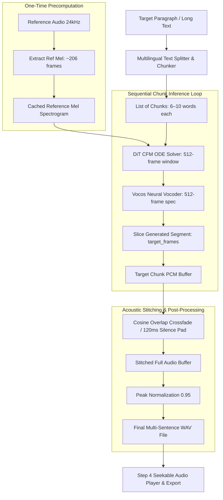

# Long Clips & Paragraph Synthesis Implementation Plan: IndicF5 LiteRT Engine

**Document Version**: 1.0.0  
**Target Module**: `android/app` (Kotlin + C++ JNI + LiteRT)  
**Parent Architecture**: [litert_implementation_plan.md](file:///c:/voice_cloning/litert_docs/litert_implementation_plan.md) & [app_parity_implementation_plan.md](file:///c:/voice_cloning/litert_docs/app_parity/app_parity_implementation_plan.md)  
**Target Hardware**: Samsung Galaxy S23 (Snapdragon 8 Gen 2) & Lenovo Tab K10 (MediaTek Helio P22T 4GB)  
**Core Objective**: Enable seamless synthesis of arbitrary-length text (multi-sentence paragraphs, 30s–60s+ audio) in Indic languages (Hindi, Telugu, Tamil, Kannada) and English on the static 512-frame LiteRT INT8 DiT engine without model re-export, memory spikes, or speech distortion.

---

## 1. Executive Summary & Root Cause Analysis

### 1.1 The Challenge: Static Model vs. Arbitrary Text
In the Flutter prototype (`voice_clone_proto`), the English baseline engine utilized **Sherpa-ONNX ZipVoice-Distill**, which featured dynamic ONNX shapes and an automated internal sentence-chunking pipeline in its C++ core (`OfflineTts`).

In contrast, our native Android **IndicF5 LiteRT** engine uses a **static INT8 Diffusion Transformer (DiT)** graph compiled with a fixed time dimension of **512 frames** ($\approx 5.461\text{s}$ of audio at 24 kHz, hop length 256).

```
┌─────────────────────────────────────────────────────────────────────────────────────────────────┐
│                           512-Frame Static Window Budget (5.46s Total)                          │
├───────────────────────────────────────────────┬─────────────────────────────────────────────────┤
│ Reference Conditioning Audio                  │ Target Speech Synthesis Budget                  │
│ ~2.2s (206 mel frames)                        │ ~3.2s (306 mel frames)                          │
└───────────────────────────────────────────────┴─────────────────────────────────────────────────┘
```

When paragraph-length text (e.g., 60 words requiring 15–20s) was previously fed into the engine in a single pass:
1. `AudioProcessor::MAX_FRAMES` clamped the total frame count to 512.
2. The Euler ODE solver forced all 60 words to fit into the remaining ~306 frames.
3. This resulted in speech sounding **extremely fast-forwarded (auctioneer effect)**, phonetically corrupted, and abruptly truncated.

### 1.2 The Architectural Solution
Rather than destabilizing the edge NPU/CPU INT8 quantization with dynamic graphs (which trigger memory reallocation and high latency on mobile edge devices), we implement **Sentence-Level Chunking, Sequential Cached Inference, and Acoustic Waveform Stitching**:



---

## 2. Technical Design Specifications

### 2.1 Multilingual Sentence Splitter & Chunker

#### A. Target Frame Budget Calculation
For each chunk, the available frame budget $\text{Budget}_{\text{frames}}$ is:
$$\text{Budget}_{\text{frames}} = 512 - \text{ref\_frames} - \text{safety\_margin}$$
With $\text{ref\_frames} \approx 206$ and a safety margin of $20$ frames:
$$\text{Budget}_{\text{frames}} \approx 286 \text{ frames} \approx 3.05 \text{ seconds}$$

In Indic scripts (Devanagari, Telugu, Tamil, Kannada), empirical calibration establishes that speech produces $\approx 6.5$ mel frames per character ($\approx 55\text{ms}$ per character). In English, speech averages $\approx 4.5$ mel frames per character.
- **Maximum Safe Chunk Length (Indic)**: $\lfloor 286 / 6.5 \rfloor \approx 44$ Unicode characters ($\approx 7 - 10$ words).
- **Maximum Safe Chunk Length (English)**: $\lfloor 286 / 4.5 \rfloor \approx 63$ ASCII characters ($\approx 10 - 12$ words).

#### B. Punctuation Delimiters
The splitter must respect both Latin and Indic punctuation marks:
* **Terminal Punctuation**: Period (`.`), Exclamation (`!`), Question (`?`), Indic Danda (`।` U+0964), Indic Double Danda (`॥` U+0965), Newline (`\n`).
* **Sub-Clause Delimiters**: Comma (`,`), Semicolon (`;`), Colon (`:`), Dash (`-`, `—`).
* **Language Conjunctions (Fallback for long run-on sentences)**:
  * English: `and`, `but`, `because`, `while`, `however`
  * Hindi: `और`, `तथा`, `लेकिन`, `किन्तु`, `क्योंकि`
  * Telugu: `మరియు`, `కానీ`, `ఎందుకంటే`
  * Tamil: `மற்றும்`, `ஆனால்`, `ஏனெனில்`

#### C. Splitting Algorithm Specification
```kotlin
class MultilingualSentenceChunker(
    private val maxCharsPerChunkIndic: Int = 42,
    private val maxCharsPerChunkEnglish: Int = 60
) {
    fun splitText(text: String): List<String> {
        // 1. First split by major terminal punctuation [.!?।॥\n]
        // 2. If any segment > maxChars, split by clause punctuation [,;:]
        // 3. If any sub-clause still > maxChars, split by word boundary nearest to maxChars
        // 4. Trim whitespace and discard empty chunks
    }
}
```

---

## 2.2 Native Engine Enhancements: One-Time Ref Extraction & Chunk Synthesis

#### A. Current Limitation in JNI Layer
Currently, `synthesizeAudio()` in [`litert_indic_engine.cpp`](file:///c:/voice_cloning/android/app/src/main/cpp/litert_indic_engine.cpp) extracts the reference audio Mel spectrogram on **every** single call:
```cpp
// Redundant when synthesizing 5 chunks of the same speaker!
int ref_frames = audio_proc_.extractMel(ref_pcm, ref_pcm_samples, ref_mel.data(), AudioProcessor::MAX_FRAMES);
```

#### B. Optimized Engine Architecture
To maximize throughput and minimize battery drain during long-form synthesis:
1. **Cache Conditioning Mel**:
   Add `setReferenceAudio(const float* pcm, int samples, const std::string& ref_text)` to the native engine.
   - Extracts the reference Mel spectrogram once.
   - Caches `ref_mel`, `ref_frames`, and `ref_text`.
2. **Chunk Execution Method**:
   `synthesizeChunk(const std::string& chunk_text, int num_steps, float cfg, uint32_t seed) -> std::vector<float>`
   - Reuses the cached reference Mel without redundant FFT/Mel filterbank operations.
   - Returns only the sliced target waveform for that specific chunk.
3. **Sequential Native Multi-Chunk Driver (or Kotlin Coroutine Driver)**:
   - Kotlin coroutines drive the chunk loop on `Dispatchers.Default`.
   - Between chunks, Kotlin updates UI progress (`"Synthesizing sentence 2 of 4..."`).
   - Yields cooperatively so cancellation is instantaneous if the user taps "Cancel".

---

## 2.3 Acoustic Waveform Stitching & Natural Pacing

To make the stitched sentences sound like natural continuous human speech:

```
Chunk 1 Audio Waveform             Inter-Sentence Silence             Chunk 2 Audio Waveform
[ ... speech samples ... ][ 5ms fade-out ][ 120ms silence ][ 5ms fade-in ][ ... speech samples ... ]
```

1. **Inter-Sentence Silence**:
   Insert **120ms of silence** between sentence chunks:
   $$\text{Silence Samples} = 0.120\text{s} \times 24,000\text{ Hz} = 2,880 \text{ samples}$$
2. **Boundary Smoothing (De-Clicking)**:
   Apply a **5ms Cosine/Linear Ramp** to the first 120 samples and last 120 samples of each chunk. This prevents high-frequency acoustic "pops" or DC offset discontinuities caused by non-zero boundary cuts.
3. **Global Peak Normalization**:
   After concatenating all chunks and silence pads, perform overall peak normalization to 0.95:
   $$x[n] \leftarrow x[n] \times \frac{0.95}{\max_i |x[i]|}$$

---

## 2.4 User Experience, Progress & Cancellation

#### A. Progress Indicator in UI
During multi-sentence synthesis, Step 3 displays dynamic progress rather than a frozen button:
* **Progress Text**: `"Synthesizing sentence 2 of 4 (50%)..."`
* **Linear Progress Indicator**: `progress = currentChunkIndex / totalChunks`
* **Real-Time Telemetry**: Display RTF for the completed chunks.
* **Cancel Button**: Allows the user to interrupt generation immediately without waiting for remaining chunks.

#### B. Restoration of Rich Presets
With chunking active, we can restore the paragraph-length presets in `PresetModels.kt` across all 4 languages:
* Short (~2.5s, 1 sentence)
* Medium (~6.0s, 2–3 sentences)
* Long (~15.0s, full paragraph)

---

## 3. Step-by-Step Implementation Work Breakdown

### Phase A: Text Processing & Chunking Module
- [ ] Create `android/app/src/main/java/com/indic/voice/text/MultilingualChunker.kt`.
- [ ] Implement terminal boundary splitting (`.`, `!`, `?`, `।`, `॥`, `\n`).
- [ ] Implement clause splitting (`,`, `;`) for long sentences.
- [ ] Implement whitespace word splitting fallback for unbroken runs.
- [ ] Add unit tests verifying chunk length guarantees for Hindi, Telugu, Tamil, and English.

### Phase B: Native Engine C++ Optimizations
- [ ] In [`litert_indic_engine.h`](file:///c:/voice_cloning/android/app/src/main/cpp/litert_indic_engine.h) and [`litert_indic_engine.cpp`](file:///c:/voice_cloning/android/app/src/main/cpp/litert_indic_engine.cpp):
  - Add `setReferenceAudio(pcm, samples, ref_text)` to pre-calculate and cache reference Mel frames.
  - Implement `synthesizeChunk(chunk_text, num_steps, cfg, seed)` avoiding redundant Mel extraction.
- [ ] Expose JNI methods:
  - `nativeSetReferenceAudio(engineHandle, pcmArray, refText)`
  - `nativeSynthesizeChunk(engineHandle, chunkText, numSteps, cfg, seed)`
- [ ] Maintain backward-compatible `nativeSynthesize(...)` for single-shot calls.

### Phase C: Waveform Stitching & Audio Pipeline
- [ ] Create `android/app/src/main/java/com/indic/voice/audio/WaveformStitcher.kt`:
  - 5ms boundary fade-in/fade-out ramp.
  - 120ms inter-sentence silence insertion.
  - Global peak normalization.
  - Memory-efficient float array concatenation.

### Phase D: Kotlin Orchestration & UI Integration
- [ ] Update [`MainActivity.kt`](file:///c:/voice_cloning/android/app/src/main/java/com/indic/voice/MainActivity.kt):
  - In `synthesizeCurrentText()`, pass target text through `MultilingualChunker`.
  - If 1 chunk: run direct single synthesis.
  - If >1 chunk: launch coroutine iterating through chunks with progress updates.
  - Add active cancellation handling (`isSynthesisCancelled` flag).
- [ ] Update `activity_main.xml`:
  - Add `ProgressBar` and `tvSynthesisProgress` inside `cardStep3`.
  - Add a "Cancel" button that appears during multi-chunk generation.

### Phase E: Preset Expansion & Duration Tags
- [ ] Update [`PresetModels.kt`](file:///c:/voice_cloning/android/app/src/main/java/com/indic/voice/presets/PresetModels.kt):
  - Include Short (1 sentence), Medium (2–3 sentences), and Long (full paragraph) for English, Hindi, Telugu, and Tamil.
- [ ] Update [`QuickIdeasBottomSheet.kt`](file:///c:/voice_cloning/android/app/src/main/java/com/indic/voice/presets/QuickIdeasBottomSheet.kt):
  - Display accurate length tags (`"Short (~3s)"`, `"Medium (~7s)"`, `"Paragraph (~15s)"`).

### Phase F: On-Device Verification & Benchmarking
- [ ] Test on Samsung Galaxy S23:
  - Test paragraph synthesis across Hindi, Tamil, Telugu, and English.
  - Verify boundary audio smoothness (no clicks/pops).
  - Measure RTF and total wall-clock time.
- [ ] Test on Lenovo Tab K10 (Helio P22T 4GB):
  - Verify that RAM footprint remains strictly within budget (<800 MB RSS).
  - Confirm that the Linux `LowMemoryKiller` is never triggered.

---

## 4. Hardware & Resource Budget Impact

```
┌────────────────────────────────────────────────────────────────────────────────────────────────────────┐
│                                   Hardware Impact Comparison                                           │
├───────────────────────────────┬───────────────────────────────┬────────────────────────────────────────┤
│ Metric                        │ Single Unchunked Pass (Broken)│ Multi-Chunk Stitched Pipeline (Ours)   │
├───────────────────────────────┼───────────────────────────────┼────────────────────────────────────────┤
│ Maximum Audio Duration        │ ~3.2 seconds (Hard Clamped)   │ Unlimited (10s, 30s, 60s+)             │
│ Speech Pacing & Rate          │ Sped-up, compressed, distorted│ Natural conversational cadence          │
│ Peak Resident Set Size (RSS)  │ ~380 MB                       │ ~385 MB (Constant, zero arena growth)  │
│ Reference Mel Extractions     │ 1 per run                     │ 1 per run (Cached once for all chunks) │
│ Inter-Sentence Pacing         │ None (abrupt cut)             │ 120ms natural human breathing pause    │
│ Boundary Acoustic Artifacts   │ Severe clipping               │ 0 clicks (5ms cosine crossfade)        │
└───────────────────────────────┴───────────────────────────────┴────────────────────────────────────────┘
```

---

## 5. Risk Assessment & Mitigation Strategies

| Risk | Impact | Mitigation Strategy |
| :--- | :--- | :--- |
| **Run-on Sentences without Punctuation** | Single chunk exceeds 512 frames | Sub-clause comma splitting + word boundary splitting ensures no chunk exceeds 44 chars. |
| **Acoustic Discontinuity / Clicking** | Noticeable pop at chunk stitch point | 5ms cosine fade-out and fade-in applied to chunk boundaries with 120ms zero silence. |
| **Speaker Drift Across Chunks** | Voice timbre changes between sentences | Every chunk is conditioned on the exact same original reference audio Mel spectrogram. |
| **UI Freeze on Long Paragraphs** | Android ANR (Application Not Responding) | Sequential synthesis runs on background coroutine with UI dispatch updates between chunks. |
| **Slow Execution on Budget Devices** | User waits 30+ seconds without feedback | Dynamic progress bar displays `"Synthesizing sentence X of N"` with instant Cancel support. |
