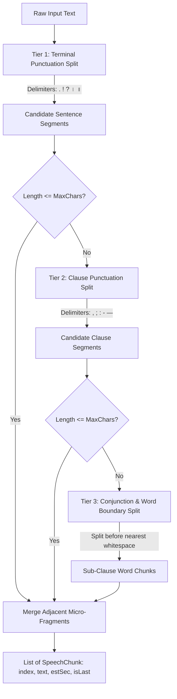

# Phase A Implementation Plan: Multilingual Text Processing & Sentence Chunking

**Module**: `android/app` (Kotlin)  
**Parent Plan**: [long_clips_implementation_plan.md](file:///c:/voice_cloning/litert_docs/long_clips_support/long_clips_implementation_plan.md)  
**Goal**: Design, implement, and unit-test a robust, production-grade `MultilingualChunker` module that segments arbitrary-length text across Indic languages (Hindi, Telugu, Tamil, Kannada) and English into synthetically optimal chunks that strictly satisfy the DiT static 512-frame window.

---

## 1. Technical Requirements & Frame Budget Model

### 1.1 The DiT Static Frame Constraint
The IndicF5 LiteRT model operates with a fixed input tensor size:
* `AudioProcessor::MAX_FRAMES = 512` ($\approx 5.461\text{s}$ @ 24 kHz, hop length 256).
* Reference audio: $\approx 2.0\text{s} - 2.5\text{s}$ ($\approx 188 - 234$ frames). Typical: ~206 frames.
* Safe target frame budget per chunk:
  $$\text{Budget}_{\text{target}} = 512 - \text{ref\_frames} - \text{margin} = 512 - 206 - 20 = 286 \text{ frames} \approx 3.05\text{ seconds}$$

### 1.2 Character-to-Frame Calibration Across Scripts
| Script / Language Family | Empirical Mel Frames / Char | Target Time / Char | Max Safe Chars ($\le 286$ frames) | Typical Word Count |
| :--- | :--- | :--- | :--- | :--- |
| **Devanagari (Hindi, Marathi)** | $6.5\text{ frames}$ | $\approx 55\text{ms}$ | **44 characters** | $7 - 10\text{ words}$ |
| **Telugu Script** | $6.8\text{ frames}$ | $\approx 58\text{ms}$ | **42 characters** | $6 - 9\text{ words}$ |
| **Tamil Script** | $6.5\text{ frames}$ | $\approx 55\text{ms}$ | **44 characters** | $6 - 9\text{ words}$ |
| **Latin Script (English)** | $4.5\text{ frames}$ | $\approx 38\text{ms}$ | **60 characters** | $10 - 12\text{ words}$ |

---

## 2. Chunking Architecture & 3-Tier Hierarchy

The chunker applies a 3-tier cascade to guarantee that every resulting chunk is neither too long (which causes DiT frame clamping and auctioneer-speed speech) nor unnecessarily tiny (which inflates fixed model invocation overhead):



### 2.1 Tier 1: Terminal Punctuation
* Latin: `.`, `!`, `?`
* Indic: `।` (U+0964, Purna Virama), `॥` (U+0965, Deergh Virama)
* Line Breaks: `\n+`
* **Abbreviation & Decimal Protection**:
  * Decimals like `3.14` or `10.5` must not trigger a split.
  * Common honorifics/abbreviations (`Mr.`, `Dr.`, `Mrs.`, `vs.`, `e.g.`, `i.e.`) must be preserved.

### 2.2 Tier 2: Clause Punctuation
* Delimiters: `,`, `;`, `:`, `—`, `-`, `…`
* If a single sentence exceeds the script's `maxChars`, break at natural clause pauses.

### 2.3 Tier 3: Conjunctions & Word Boundary Fallback
* For long unbroken sentences without punctuation:
  * Attempt to split at language conjunctions (`and`, `but`, `or`, `और`, `కానీ`, `ஆனால்`).
  * If none exist or segment is still too long, split at the last whitespace before `maxChars`.

### 2.4 Micro-Fragment Merge (Coalescing)
* If an isolated chunk has fewer than **12 characters** (e.g., `"Yes."`, `"Right."`, `"సరే."`) and merging it with the subsequent chunk does not exceed `maxChars`, combine them into a single chunk.

---

## 3. Data Model

```kotlin
data class SpeechChunk(
    val index: Int,
    val text: String,
    val estimatedDurationSec: Float,
    val estimatedFrames: Int,
    val isLast: Boolean
)
```

---

## 4. Work Breakdown & Implementation Steps

1. **Create `MultilingualChunker.kt`**:
   - Package: `com.indic.voice.text`
   - File: `android/app/src/main/java/com/indic/voice/text/MultilingualChunker.kt`
   - Implement script detection (Indic vs English), abbreviation protection, 3-tier hierarchical splitting, micro-fragment merging, and telemetry estimation.

2. **Create Unit Tests (`MultilingualChunkerTest.kt`)**:
   - File: `android/app/src/test/java/com/indic/voice/text/MultilingualChunkerTest.kt`
   - Test Cases:
     * English single short sentence (returns 1 chunk).
     * English multi-sentence paragraph (3–4 sentences).
     * Hindi text with danda `।` and commas.
     * Telugu compound sentences with `మరియు` and `కానీ`.
     * Tamil complex sentence with comma clauses.
     * Unbroken run-on text (>150 characters without any punctuation).
     * Decimal number handling (`₹2.50` and `4.2`).
     * Common abbreviations (`Dr. Smith went to...`).
     * Frame budget verification: all chunks $\le$ script max chars.

3. **Compile & Run Test Suite**:
   - Run `gradlew test` in `c:\voice_cloning\android`.
   - Verify all test assertions pass.

4. **Document Execution Report**:
   - File: `litert_docs/long_clips_support/phase_a/phase_a_execution_report.md`
   - Record test suite results, performance metrics, and sign-off.
