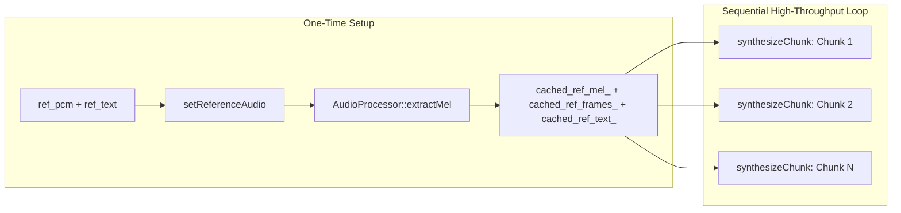

# Phase B Implementation Plan: Native Engine C++ Optimizations & Reference Caching

**Module**: `android/app` (C++ NDK + JNI + Kotlin)  
**Parent Plan**: [long_clips_implementation_plan.md](file:///c:/voice_cloning/litert_docs/long_clips_support/long_clips_implementation_plan.md)  
**Goal**: Optimize the native C++ LiteRT Indic engine (`LiteRTIndicEngine`) by decoupling speaker reference Mel feature extraction from target synthesis. Pre-calculate and cache reference Mel frames once, and expose a high-throughput `synthesizeChunk` API across C++, JNI, and Kotlin to support sequential multi-chunk paragraph synthesis without redundant computations.

---

## 1. Technical Rationale & Computational Waste Elimination

### 1.1 The Current Single-Shot Redundancy
Currently, [`litert_indic_engine.cpp:201-202`](file:///c:/voice_cloning/android/app/src/main/cpp/litert_indic_engine.cpp#L201-L202) executes the following on **every single call**:
```cpp
// Executed repeatedly for chunk 1, chunk 2, chunk 3, chunk 4...
std::vector<float> ref_mel(AudioProcessor::MAX_FRAMES * AudioProcessor::N_MELS, 0.0f);
int ref_frames = audio_proc_.extractMel(ref_pcm, ref_pcm_samples, ref_mel.data(), AudioProcessor::MAX_FRAMES);
```
* **Performance Penalty**:
  * Reference audio (2.5s @ 24 kHz = 60,000 PCM samples) requires full STFT computation ($N=1024, \text{hop}=256$), Hann windowing, and 100-band Mel triangular filterbank matrix multiplication on each invocation.
  * For a 5-sentence paragraph, Mel extraction runs **5 times on the identical speaker audio**.
* **Memory & JNI Penalty**:
  * Copying the 60,000-element `refPcm` `FloatArray` from Java heap to C++ native heap across JNI happens 5 times.

### 1.2 The Decoupled Caching Architecture
By caching the conditioning state, we achieve:
1. **$1\times$ Mel Extraction**: Computed once when the user selects or records reference audio.
2. **Zero JNI Array Copying during Synthesis**: `synthesizeChunk` only passes a lightweight UTF-8 string `chunkText`.
3. **Deterministic Timbre Guarantee**: All chunks share the identical reference Mel matrix and frame baseline.



---

## 2. API Specifications

### 2.1 C++ Engine Interface (`litert_indic_engine.h`)
```cpp
// Pre-calculate and cache speaker reference Mel spectrogram
bool setReferenceAudio(
    const float* ref_pcm, size_t ref_pcm_samples,
    const std::string& ref_text
);

// Synthesize an individual speech chunk against cached reference
std::vector<float> synthesizeChunk(
    const std::string& chunk_text,
    int num_steps = 16,
    float cfg_strength = 2.0f,
    uint32_t seed = 42,
    EngineTelemetry* out_telemetry = nullptr
);

// Backward-compatible single-shot synthesis
std::vector<float> synthesize(
    const float* ref_pcm, size_t ref_pcm_samples,
    const std::string& ref_text,
    const std::string& target_text,
    int num_steps = 16,
    float cfg_strength = 2.0f,
    uint32_t seed = 42,
    EngineTelemetry* out_telemetry = nullptr
);
```

### 2.2 JNI Bridge Interface (`jni_bridge.cpp`)
```cpp
JNIEXPORT jboolean JNICALL
Java_com_indic_voice_LiteRTIndicEngine_nativeSetReferenceAudio(
    JNIEnv* env, jobject thiz, jlong engine_ptr,
    jfloatArray ref_pcm_array, jstring ref_text_str
);

JNIEXPORT jfloatArray JNICALL
Java_com_indic_voice_LiteRTIndicEngine_nativeSynthesizeChunk(
    JNIEnv* env, jobject thiz, jlong engine_ptr,
    jstring chunk_text_str, jint num_steps, jfloat cfg_strength,
    jint seed, jfloatArray out_telemetry_array
);
```

### 2.3 Kotlin Engine Wrapper (`LiteRTIndicEngine.kt`)
```kotlin
suspend fun setReferenceAudio(
    refPcm: FloatArray,
    refText: String
): Boolean

suspend fun synthesizeChunk(
    chunkText: String,
    numSteps: Int = 16,
    cfgStrength: Float = 2.0f,
    seed: Int = 42
): SynthesisResult
```

---

## 3. Work Breakdown & Implementation Steps

1. **Header Updates (`litert_indic_engine.h`)**:
   - Declare member variables: `cached_ref_mel_`, `cached_ref_frames_`, `cached_ref_text_`, `has_cached_ref_`.
   - Declare `setReferenceAudio(...)` and `synthesizeChunk(...)`.

2. **C++ Implementation (`litert_indic_engine.cpp`)**:
   - Implement `setReferenceAudio`: compute Mel once, store in `cached_ref_mel_`.
   - Implement `synthesizeChunk`: reuse cached conditioning, run DiT Euler ODE, Vocos vocoder, iSTFT, target slice, peak normalization.
   - Refactor `synthesize(...)` to call `setReferenceAudio(...)` then `synthesizeChunk(...)`.

3. **JNI Bridge Updates (`jni_bridge.cpp`)**:
   - Add `nativeSetReferenceAudio` with proper UTF string and JNI float array handling.
   - Add `nativeSynthesizeChunk` with telemetry population.

4. **Kotlin Wrapper Updates (`LiteRTIndicEngine.kt`)**:
   - Expose `setReferenceAudio` and `synthesizeChunk` via `Dispatchers.Default`.
   - Maintain backward-compatible `synthesize`.

5. **Compilation & Build Verification**:
   - Run `gradlew test` (unit tests).
   - Run `gradlew assembleDebug` (C++ CMake compilation for `arm64-v8a` and `armeabi-v7a`).

6. **Execution Report**:
   - Record deliverables and compilation verification in `phase_b_execution_report.md`.
