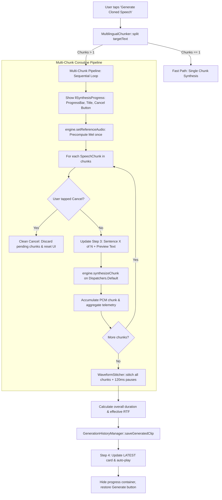

# Phase D Implementation Plan: Kotlin Coroutine Orchestration & UI Dynamic Progress

**Module**: `android/app` (Kotlin + Android XML Layout)  
**Parent Plan**: [long_clips_implementation_plan.md](file:///c:/voice_cloning/litert_docs/long_clips_support/long_clips_implementation_plan.md)  
**Goal**: Integrate the `MultilingualChunker`, optimized native engine (`setReferenceAudio` / `synthesizeChunk`), and `WaveformStitcher` into `MainActivity.kt` and `activity_main.xml`. Provide real-time UI progress tracking, active user cancellation support, seamless single/multi-chunk execution, and master telemetry aggregation.

---

## 1. Technical Architecture & State Flow



---

## 2. Layout Specifications (`activity_main.xml`)

Inside `cardStep3` (below the `btnSynthesize` button), replace the single indeterminate spinner with a dedicated **Dynamic Progress Box** (`llSynthesisProgress`):
* **Status Title (`tvChunkProgressTitle`)**: `"Synthesizing sentence 2 of 4 (50%)..."`
* **Cancel Button (`btnCancelSynthesis`)**: Text button in `#FF5252` recording red that cancels the active coroutine.
* **Determinate Progress Bar (`chunkProgressBar`)**: `LinearProgressIndicator` showing fractional completion.
* **Chunk Preview Text (`tvChunkSubText`)**: Single-line ellipsize text showing the current chunk being synthesized.

---

## 3. Implementation Details (`MainActivity.kt`)

1. **State Management**:
   ```kotlin
   private var synthesisJob: Job? = null
   private val chunker by lazy { MultilingualChunker() }
   private val stitcher by lazy { WaveformStitcher() }
   ```
2. **Cancellation Listener**:
   ```kotlin
   binding.btnCancelSynthesis.setOnClickListener {
       synthesisJob?.cancel()
       showFeedback("Synthesis cancelled.")
   }
   ```
3. **Sequential Execution & Yielding**:
   - Executes on `lifecycleScope.launch(Dispatchers.Default)`.
   - Between each chunk, updates UI on `Dispatchers.Main` and yields to allow immediate response if cancelled.
   - Computes aggregated telemetry:
     $$\text{Total Time} = \sum t_{\text{chunk}, i}$$
     $$\text{Overall RTF} = \frac{\text{Total Time} / 1000}{\text{Final Waveform Duration (s)}}$$
4. **Playback & History Integration**:
   - Passes the final stitched `FloatArray` directly to `historyManager.saveGeneratedClip(...)`.
   - Populates the Step 4 player and triggers playback.

---

## 4. Work Breakdown & Steps

1. **Update `activity_main.xml`**:
   - Add `llSynthesisProgress`, `tvChunkProgressTitle`, `btnCancelSynthesis`, `chunkProgressBar`, `tvChunkSubText`.
2. **Update `MainActivity.kt`**:
   - Inject `chunker` and `stitcher`.
   - Implement multi-chunk loop with progress updates and cancellation handling in `synthesizeCurrentText()`.
3. **Build & Automated Verification**:
   - Run `gradlew testDebugUnitTest` (verify all unit tests pass).
   - Run `gradlew assembleDebug` (compile full APK).
4. **Execution Report**:
   - Document changes and verification in `phase_d_execution_report.md`.
