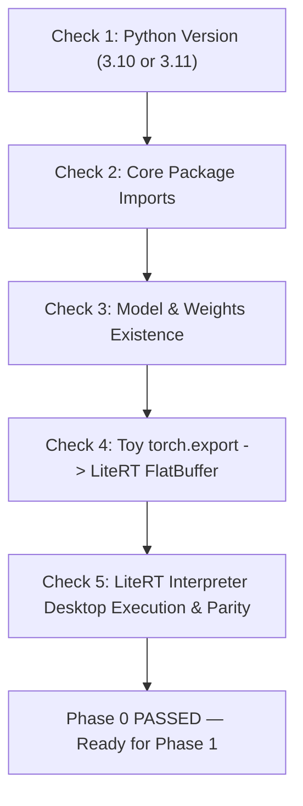

# Phase 0 Implementation Plan: Toolchain & Environment Setup

**Document:** `litert_docs/phase_wise_implementation/phase_0_toolchain_and_environment.md`  
**Parent Plan:** [Master LiteRT Implementation Plan](../litert_implementation_plan.md)  
**Status:** `COMPLETE` / `VERIFIED`  
**Report:** [Phase 0 Verification Report](phase_0_report.md)  
**Target Output:** Verified WSL2 & desktop environment with Google LiteRT compiler (`litert-torch`), `torch.export`, and XNNPACK interpreter passing all 5 automated gate checks.

---

## 1. Objectives & Executive Scope

Before attempting to export the 335M-parameter IndicF5 Diffusion Transformer or the Vocos neural vocoder into LiteRT FlatBuffers, we must establish a verified, isolated compilation and runtime toolchain. 

Phase 0 resolves all environment prerequisites, library conflicts, and graph-tracing validations so subsequent export phases proceed deterministically.

### Core Goals:
1. **Resolve Python 3.14 Binary Wheel Incompatibility:** The host system's default Python version is 3.14. Deep learning C/C++ compilation packages (`litert-converter`, `ai-edge-litert`, `torch-xla`, and StableHLO optimizers) distribute compiled binary wheels for Python 3.10 and 3.11. Phase 0 provisions an isolated Python 3.11/3.10 virtual environment (`litert-env`).
2. **Install Google LiteRT Toolchain:** Pin and install `ai-edge-torch`, `ai-edge-litert`, `ai-edge-quantizer`, and compatible PyTorch 2.x wheels.
3. **Validate PyTorch 2.x Graph Tracing (`torch.export`):** Verify that TorchDynamo and AOTAutograd can trace PyTorch operators without graph breaks on the Windows host.
4. **Deploy Automated Verification Harness:** Provide a one-click validation script (`verify_phase0.py`) ensuring end-to-end functionality before Phase 1 begins.

---

## 2. Technical Challenge & Solution Architecture

```
┌─────────────────────────────────────────────────────────────────────────────────────────────┐
│                           Environment Strategy & Dependency Matrix                          │
├────────────────────────────────┬────────────────────────────┬───────────────────────────────┤
│ Package                        │ Supported Python Versions  │ Target Pinned Version         │
├────────────────────────────────┼────────────────────────────┼───────────────────────────────┤
│ `python`                       │ 3.10, 3.11                 │ 3.11.x (or 3.10.x)            │
│ `torch`                        │ 3.10, 3.11, 3.12           │ 2.4.0 <= torch < 2.13.0       │
│ `ai-edge-torch`                │ 3.10, 3.11                 │ 0.7.2 (or 0.8.x)              │
│ `ai-edge-litert`               │ 3.10, 3.11                 │ 2.3.0                         │
│ `ai-edge-quantizer`            │ 3.10, 3.11                 │ 0.7.x - 0.9.x                 │
│ `safetensors`                  │ All                        │ >= 0.4.0                      │
│ `vocos`                        │ All                        │ >= 0.1.0                      │
│ `flatbuffers`                  │ All                        │ >= 24.3                       │
└────────────────────────────────┴────────────────────────────┴───────────────────────────────┘
```

---

## 3. Step-by-Step Execution Plan

### Step 0.1: Provision Python 3.11 Runtime

#### Detection:
Check whether Python 3.11 or 3.10 is already available on the machine via the Windows Python Launcher:
```powershell
py --list
```

#### Provisioning Paths:
- **Path A (Windows `winget` installation - Recommended):**
  ```powershell
  winget install Python.Python.3.11 --silent --accept-package-agreements --accept-source-agreements
  ```
- **Path B (Manual installer download):**
  Download official Python 3.11.9 64-bit installer from `python.org` and install with PATH integration enabled.
- **Path C (WSL2 Linux alternative, if preferred for cross-compilation):**
  ```bash
  sudo apt update && sudo apt install -y python3.11 python3.11-venv python3.11-dev
  ```

#### Virtual Environment Creation:
From the workspace root (`c:\voice_cloning`):
```powershell
py -3.11 -m venv litert-env
.\litert-env\Scripts\Activate.ps1
python -m pip install --upgrade pip setuptools wheel
```

---

### Step 0.2: Dependency Installation & Conflict Resolution

Install the validated LiteRT stack into `litert-env`:

```powershell
# 1. Install PyTorch with CPU/CUDA wheels compatible with ai-edge-torch
pip install "torch>=2.4.0,<2.13.0" "torchaudio>=2.4.0" --index-url https://download.pytorch.org/whl/cpu

# 2. Install LiteRT and Edge compilation libraries
pip install ai-edge-torch==0.7.2 ai-edge-litert==2.3.0

# 3. Install Audio and Model dependencies
pip install safetensors vocos librosa soundfile einops x-transformers flatbuffers
```

#### Verification Dry-Run:
Ensure no dependency resolution conflicts exist:
```powershell
python -m pip check
```

---

### Step 0.3: Workspace Path Linking & Resource Verification

Ensure the new virtual environment has visibility into the IndicF5 architecture definitions and model weights:
1. **Link Scratch Repo:** The directory `scratch/indicf5_repo` must be importable (`f5_tts` module).
2. **Validate Model Weights:** Verify existence and readability of:
   - `models/indicf5/model.safetensors` (1.35 GB)
   - `models/indicf5/vocab.txt` (11.2 KB)
   - `vocos_24khz.onnx` (54.1 MB)
   - Audio reference files in `samples/` and evaluation texts in `prompts.json`.

---

### Step 0.4: PyTorch 2.x `torch.export` & StableHLO Sanity Check

Create a proof-of-concept verification script (`scripts/test_torch_export_sanity.py`) to confirm that `torch.export` operates without graph breaks:

```python
import torch
import ai_edge_torch

class SanityAttentionBlock(torch.nn.Module):
    def __init__(self, dim=128, heads=4):
        super().__init__()
        self.qkv = torch.nn.Linear(dim, dim * 3)
        self.proj = torch.nn.Linear(dim, dim)
        self.norm = torch.nn.LayerNorm(dim)
        self.heads = heads
        self.dim = dim

    def forward(self, x):
        norm_x = self.norm(x)
        b, s, d = norm_x.shape
        qkv = self.qkv(norm_x).reshape(b, s, 3, self.heads, d // self.heads)
        q, k, v = qkv.unbind(dim=2)
        attn = torch.nn.functional.scaled_dot_product_attention(
            q.transpose(1, 2), k.transpose(1, 2), v.transpose(1, 2)
        )
        out = attn.transpose(1, 2).reshape(b, s, d)
        return x + self.proj(out)

# 1. Tracing
model = SanityAttentionBlock().eval()
dummy_input = (torch.randn(1, 64, 128),)
exported_prog = torch.export.export(model, dummy_input)

# 2. Direct LiteRT Compilation
edge_model = ai_edge_torch.convert(model, dummy_input)
edge_model.export("sanity_block.tflite")
print("Sanity export to sanity_block.tflite succeeded!")
```

---

### Step 0.5: Automated Verification Suite (`verify_phase0.py`)

A comprehensive verification script will be created at `scripts/verify_phase0.py` that executes 5 automated checks:



#### Detailed Checks:
1. **Check 1 (Runtime Version):** Confirms Python is version 3.10.x or 3.11.x, 64-bit AMD64.
2. **Check 2 (Package Verification):** Imports `torch`, `ai_edge_torch`, `ai_edge_litert`, `safetensors`, `vocos`, `librosa`, and verifies version constraints.
3. **Check 3 (Workspace Assets):** Validates paths to `models/indicf5/model.safetensors`, `vocab.txt`, and `prompts.json`.
4. **Check 4 (End-to-End Tracing):** Exports a composite multi-head attention + ConvNeXt module into a `.tflite` FlatBuffer.
5. **Check 5 (LiteRT Execution):** Loads the generated `.tflite` with `ai_edge_litert.interpreter.Interpreter`, runs forward inference, and validates output against PyTorch FP32 ($L_\infty < 10^{-4}$).

---

## 4. Phase 0 Acceptance Criteria (Gate Check)

Before transitioning to **Phase 1: Model Export & Graph Decomposition**, all of the following conditions must be satisfied:

- [ ] `litert-env` virtual environment created and activatable.
- [ ] `python -m pip check` reports 0 broken dependencies.
- [ ] `ai-edge-torch` and `ai-edge-litert` packages successfully imported without dynamic link library (DLL) load errors.
- [ ] `models/indicf5/model.safetensors` confirmed readable and uncorrupted.
- [ ] `python scripts/verify_phase0.py` exits with status code `0` and all 5 checks marked `[PASSED]`.
- [ ] Results and environment specifications logged in `litert_docs/phase_wise_implementation/phase_0_report.md`.
