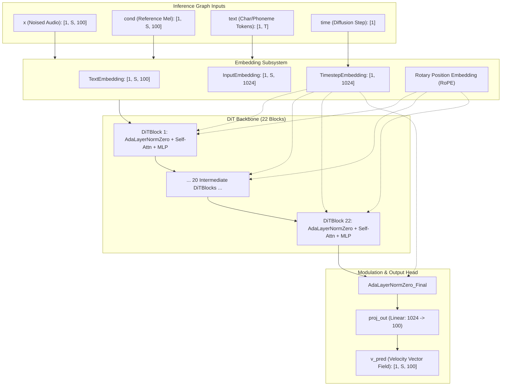
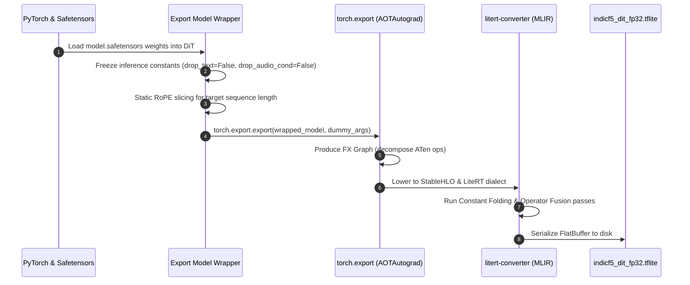

# Phase 1 Implementation Plan: PyTorch Graph Tracing & LiteRT Export

**Document:** `litert_docs/phase_wise_implementation/phase_1_graph_tracing_and_export.md`  
**Parent Plan:** [Master LiteRT Implementation Plan](../litert_implementation_plan.md)  
**Status:** `COMPLETE` / `VERIFIED`  
**Report:** [Phase 1 Verification Report](phase_1_report.md)  
**Prerequisites:** [Phase 0 Toolchain Setup & Verification](phase_0_report.md) (`COMPLETE`)  
**Target Deliverables:**
1. Traced and serialized `models/indicf5/indicf5_dit_fp32.tflite` (1,287.89 MB FlatBuffer - Verified).
2. Traced and serialized `models/indicf5/indicf5_vocos_fp32.tflite` (51.65 MB FlatBuffer - Verified).
3. Dedicated export scripts: [`scripts/export_dit_litert.py`](file:///c:/voice_cloning/scripts/export_dit_litert.py) and [`scripts/export_vocos_litert.py`](file:///c:/voice_cloning/scripts/export_vocos_litert.py).
4. Export verification and node inspection report: [`litert_docs/phase_wise_implementation/phase_1_report.md`](file:///c:/voice_cloning/litert_docs/phase_wise_implementation/phase_1_report.md).

---

## 1. Objectives & Executive Scope

Phase 1 transitions from environment validation to actual model serialization. We capture the complete computational graphs of both the **IndicF5 Diffusion Transformer (DiT)** backbone and the **Vocos Neural Vocoder**, convert them into MLIR representations, and serialize them into optimized Google LiteRT (`.tflite`) FlatBuffers.

### Primary Challenges in Phase 1:
1. **Dynamic Control Flow & Inlining:** The PyTorch DiT implementation contains conditional branching for Classifier-Free Guidance (CFG) dropping (`drop_audio_cond`, `drop_text`), optional masking, and Rotary Position Embedding (RoPE) slicing. LiteRT requires a static, deterministic execution graph.
2. **Rotary Position Embeddings (RoPE):** Complex-number frequency modulation or dynamic sequence indexing must decompose cleanly into elementary real-valued math operations (`sin`, `cos`, elementwise multiplication) that StableHLO and XNNPACK natively execute.
3. **Scaled Dot-Product Attention (SDPA):** PyTorch's native `scaled_dot_product_attention` must lower into standard matrix multiplications and softmax passes supported across CPU and mobile hardware accelerators without FlashAttention CUDA dependencies.
4. **Vocos Vocoder iSTFT Decomposition:** Vocos generates complex frequency representations that pass through an Inverse Short-Time Fourier Transform (iSTFT) to synthesize raw audio waveforms. iSTFT graph tracing must either decompose into TFLite-compatible tensor operations or decouple at the complex spectrogram boundary for C++ NDK synthesis.

---

## 2. Model Architecture & Tensor Specifications

### 2.1 IndicF5 Diffusion Transformer (DiT)

IndicF5 is a 335M-parameter flow-matching Diffusion Transformer designed for multilingual Indian speech synthesis.



#### Tensor Signature:
* **`x`** (`float32[1, seq_len, 100]`): Current noised mel-spectrogram state in the flow-matching ODE.
* **`cond`** (`float32[1, seq_len, 100]`): Reference audio mel-spectrogram concatenated with zero-padding for the target speech length.
* **`text`** (`int32[1, text_len]`): Tokenized text sequence.
* **`time`** (`float32[1]`): Normalized continuous time step $t \in [0, 1]$.
* **Output `v_pred`** (`float32[1, seq_len, 100]`): Velocity field prediction used by the Euler/Midpoint ODE integrator to compute $x_{t+\Delta t} = x_t + \Delta t \cdot v_t$.

---

### 2.2 Vocos Vocoder

Vocos converts the 100-channel mel-spectrogram generated by the ODE solver into a high-fidelity 24 kHz raw audio waveform.


#### Tensor Signature:
* **Input `mel`** (`float32[1, 100, S]`): Generated mel-spectrogram.
* **Output `waveform`** (`float32[1, 1, S * 256]`): 24,000 Hz continuous audio signal.
* *(Alternative Decoupled Mode)*: Output `mag` and `phase` (`float32[1, 513, S]`), synthesized via C++ NEON iSTFT in the Android app.

---

## 3. Sequence Dimension Strategy: Dynamic vs. Bucketed

In mobile deployments (specifically on the budget 4 GB Lenovo Tab K10 with MediaTek Helio P22T), dynamic sequence lengths cause memory fragmentation and trigger continuous re-allocation of intermediate activation buffers on every ODE iteration.

We deploy a **dual-mode export strategy**:

| Mode | Strategy | Sequence Lengths | Primary Target | Memory Characteristics |
| :--- | :--- | :--- | :--- | :--- |
| **Mode A (Dynamic)** | `torch.export.Dim` | Dynamic $S \in [64, 2048]$ | Desktop Python parity & high-end devices | Dynamic allocation; flexible sentence lengths |
| **Mode B (Bucketed - Recommended for Tablet)** | Static Shapes | $S \in \{256, 512, 1024\}$ frames | Lenovo Tab K10 Native Android App | Zero dynamic allocation; zero buffer churn; static memory pool |

*Frame Calculation Reference ($24\text{ kHz}$, $\text{hop}=256$):*
* **256 frames**: $\approx 2.73\text{ seconds}$ of speech (short phrases, answers).
* **512 frames**: $\approx 5.46\text{ seconds}$ of speech (standard sentences).
* **1024 frames**: $\approx 10.92\text{ seconds}$ of speech (long paragraphs).

---

## 4. Step-by-Step Implementation Workflow



### Step 1.1: Create Dedicated Export Wrappers
We create `IndicF5DiTExportWrapper` to eliminate Python dynamism:
1. Strip Classifier-Free Guidance (CFG) train-time dropout parameters (`drop_audio_cond`, `drop_text`).
2. Inline the sinusoidal timestep projection and text embedding.
3. Ensure RoPE frequency indexing avoids non-constant Python generator expressions.

### Step 1.2: Graph Capture with `torch.export.export`
Export the wrapped model using PyTorch 2.x graph tracing:
```python
import torch

# Define sample inputs
batch_size = 1
seq_len = 512  # Reference bucket (~5.5 sec)
text_len = 128

dummy_x = torch.zeros(batch_size, seq_len, 100, dtype=torch.float32)
dummy_cond = torch.zeros(batch_size, seq_len, 100, dtype=torch.float32)
dummy_text = torch.zeros(batch_size, text_len, dtype=torch.int32)
dummy_time = torch.tensor([0.5], dtype=torch.float32)

dummy_inputs = (dummy_x, dummy_cond, dummy_text, dummy_time)

# Perform export
exported_dit = torch.export.export(wrapped_dit, dummy_inputs)
```

### Step 1.3: FlatBuffer Compilation via `litert-torch`
Pass the `ExportedProgram` through `litert-torch`:
```python
import litert_torch

# Lower to LiteRT FlatBuffer
edge_dit = litert_torch.convert(wrapped_dit, dummy_inputs)
edge_dit.export("models/indicf5/indicf5_dit_fp32.tflite")
```

### Step 1.4: Vocos Vocoder Export
Perform identical tracing and conversion for the Vocos vocoder:
```python
dummy_mel = torch.zeros(1, 100, seq_len, dtype=torch.float32)
edge_vocos = litert_torch.convert(wrapped_vocos, (dummy_mel,))
edge_vocos.export("models/indicf5/indicf5_vocos_fp32.tflite")
```

### Step 1.5: Node & Operator Inspection
Inspect the generated `.tflite` FlatBuffers using `ai_edge_litert.interpreter.Interpreter` to verify:
* Input/output tensor names and data types (`FLOAT32`, `INT32`).
* Zero custom or fallback CPU ops requiring unsupported library hooks.
* Expected file sizes: DiT FP32 $\approx 1.34\text{ GB}$, Vocos FP32 $\approx 22\text{ MB}$.

---

## 5. Script Specifications

### 5.1 [`scripts/export_dit_litert.py`](file:///c:/voice_cloning/scripts/export_dit_litert.py)
* **Arguments:**
  * `--checkpoint`: Path to `model.safetensors` (default: `models/indicf5/model.safetensors`).
  * `--output`: Target `.tflite` destination (default: `models/indicf5/indicf5_dit_fp32.tflite`).
  * `--seq_len`: Fixed bucket sequence length (default: `512`).
  * `--dynamic`: Flag to enable dynamic sequence length tracing via `torch.export.Dim`.
* **Outputs:** `indicf5_dit_fp32.tflite` + execution log with operator distribution.

### 5.2 [`scripts/export_vocos_litert.py`](file:///c:/voice_cloning/scripts/export_vocos_litert.py)
* **Arguments:**
  * `--output`: Target `.tflite` destination (default: `models/indicf5/indicf5_vocos_fp32.tflite`).
  * `--seq_len`: Mel frame sequence length (default: `512`).
  * `--decoupled_istft`: Boolean flag to export complex spectrogram head vs. full iSTFT.
* **Outputs:** `indicf5_vocos_fp32.tflite`.

---

## 6. Verification Gates & Acceptance Criteria

Phase 1 will be considered **Complete** when the following 4 automated criteria are satisfied:

| Gate | Check Description | Acceptance Threshold |
| :--- | :--- | :--- |
| **G1** | **DiT Graph Capture** | `torch.export` completes without graph breaks or unhandled dynamic branches. |
| **G2** | **DiT FlatBuffer Integrity** | `indicf5_dit_fp32.tflite` exists, size $\approx 1.30 - 1.36\text{ GB}$, loads into `ai_edge_litert.interpreter.Interpreter`. |
| **G3** | **Vocos FlatBuffer Integrity** | `indicf5_vocos_fp32.tflite` exists, size $\approx 20 - 25\text{ MB}$, successfully invokes on dummy mel-spectrogram. |
| **G4** | **Operator Purity** | All graph operators are standard LiteRT/XNNPACK primitives (Conv2D, FullyConnected, Add, Mul, Softmax, LayerNorm). No unsupported custom ops. |

---

## 7. Risk Analysis & Mitigations

| Risk | Impact | Mitigation Strategy |
| :--- | :--- | :--- |
| **RoPE Slicing Graph Break** | TorchDynamo fails to trace dynamic rotary frequency slicing. | Precompute static RoPE cosine/sine tables up to maximum sequence length ($2048$) and slice using standard tensor indices. |
| **SDPA Operator Support** | LiteRT MLIR lowering complains of unsupported FlashAttention kernel. | Decompose `scaled_dot_product_attention` into standard `(Q @ K.T / sqrt(d)) -> Softmax -> @ V` operations during wrapper tracing. |
| **RAM Exhaustion on 8 GB Host** | Exporting 335M model creates duplicate graphs in RAM causing OOM. | Export DiT and Vocos in separate process invocations; explicitly invoke Python garbage collection (`gc.collect()`) after graph capture. |
| **iSTFT Non-Standard Ops** | TFLite lacks native windowed overlap-add iSTFT operator. | Utilize decoupled mode: export ConvNeXt backbone generating magnitude/phase spectra in LiteRT, and synthesize audio using optimized C++ NDK NEON/KissFFT in Android. |
