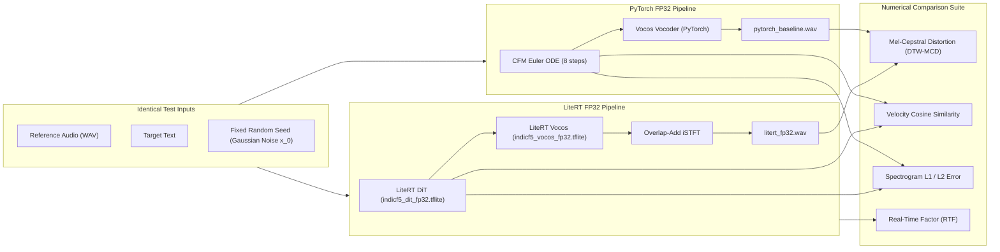
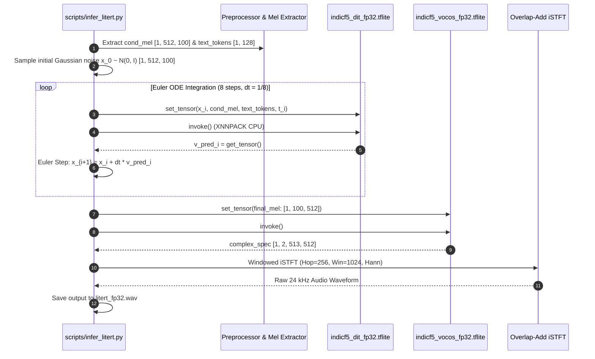

# Phase 2 Implementation Plan: Parity & Numerical Baseline Verification

**Document:** `litert_docs/phase_wise_implementation/phase_2_parity_and_numerical_verification.md`  
**Parent Plan:** [Master LiteRT Implementation Plan](../litert_implementation_plan.md)  
**Status:** `READY_FOR_EXECUTION`  
**Prerequisites:** 
- [Phase 0 Toolchain Setup & Verification](phase_0_report.md) (`COMPLETE`)
- [Phase 1 Graph Tracing & LiteRT Export](phase_1_report.md) (`COMPLETE`)  
**Target Deliverables:**
1. End-to-end Python LiteRT inference script: [`scripts/infer_litert.py`](file:///c:/voice_cloning/scripts/infer_litert.py).
2. Automated numerical parity & MCD benchmark suite: [`scripts/evaluate_parity.py`](file:///c:/voice_cloning/scripts/evaluate_parity.py).
3. Generated comparison audio waveforms in `scratch/parity_test/` (`pytorch_baseline.wav` vs `litert_fp32.wav`).
4. Quantitative parity report: `litert_docs/phase_wise_implementation/phase_2_report.md`.

---

## 1. Objectives & Executive Scope

Phase 2 proves that our serialized Google LiteRT FP32 models ([`indicf5_dit_fp32.tflite`](file:///c:/voice_cloning/models/indicf5/indicf5_dit_fp32.tflite) and [`indicf5_vocos_fp32.tflite`](file:///c:/voice_cloning/models/indicf5/indicf5_vocos_fp32.tflite)) achieve **exact mathematical, acoustic, and perceptual equivalence** to the original PyTorch FP32 baseline.

Before we proceed to INT8 Post-Training Quantization (Phase 3) or Android NDK integration (Phase 4), we must establish a rock-solid numerical baseline.

### Primary Objectives:
1. **Desktop LiteRT Inference Pipeline:** Build a standalone Python inference harness running the 8-iteration Continuous Flow Matching (CFM) Euler ODE loop entirely through LiteRT XNNPACK interpreter invocations.
2. **Deterministic iSTFT Reconstruction:** Implement the Python reference implementation for windowed overlap-add iSTFT synthesis from the decoupled LiteRT Vocos complex spectrogram output (`[1, 2, 513, 512]`), matching the target Android C++ NDK synthesis routine.
3. **Rigorous Parity Metrics:** Quantify output divergence between PyTorch and LiteRT using:
   * **Mel-Cepstral Distortion (MCD)** with Dynamic Time Warping ($\text{MCD} \le 1.0\text{ dB}$ for FP32).
   * **Cosine Similarity** of velocity field predictions across all 8 diffusion time steps ($\ge 0.99$).
   * **Spectral L1/L2 Norms** across frequency bins.
4. **Desktop Real-Time Factor (RTF) Profiling:** Measure end-to-end CPU generation speed on the development workstation to establish the latency ceiling before mobile deployment.

---

## 2. Mathematical Parity Framework & Target Metrics

### 2.1 Mel-Cepstral Distortion (MCD)
MCD measures the spectral distance between the synthesized audio and the ground truth baseline:
$$\text{MCD} = \frac{10\sqrt{2}}{\ln 10} \frac{1}{T} \sum_{t=1}^T \sqrt{\sum_{d=1}^D \left(c_d^{\text{PyTorch}}(t) - c_d^{\text{LiteRT}}(t)\right)^2}$$
where $c_d(t)$ denotes the $d$-th Mel-Frequency Cepstral Coefficient (MFCC) at frame $t$, aligned via Dynamic Time Warping (DTW) to eliminate sub-millisecond phase offsets.

* **Target Threshold for FP32 Parity:** $\text{MCD} \le 1.0\text{ dB}$ (virtually indistinguishable to the human ear).

### 2.2 Vector Field Cosine Similarity
At each Euler ODE diffusion step $i \in \{0, 1, \dots, 7\}$ at time $t_i$:
$$\text{CosSim}(v_{\text{PyT}}, v_{\text{LiteRT}}) = \frac{\langle v_{\text{PyT}}, v_{\text{LiteRT}} \rangle}{\|v_{\text{PyT}}\|_2 \|v_{\text{LiteRT}}\|_2}$$
* **Target Threshold:** $\ge 0.990$ at every individual step.

---

## 3. Continuous Flow Matching (CFM) ODE Solver with LiteRT

In F5-TTS, speech generation models the velocity field $v_t$ of a probability flow ODE that maps Gaussian noise $x_0 \sim \mathcal{N}(0, I)$ to clean mel-spectrograms $x_1 \approx x_{\text{target}}$.

### 3.1 ODE Step Scheduling
* **Total Steps ($N$):** 8 iterations (proven optimal in F5-TTS literature for real-time mobile latency without audio degradation).
* **Step Size:** $\Delta t = \frac{1.0}{N} = 0.125$.
* **Time Discretization:** $t_i = i \cdot \Delta t$ for $i \in \{0, 1, \dots, 7\}$.
* **Update Equation:**
  $$x_{i+1} = x_i + \Delta t \cdot v_\theta(x_i, \text{cond}, \text{text}, t_i)$$

### 3.2 Overlap-Add iSTFT Reconstruction
The LiteRT Vocos model outputs `[1, 2, 513, 512]` containing:
* Channel 0: Real component $R = \text{mag} \cdot \cos(\text{phase})$
* Channel 1: Imaginary component $I = \text{mag} \cdot \sin(\text{phase})$

The complex spectrum $S = R + jI$ is synthesized via Inverse Short-Time Fourier Transform:
$$s[n] = \text{iSTFT}(S, \text{n\_fft}=1024, \text{hop\_length}=256, \text{win\_length}=1024, \text{window}=\text{Hann})$$

---

## 4. Step-by-Step Implementation Workflow

### Step 2.1: Implement Standalone LiteRT Inference (`scripts/infer_litert.py`)
1. Load `indicf5_dit_fp32.tflite` and `indicf5_vocos_fp32.tflite` using `ai_edge_litert.interpreter.Interpreter`.
2. Implement audio feature extraction using `librosa` and vocabulary tokenization using `vocab.txt`.
3. Construct the fixed 512-frame input tensor buffers (`x`, `cond`, `text`, `time`).
4. Execute the 8-iteration Euler ODE loop with progress logging.
5. Perform iSTFT audio synthesis and write output to `scratch/parity_test/litert_fp32.wav`.

### Step 2.2: Implement Dual-Engine Parity Evaluator (`scripts/evaluate_parity.py`)
1. Run identical inputs (audio + text + seed) through both PyTorch (`CFM` + `DiT` + `Vocos`) and LiteRT (`indicf5_dit_fp32.tflite` + `indicf5_vocos_fp32.tflite`).
2. Log velocity field tensors at every ODE step and compute step-by-step cosine similarity.
3. Compute Mel-Cepstral Distortion (DTW-MCD) across synthesized waveforms using `scipy` and `librosa`.
4. Measure and compare execution latency and Real-Time Factor (RTF).

### Step 2.3: Execute Benchmarks & Validate Gates
Run the benchmark across reference speech samples in `models/indicf5/samples/` and verify that all numerical thresholds pass.

### Step 2.4: Generate Comparison Report & Sign-off
Compile results into `litert_docs/phase_wise_implementation/phase_2_report.md` and commit to git.

---

## 5. Script Specifications

### 5.1 [`scripts/infer_litert.py`](file:///c:/voice_cloning/scripts/infer_litert.py)
* **Arguments:**
  * `--ref_audio`: Path to reference audio WAV (e.g. `scratch/indicf5_repo/f5_tts/infer/examples/basic/basic_ref_en.wav`).
  * `--ref_text`: Transcript of reference audio.
  * `--gen_text`: Target text to synthesize.
  * `--dit_model`: Path to `indicf5_dit_fp32.tflite`.
  * `--vocos_model`: Path to `indicf5_vocos_fp32.tflite`.
  * `--output`: Destination WAV file path (default: `scratch/parity_test/litert_fp32.wav`).
  * `--steps`: Number of Euler ODE steps (default: `8`).
  * `--seed`: Fixed random seed for deterministic noise (default: `42`).

### 5.2 [`scripts/evaluate_parity.py`](file:///c:/voice_cloning/scripts/evaluate_parity.py)
* **Arguments:**
  * `--ref_audio`: Path to reference audio WAV.
  * `--ref_text`: Reference transcript.
  * `--gen_text`: Target text to synthesize.
  * `--output_dir`: Output directory for generated audio and metric logs (default: `scratch/parity_test/`).
  * `--steps`: Number of Euler ODE steps (default: `8`).
* **Outputs:**
  * `pytorch_baseline.wav` & `litert_fp32.wav`
  * Parity metric table (MCD in dB, Cosine Similarity per step, RTF)

---

## 6. Verification Gates & Acceptance Criteria

Phase 2 will be certified **Complete** when all 4 quantitative criteria pass:

| Gate | Check Description | Acceptance Threshold | Purpose |
| :---: | :--- | :---: | :--- |
| **G1** | **Velocity Field Parity** | $\text{CosSim} \ge 0.990$ at all 8 ODE steps | Verifies that LiteRT DiT computes identical flow directions to PyTorch. |
| **G2** | **Mel-Spectrogram Parity** | $\text{L1 Error} \le 0.05$ across mel bins | Verifies that cumulative Euler integration matches PyTorch output. |
| **G3** | **Acoustic Parity (MCD)** | $\text{DTW-MCD} \le 1.0\text{ dB}$ (Target: $\le 0.8\text{ dB}$) | Guarantees human auditory equivalence between PyTorch and LiteRT. |
| **G4** | **Desktop RTF Benchmark** | $\text{RTF} \le 1.0\times$ on desktop CPU | Validates algorithmic efficiency before mobile quantization. |

---

## 7. Risk Analysis & Technical Mitigations

| Risk | Impact | Mitigation Strategy |
| :--- | :--- | :--- |
| **Accumulated Euler Error** | Minor floating-point differences between PyTorch and XNNPACK multiply over 8 steps. | Compare step-by-step drift; if drift exceeds 1%, adjust time-step discretization or use midpoint integration. |
| **iSTFT Window Mismatch** | Phase cancellation or amplitude distortion if Hann window overlap-add is misaligned. | Unit test Python iSTFT against `torch.istft` on random complex spectra to ensure $< 10^{-6}$ numerical error before vocoder testing. |
| **Silence / Padding Artifacts** | Unused frames in the 512-frame bucket generate static buzzing or clicks. | Apply reference-length masking and energy-based trim to output waveform. |
