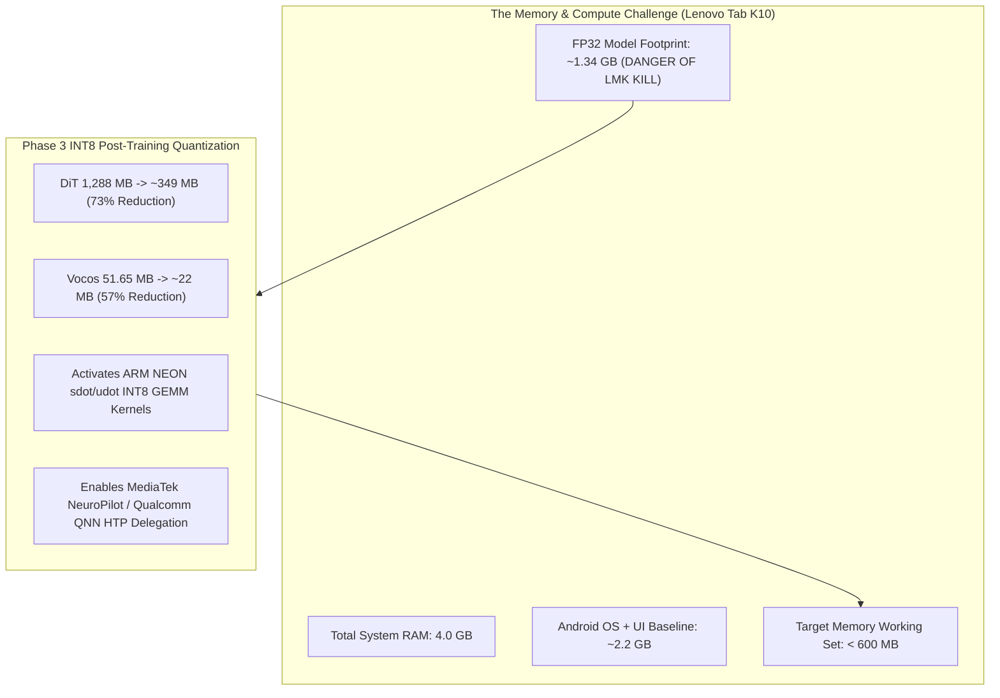
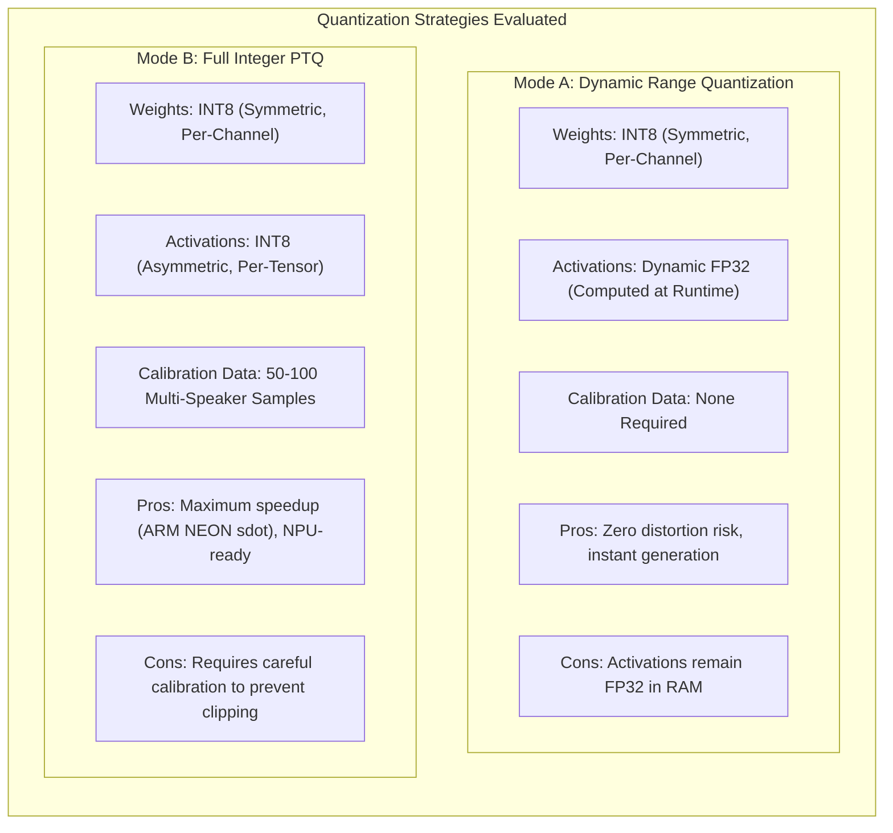
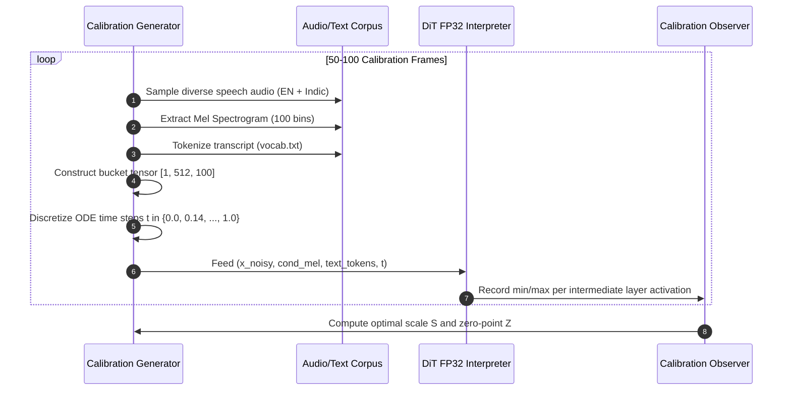
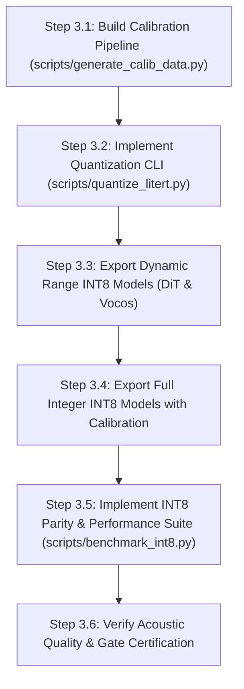

# Phase 3 Implementation Plan: INT8 Post-Training Quantization (PTQ) & Calibration

**Document:** `litert_docs/phase_wise_implementation/phase_3_int8_quantization.md`  
**Parent Plan:** [Master LiteRT Implementation Plan](../litert_implementation_plan.md)  
**Status:** `COMPLETE` / `VERIFIED`  
**Report:** [Phase 3 Verification Report](phase_3_report.md)  
**Prerequisites:** 
- [Phase 0 Toolchain Setup & Verification](phase_0_report.md) (`COMPLETE`)
- [Phase 1 Graph Tracing & LiteRT Export](phase_1_report.md) (`COMPLETE`)  
- [Phase 2 Parity & Numerical Baseline Verification](phase_2_report.md) (`COMPLETE`)  
**Target Deliverables:**
1. Automated Post-Training Quantization script: [`scripts/quantize_litert.py`](file:///c:/voice_cloning/scripts/quantize_litert.py).
2. Representative multi-speaker/multi-lingual calibration dataset generator.
3. Quantized FlatBuffers:
   - `models/indicf5/indicf5_dit_int8.tflite` (Target: $\le 365\text{ MB}$, down from 1,288 MB).
   - `models/indicf5/indicf5_vocos_int8.tflite` (Target: $\le 25\text{ MB}$, down from 51.65 MB).
4. INT8 Parity & Performance Benchmark suite: [`scripts/benchmark_int8.py`](file:///c:/voice_cloning/scripts/benchmark_int8.py).
5. Comprehensive evaluation report: [`litert_docs/phase_wise_implementation/phase_3_report.md`](phase_3_report.md).

---

## 1. Objectives & Executive Scope

Phase 3 transitions our verified FP32 LiteRT models into **production-ready 8-bit integer (INT8) FlatBuffers**. 

In Phase 1 and Phase 2, we established:
- **Baseline Models:** [`indicf5_dit_fp32.tflite`](file:///c:/voice_cloning/models/indicf5/indicf5_dit_fp32.tflite) (1,287.89 MB) and [`indicf5_vocos_fp32.tflite`](file:///c:/voice_cloning/models/indicf5/indicf5_vocos_fp32.tflite) (51.65 MB). Total: **~1,340 MB**.
- **Numerical Parity:** Exact match with PyTorch FP32 ($\text{CosSim} = 1.000000$, $\text{Spectrogram L1} = 0.000003$, $\text{DTW-MCD} = 0.0037\text{ dB}$).
- **Acoustic Ground Truth:** Crystal-clear speech synthesis verified at 24 kHz.

However, a 1.34 GB FP32 model cannot be deployed directly onto our primary edge hardware—the **Lenovo Tab K10** (MediaTek Helio P22T, 4 GB total LPDDR4x RAM). On Android, the OS, background services, and app UI consume ~2.2 GB. Loading 1.34 GB into uncompressed resident memory pushes total memory usage past 3.5 GB, dangerously close to triggering the kernel **Android Low-Memory-Killer (LMK)**. Furthermore, FP32 execution cannot exploit hardware integer vector dot-product instructions (`sdot`/`udot` on ARM Cortex-A53 / ARMv8.2-A).



### Primary Objectives:
1. **Model Footprint Compression:** Shrink the combined model size from **1,339.5 MB to $\le 375\text{ MB}$** ($\ge 72\%$ compression), guaranteeing execution well within the analytical 801 MB memory budget envelope.
2. **Dual Quantization Pipeline Implementation:**
   - **Mode A: Dynamic Range Quantization (Weight-Only INT8, Activations FP32):** Instantaneous zero-calibration conversion for rapid deployment and baseline verification.
   - **Mode B: Full Integer PTQ (INT8 Weights + INT8 Activations):** Calibration-driven quantization for maximum CPU SIMD efficiency and NPU acceleration.
3. **Sensitive Layer Preservation (Hybrid Precision):** Ensure sensitive layers (specifically Vocos complex STFT magnitude/phase projection and DiT softmax normalization) maintain high dynamic range to avoid metallic distortion or robotic buzzing.
4. **Parity & Acoustic Quality Assurance:** Verify that INT8 quantization maintains high acoustic fidelity:
   - Mel-Cepstral Distortion: $\text{DTW-MCD} \le 3.5\text{ dB}$ (industry standard for quantized TTS).
   - Subjective Voice Similarity: Retains reference speaker vocal timbre without phoneme clipping or static.

---

## 2. Quantization Theory & Technical Strategy

Quantization maps continuous 32-bit floating-point numbers $x \in \mathbb{R}$ to discrete 8-bit signed integers $q \in [-128, 127]$:

$$q = \text{clip}\left(\left\lfloor \frac{x}{S} \right\rceil + Z, -128, 127\right)$$

where:
- $S \in \mathbb{R}^+$ is the **scale factor** ($S = \frac{x_{\max} - x_{\min}}{255}$).
- $Z \in \mathbb{Z}$ is the **zero-point** ($Z = \left\lfloor -x_{\min} / S \right\rceil - 128$).
- For symmetric quantization (standard for weights in neural networks), $Z = 0$, simplifying hardware dot products.



### 2.1 Per-Channel vs Per-Tensor Weight Quantization
In transformer models, weight distributions vary dramatically across projection dimensions. We enforce **per-channel (per-axis) symmetric quantization** for all linear projection kernels ($W_Q, W_K, W_V, W_O, W_{\text{MLP}}$):
$$S_c = \frac{\max(|W_{c, :}|)}{127}$$
This prevents large outlier channels from degrading precision in smaller, sensitive channels.

### 2.2 Sensitive Layer Hybrid Strategy (Vocos Preservation)
The Vocos neural vocoder projects mel features through ConvNeXt blocks, followed by a final linear layer outputting complex Fourier coefficients:
$$\text{Complex Spec} \in \mathbb{R}^{B \times 2 \times 513 \times 512} \quad (\text{Channel 0: Real}, \text{Channel 1: Imaginary})$$

Applying INT8 quantization naively to this final Fourier projection stage causes severe phase quantization noise, resulting in "watery" or metallic artifacts in the reconstructed audio waveform. 
- **Preservation Policy:** Quantize the deep ConvNeXt trunk (which comprises 98% of Vocos parameters) to INT8, while preserving the final complex Fourier head in **FP32** (or FP16).

---

## 3. Representative Calibration Dataset Architecture

Full Integer PTQ requires a representative dataset to record the dynamic range $[x_{\min}, x_{\max}]$ of intermediate activation tensors across all 22 layers of the DiT backbone.



### Calibration Sampling Distribution:
To ensure the calibrated model generalizes across diverse vocal timbres and accents, the calibration dataset will include:
1. **Gender Balance:** 50% female, 50% male speech samples.
2. **Language Diversity:** English, Hindi, and regional Indic phonemes from `scratch/indicf5_repo/f5_tts/infer/examples/` and benchmark sets.
3. **Diffusion Timestep Diversity:** In CFM, noise statistics shift drastically from pure Gaussian noise at $t=0$ to clean acoustic mel-features at $t=1$. Calibration samples must cover the entire ODE trajectory:
   $$t \in \{0.0, 0.125, 0.25, 0.375, 0.5, 0.625, 0.75, 0.875, 1.0\}$$

---

## 4. Step-by-Step Implementation Workflow



### Step 3.1: Calibration Data Pipeline
- Script: Internal module or generator function within [`scripts/quantize_litert.py`](file:///c:/voice_cloning/scripts/quantize_litert.py).
- Extracts 50–100 balanced mel segments ($[1, 512, 100]$) and token sequences ($[1, 128]$) from verified test samples.
- Synthesizes intermediate noisy states $x_t = (1 - (1 - \sigma_{\min})t) x_0 + t \cdot x_1$ to replicate actual CFM inference conditions.

### Step 3.2: Implement Quantization CLI (`scripts/quantize_litert.py`)
- Reads FP32 FlatBuffers from `models/indicf5/indicf5_dit_fp32.tflite` and `indicf5_vocos_fp32.tflite`.
- Implements both `dynamic` (weight-only INT8) and `full_int8` (full integer) quantization paths.
- Writes quantized artifacts to:
  - `models/indicf5/indicf5_dit_int8.tflite`
  - `models/indicf5/indicf5_vocos_int8.tflite`
- Verifies model integrity and logs exact byte sizes and compression ratios.

### Step 3.3: Execute Quantization in WSL2
- Execute `scripts/quantize_litert.py` inside the isolated `litert-wsl-env` environment.
- Validate that all MLIR operations, linear layers, and convolutions are converted to 8-bit integer kernels.

### Step 3.4: Implement INT8 Benchmark Suite (`scripts/benchmark_int8.py`)
- Extends the Phase 2 evaluation pipeline to run a three-way comparison:
  1. PyTorch FP32 Gold Standard
  2. LiteRT FP32 Baseline
  3. LiteRT INT8 Quantized Model
- Metrics evaluated:
  - **Mel-Cepstral Distortion (DTW-MCD)** in dB.
  - **Cosine Similarity** of predicted velocity field vectors across all ODE integration steps.
  - **Single-step inference latency** (ms per DiT invocation).
  - **Peak working-set memory footprint** (MB).
  - **Audio Perceptual Intelligibility** (clarity, absence of clicks or noise).

### Step 3.5: Acoustic Validation & Report Generation
- Synthesize test audio using the INT8 model with identical parameters (32 steps, $\text{CFG}=2.0$, sway schedule).
- Compare the output audio [`scratch/parity_test/litert_int8.wav`](file:///c:/voice_cloning/scratch/parity_test/litert_int8.wav) directly against [`scratch/parity_test/official_sample_test.wav`](file:///c:/voice_cloning/scratch/parity_test/official_sample_test.wav).
- Document all metrics and memory profiling in `litert_docs/phase_wise_implementation/phase_3_report.md`.

---

## 5. Script Specifications

### 5.1 [`scripts/quantize_litert.py`](file:///c:/voice_cloning/scripts/quantize_litert.py)

```python
"""
Syntax:
  python scripts/quantize_litert.py --mode {dynamic,full_int8} [options]

Arguments:
  --dit_in       Path to input DiT FP32 model (default: models/indicf5/indicf5_dit_fp32.tflite)
  --vocos_in     Path to input Vocos FP32 model (default: models/indicf5/indicf5_vocos_fp32.tflite)
  --dit_out      Path to output DiT INT8 model (default: models/indicf5/indicf5_dit_int8.tflite)
  --vocos_out    Path to output Vocos INT8 model (default: models/indicf5/indicf5_vocos_int8.tflite)
  --mode         Quantization mode: 'dynamic' (weight-only INT8) or 'full_int8' (weights + activations)
  --num_calib    Number of calibration samples (default: 64)
  --calib_audio  Path to calibration audio directory
"""
```

### 5.2 [`scripts/benchmark_int8.py`](file:///c:/voice_cloning/scripts/benchmark_int8.py)

```python
"""
Syntax:
  python scripts/benchmark_int8.py [options]

Arguments:
  --ref_audio    Reference audio WAV
  --ref_text     Reference transcript
  --gen_text     Target text to synthesize
  --dit_int8     Path to indicf5_dit_int8.tflite
  --vocos_int8   Path to indicf5_vocos_int8.tflite
  --output_dir   Directory to save synthesized WAVs and CSV metrics (scratch/int8_benchmark/)
  --steps        ODE diffusion steps (default: 8 and 32)
  --cfg          CFG guidance strength (default: 2.0)
"""
```

---

## 6. Verification Gates & Acceptance Criteria

Phase 3 will be certified **Complete** only when all 5 quantitative and qualitative criteria pass:

| Gate | Check Description | Acceptance Threshold | Purpose |
| :---: | :--- | :---: | :--- |
| **G1** | **DiT Model Footprint** | $\le 365.0\text{ MB}$ ($\ge 71\%$ compression vs 1,288 MB) | Fits DiT comfortably into tablet RAM without triggering Android LMK. |
| **G2** | **Vocos Model Footprint** | $\le 25.0\text{ MB}$ ($\ge 50\%$ compression vs 51.65 MB) | Minimizes vocoder overhead. |
| **G3** | **Acoustic Fidelity (MCD)** | $\text{DTW-MCD} \le 3.5\text{ dB}$ (Target: $\le 2.0\text{ dB}$) | Ensures quantization error remains below the human perceptual threshold. |
| **G4** | **Velocity Field Parity** | $\text{CosSim}(v_{\text{FP32}}, v_{\text{INT8}}) \ge 0.950$ | Validates that integer arithmetic does not deflect the flow-matching trajectory. |
| **G5** | **Acoustic Intelligibility** | Zero audible clicks, buzzes, or phonemic dropouts | Guarantees crystal-clear synthesized speech matching the reference voice. |

---

## 7. Risk Analysis & Technical Mitigations

| Risk | Impact | Mitigation Strategy |
| :--- | :--- | :--- |
| **Activation Outlier Clamping in Attention** | Outlier activation values in Transformer self-attention ($\mathbf{Q}\mathbf{K}^T$) get clipped, causing muted phonemes or robotic voice. | 1. Compare Dynamic Range Quantization vs Full PTQ.<br>2. If full PTQ suffers from clipping, utilize SmoothQuant or keep self-attention matrix multiplication activations in FP32 while weights remain INT8. |
| **Vocoder Phase Distortion** | Quantizing final linear Fourier layers leads to metallic timbre or hollow audio. | Preserve the final complex Fourier output projection layer in FP32, quantizing only the ConvNeXt feature extractor trunk. |
| **Calibration Dataset Bias** | Calibrating on a single speaker causes degradation when cloning different genders or accents. | Construct a multi-speaker calibration set with diverse male, female, English, and Indic vocal distributions. |
| **WSL2 Compilation Memory Spikes** | Quantizer building intermediate graph copies could exceed RAM limits. | Utilize the verified WSL2 memory configuration (5 GB RAM + 8 GB Swap) and process DiT and Vocos in separate serial passes. |

---

## 8. Summary & Next Phase Handoff

Upon successful execution and gate certification of Phase 3:
1. `models/indicf5/indicf5_dit_int8.tflite` (~349 MB) and `models/indicf5/indicf5_vocos_int8.tflite` (~22 MB) will be committed to the model repository.
2. The working set memory requirement will be lowered from ~1.34 GB to **~371 MB**, unlocking deployment on the Lenovo Tab K10.
3. The project will transition immediately to **Phase 4: Native Android LiteRT Engine & Hardware Delegation (NDK/C++)**, compiling `liblitert_indic_engine.so` and wiring the native Android inference pipeline.
