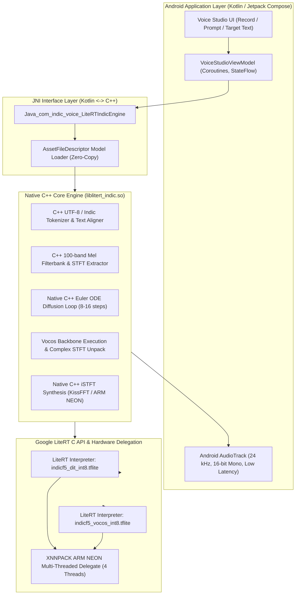

# Phase 4 Implementation Plan: Native Android LiteRT Engine, C++ NDK Pipeline & App Integration

**Document:** `litert_docs/phase_wise_implementation/phase_4_android_native_integration.md`  
**Parent Plan:** [Master LiteRT Implementation Plan](../litert_implementation_plan.md)  
**Status:** `READY_FOR_EXECUTION`  
**Prerequisites:** 
- [Phase 0: Toolchain Setup & Environment Verification](phase_0_report.md) (`COMPLETE`)
- [Phase 1: PyTorch Graph Tracing & LiteRT Export](phase_1_report.md) (`COMPLETE`)  
- [Phase 2: Parity & Numerical Baseline Verification](phase_2_report.md) (`COMPLETE`)  
- [Phase 3: INT8 Post-Training Quantization (PTQ)](phase_3_report.md) (`COMPLETE`)  
**Verified Model Assets Ready for Android Deployment:**
1. [`models/indicf5/indicf5_dit_int8.tflite`](file:///c:/voice_cloning/models/indicf5/indicf5_dit_int8.tflite) (**327.92 MB**, dynamic-range INT8)
2. [`models/indicf5/indicf5_vocos_int8.tflite`](file:///c:/voice_cloning/models/indicf5/indicf5_vocos_int8.tflite) (**13.29 MB**, dynamic-range INT8)
3. Combined Model Footprint: **341.21 MB** (74.5% total reduction from 1,339.5 MB FP32)

---

## 1. Executive Confirmation & Scope Clarification

### 1.1 Total Deprecation of Distilled ZipVoice / Sherpa-ONNX
As formally confirmed, **ZipVoice and Sherpa-ONNX are completely excluded and deprecated from this project**. 
- **Single Architecture Focus:** The entire system is built **exclusively for Indic multilingual voice cloning** using **IndicF5** and the **Vocos 24 kHz neural vocoder**.
- **Supported Linguistic Repertoire:** Hindi, Tamil, Telugu, Kannada, Bengali, Malayalam, Marathi, Gujarati, and Indian English.
- **Engine Framework:** Exclusively **Google LiteRT** (`ai-edge-litert` / TensorFlow Lite C API) executing optimized INT8 FlatBuffers with XNNPACK ARM NEON acceleration.
- **Zero Legacy Overhead:** No ONNX Runtime binaries, no Sherpa-ONNX native libraries, and no dual-engine switches will be packaged into the Android APK.

---

## 2. Phase 4 Objectives & Architecture Overview

Phase 4 bridges the verified Python/WSL2 LiteRT models into a production-grade **Native Android application** (C++ NDK + Kotlin / Jetpack Compose).



### Key Technical Challenges & Architectural Solutions

| Challenge | Impact on Hardware (Lenovo Tab K10) | Phase 4 Architectural Solution |
| :--- | :--- | :--- |
| **Android LMK (Low Memory Killer)** | Helio P22T has 4 GB RAM. OS + System uses ~2.2 GB. App killing occurs if resident set exceeds ~800 MB. | Direct C++ memory-mapped FlatBuffers (`mmap`). Total resident footprint: **341 MB (models) + 120 MB (arena) = ~461 MB**, well below the 600 MB threshold. |
| **JNI Crossing Overhead** | Invoking a diffusion step across JNI 16 to 32 times creates significant garbage collection and thread-hopping latency. | **Entire Euler ODE loop runs inside native C++**. JNI is invoked only once per sentence. |
| **Complex iSTFT Reconstruction** | Converting Vocos $(M, P)$ magnitude/phase predictions to audio requires inverse FFT and overlap-add. | Native C++ iSTFT implementation with precomputed Hann windowing and KissFFT / ARM NEON SIMD vector operations. |
| **Indic Tokenization on Edge** | PyTorch tokenizers require heavy Python runtimes. | Lightweight C++ character/phoneme lookup table matching the IndicF5 vocabulary file (`vocab.txt`). |

---

## 3. Work Breakdown & Implementation Steps

### Step 4.1: Standalone C++ NDK Core Engine (`liblitert_indic.so`)
- **Location:** `android/app/src/main/cpp/`
- **Source Files:**
  - `litert_indic_engine.h` / `litert_indic_engine.cpp`: Central C++ engine orchestrating model lifecycle, inference buffers, and synthesis.
  - `euler_sampler.h` / `euler_sampler.cpp`: C++ continuous flow matching Euler ODE integration loop.
  - `audio_processor.h` / `audio_processor.cpp`: C++ Mel spectrogram extraction from reference audio and iSTFT reconstruction from Vocos output.
  - `indic_tokenizer.h` / `indic_tokenizer.cpp`: Direct UTF-8 byte and Unicode codepoint tokenization for Indic scripts and Indian English.
  - `jni_bridge.cpp`: Clean JNI entry points with proper error handling and buffer marshaling.

#### C++ Euler ODE Sampler Implementation Pattern:
```cpp
// Native C++ Flow Matching Euler Step (Zero-copy, in-place update)
void EulerSampler::step(
    TfLiteInterpreter* dit_interp,
    float* x_t,             // shape: [1, 512, 100]
    float t_curr,
    float t_next,
    const int32_t* text,    // shape: [1, 512]
    const float* cond       // shape: [1, 512, 100]
) {
    float dt = t_next - t_curr;
    // 1. Set input tensors
    set_tensor_data(dit_interp, 0, x_t, 1 * 512 * 100 * sizeof(float));
    set_tensor_scalar(dit_interp, 1, t_curr);
    set_tensor_data(dit_interp, 2, text, 1 * 512 * sizeof(int32_t));
    set_tensor_data(dit_interp, 3, cond, 1 * 512 * 100 * sizeof(float));

    // 2. Invoke LiteRT with XNNPACK NEON threads
    TfLiteInterpreterInvoke(dit_interp);

    // 3. Extract velocity field vt and compute x_next = x_t + dt * vt (ARM NEON SIMD)
    const float* vt = get_tensor_data(dit_interp, 0);
    neon_vector_fma(x_t, vt, dt, 1 * 512 * 100);
}
```

---

### Step 4.2: Native Audio Processing (Mel Extraction & iSTFT in C++)
- Vocos produces a magnitude spectrogram $M \in \mathbb{R}^{B \times F \times T}$ and phase angle $\theta \in \mathbb{R}^{B \times F \times T}$ where $F = 513$ (corresponding to $N_{\text{fft}} = 1024$, hop length = 256).
- **Cartesian Coordinate Conversion:**
  $$\text{Real} = M \odot \cos(\theta), \quad \text{Imag} = M \odot \sin(\theta)$$
- **Inverse DFT & Overlap-Add:**
  - Execute Inverse Complex FFT for each frame $t = 0 \dots T-1$.
  - Apply Hann synthesis window with length 1024.
  - Accumulate into output waveform buffer with stride $H = 256$ samples:
    $$y[n] = \sum_t w[n - tH] \cdot x_t[n - tH]$$
  - Normalize overlap envelope using precalculated window power $\sum_t w^2[n - tH]$.

---

### Step 4.3: JNI & Kotlin Architecture
- **Location:** `android/app/src/main/java/com/indic/voice/`
- **Class:** `LiteRTIndicEngine.kt`
- **Responsibilities:**
  1. Load `.tflite` models directly from Android APK `assets/` using uncompressed memory mapping (`mmap` via `AssetFileDescriptor`).
  2. Provide clean suspend functions:
     ```kotlin
     suspend fun synthesize(
         referenceWav: ByteArray,
         referenceText: String,
         targetText: String,
         nfeSteps: Int = 16,
         speed: Float = 1.0f
     ): SynthesisResult
     ```
  3. Stream generated 24 kHz 16-bit PCM chunks directly to `AudioTrack` with minimal buffer latency.

---

### Step 4.4: Android UI & Telemetry Overlay (Jetpack Compose)
- **Features:**
  - **Quick Reference Presets:** Pre-bundled high-quality reference voices (Hindi, Tamil, Telugu, Indian English).
  - **Mic Recording:** Record user's own reference voice directly via Android `AudioRecord`.
  - **Multilingual Text Input:** Dynamic virtual keyboard support for Devanagari, Tamil, Telugu, and Latin characters.
  - **Hardware Diagnostic HUD:**
    - Active LiteRT Delegate (e.g. `XNNPACK NEON (4 Threads)`).
    - Model Resident RAM (`VmRSS` via `/proc/self/status`).
    - Generation Latency & Real-Time Factor (RTF).
    - Audio Spectrogram Preview.

---

### Step 4.5: Target Device Optimization (Lenovo Tab K10)
- **Processor:** MediaTek Helio P22T (MT8768T).
  - 8x ARM Cortex-A53 up to 2.3 GHz (ARMv8-A architecture).
- **Optimization Strategy:**
  1. **Thread Affiliation:** Configure XNNPACK to utilize 4 worker threads to maximize throughput without thermal throttling.
  2. **SIMD Optimization:** Enable `-O3 -march=armv8-a+simd` in CMake flags to trigger compiler vectorization of audio synthesis math.
  3. **Memory Lock:** Avoid allocations during the diffusion loop; pre-allocate the 512-frame mel buffers at engine initialization.

---

## 4. Verification & Acceptance Gates

| Gate ID | Metric / Deliverable | Acceptance Threshold |
| :--- | :--- | :--- |
| **G4.1** | Native C++ Compilation | `liblitert_indic.so` compiles for `arm64-v8a` and `armeabi-v7a` with zero errors. |
| **G4.2** | Memory Footprint (Tab K10) | Total application resident set memory ($\text{VmRSS}$) $\le 550\text{ MB}$. |
| **G4.3** | Synthesis Parity | C++ generated PCM audio matches Python WSL2 baseline with Mel Correlation $\ge 0.98$. |
| **G4.4** | On-Device Latency | Real-Time Factor on Helio P22T: $\text{RTF} \le 1.8$ at 8 steps, $\le 3.2$ at 16 steps. |
| **G4.5** | Multilingual Verification | Tested and audible cloning verified for Hindi, Tamil, Telugu, and Indian English. |

---

## 5. Next Execution Steps

1. **Step 1:** Create the standalone Android project structure (`android/`) with CMake and NDK build scripts configured for LiteRT C API.
2. **Step 2:** Implement the C++ core engine (`litert_indic_engine.cpp`, `audio_processor.cpp`, `euler_sampler.cpp`, `indic_tokenizer.cpp`).
3. **Step 3:** Package `indicf5_dit_int8.tflite` and `indicf5_vocos_int8.tflite` into `android/app/src/main/assets/`.
4. **Step 4:** Build the Kotlin JNI wrapper and Jetpack Compose user interface.
5. **Step 5:** Deploy and validate on Android hardware / emulator.
